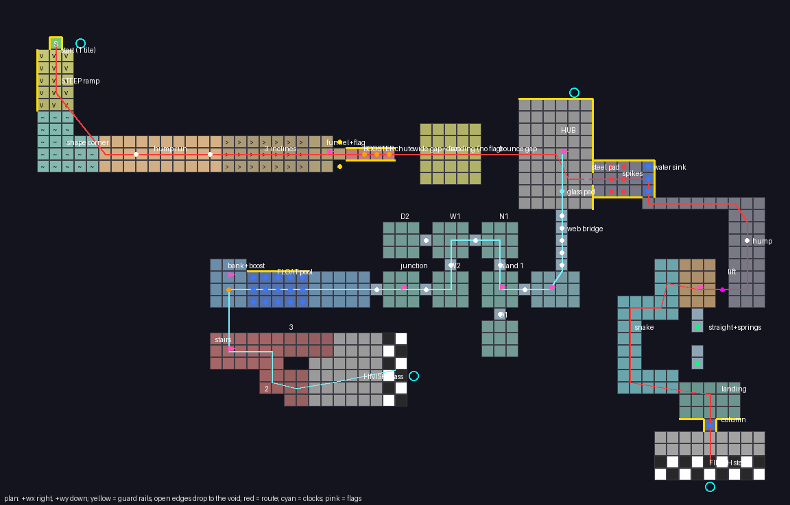
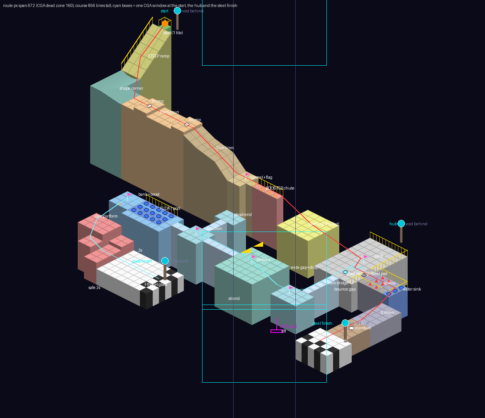

# COURSE 3, "Downhill Decision" (DOWN): design sheet

*Status: **IN ENGINE, first build** (2026-11-19): `apps/bonanza/courses/down.bbc`,
written by `down/sketch.py --bbc --force`, on the `BZDOWN=1` playtest knob's pad 2
(TRIAL's place). Every check passes and the route demo finishes (22.0 s, steel,
no falls). Attempt 1's sections below are the pen-in, kept for its reasoning.*

*Rev 6 (2026-11-20), **ON TRIAL**: the line from the ramp through the corner chute into the hump run is 3
wide all the way - the ramp 3 wide (its left rail kept, the right side open as rev 5 made it, no flat foot:
the chute's end taper is the foot) and `chute 3 round depth 8` (SPEC.md 130.28.4; the study is
[CHUTE3.md](CHUTE3.md)). The owner playtests it and decides whether it stays; `CHUTE_W = 2` in
`down/sketch.py` and a re-emit puts the 2-wide line back exactly.*

## The first build (2026-11-19): what the owner's notes and the tool changed

The owner's notes on the pen-in:
- a 3-wide line into a 3 x 3 FUNNEL whose last column's outer cells are
  diagonal guides into the 1-wide booster chute, flag 0 in its middle;
- NO flag on the landing between the chute and the hub (a respawn there could
  never cross on);
- the lift was hidden, so glass goes SOUTH and steel EAST;
- the stairs look safe at the start (two 1-unit steps, one 3-unit middle step,
  one more flush onto the finish);
- the exits as the map would have them flipped: steel exit 0 (to 4), glass
  exit 1 (to 6);
- NO archways: a pad at each exit, since a rubber ball that hops one dies on
  the spikes or on the glass-only MEMBRANE bridge, which introduces both.

What the tool and the autopilot found, *measured* each time:
- the ramp's foot needed a flat cell into the corner chute (the ball fell
  through the gap the chute's start left);
- the chute corner had to be shallower (8 px) and the humps moved two tiles
  along and made 8 px high: six occluder records stacked in a block;
- the booster chute's front is a see-through guard (a block hid the pads;
  its first tile stays a block, and three pads, not four);
- the first gap is 2 tiles (from rest at flag 0 the boosted throw fell 0.2
  tiles short of 3);
- the hub and both legs are 2 units lower, so rubber's bounce off the landing
  clears the second 3-tile gap;
- the steel exit is OFF the arrival line, with TWO pads in a row. A ball
  arriving fast still makes little hops and skipped a single pad, then
  popped on the spikes as rubber, which a player would meet too;
- spikes never touch water (a plain row between them);
- the momentum hump is 8 px (at 11 the slow steel ball out of the water
  stopped);
- the glass finish's clock is beside its goal (each finish needs one in view);
- rev 8 (2026-11-20, the owner: rubber double-bounced over the spikes onto the
  water and off its front onto T): the water's front edge is GUARDED (`arch
  ... guard`, SPEC.md 130.35.10 - rubber and glass stay on the water, steel
  sinks under the rail and out of the arch), and the two cells beside a
  floor at each height - the front strip's last, the water's right strip's
  last - are two-height guards instead of blocks (130.35.9). Distances are tiles, heights units; numbers marked PREDICTED come from
the tool's ladders and the rules quoted, not from a run. `down/sketch.py` draws
the pictures.*

The owner (2026-11-19): *"This is the 'reward course' for going through the
tutorial ... a course with lots of ramps and a few shapes, along with a split
about 2/3rds (tiles wise, maybe not time wise) of the way through leading to
separate exits. It will also introduce the other two balls; steel on one route
leg, glass on the other."* The song is **Bounce Trial** (`music trial`; an
agent is fixing its PC-speaker ring sections).

| field | value |
|---|---|
| place | course 3, the pathway's pad 2: the SPLIT (exit 0 Up to course 4, exit 1 Left to course 6) |
| balls | rubber from the start; STEEL on one leg, GLASS on the other, each by a pad under an archway (a forced CONVERSION) |
| finishes | two: exit 0 at the end of the steel leg, exit 1 at the end of the glass leg (which exit is which is the owner's) |
| style | grounded; climbs up the screen and drops down it (the guide's 1.10); lots of RAMPS, a few SHAPES |
| camera | not locked: some horizontal scrolling is acceptable during the big gap jumps (the owner: the no-pan rule is about short sections and hard-to-time jumps) |
| families | boost, archway, spike + water, the shapes (chute), hump, crack (the web bridge), the lift (platform), material pads: **TO CHECK in the engine** against the three-a-course FETCHED families limit (`fam_fetched`) |

## 1. The course, section by section

| | section | what happens | notes |
|---|---|---|---|
| A | **the start** | ONE tile, guard rails round three sides, the steep ramp in front | |
| R | **the steep ramp** | 5 tiles at 2 units a tile (the steepest a ramp may be), block-railed: 10 units down, the ball fast at once | |
| C | **the shape corner** | a banked 2-wide CHUTE turns the ball from +y to +x at speed (shapes.bbc's `chute 2 round`; a `bank` corner may suit better) | the owner: *"if we can use a shape to guide it at some speed that would be cool"* |
| H | **the hump run** | 2 wide, UNGUARDED, along +x, two HUMPS (2 x 2, the hump course's back hump's kind; height to tune) | the owner's "east/west" read as along world x; say if screen-horizontal was meant |
| D | **the descent** | three inclines down +x: gentle (1 a tile), mild (0.5), steep (2): 7.5 units | |
| B | **the booster chute** | 1 wide, block-railed, four `boost` pads +x | |
| L | **the wide gap and drop** | a 3-tile gap and a drop of 4.5 units onto an EASY, UNGUARDED landing, 4 x 5 tiles | **to measure**: the throw's reach at the boosted speed (no ball crosses three LEVEL tiles even boosted, 130.16.5.3 - the drop is what makes it) |
| X | **the bounce gap and the HUB** | rubber's rebound off L carries it over another 3-tile gap onto the HUB, 8 x 9 tiles, a unit lower, railed at the back | the bounce is TRIAL's shape (Little Hop's K: a tile farther still passed) |
| | **the split** | two ARCHWAYS out of the hub: south (+y) over a STEEL pad, east (+x) over a GLASS pad. Rolling through either converts the ball | about two thirds of the tiles are behind the player here |

**The steel leg** (south, +y, down the screen):

| | what happens |
|---|---|
| S | SPIKES on the only path (3 x 3): steel rolls over them (130.38: its window holds the TIP); a rubber or glass ball would shatter. A flag before them |
| W | a WATER SINK: a 3-unit-deep column across the path, a block rail ON TOP past it so nothing hops over; steel SINKS (rubber and glass ride on water) to the bed and rolls out of the column's front ARCH onto a floor 3 units lower |
| M | MOMENTUM: a ramp up 2 units and down again that steel crosses only with its speed |
| G | the steel FINISH (exit 0) |

**The glass leg** (east, +x, then down the screen):

| | what happens |
|---|---|
| K | a WEB BRIDGE: a 1-wide bridge of thin CRACKED tiles over the void (`prop crack ... `, the thin floating kind): glass, light, rolls across at leisure (PLAYGROUND's cracks: rubber and steel only at speed) |
| P | a LIFT (`prop platform`, MILL's) carries the ball up 4 units to the CHOICE plateau |
| Q | the CHOICE: left, a SAFE CHUTE down (a shape); right, STAIRS of 3.5-unit drops: glass SHATTERS at 3 (130.11.8.5) and respawns at the flag |
| V | the glass FINISH (exit 1) |

## 2. Flags and clocks (first guesses; the owner places them)

- Flags: on the landing L (after the wide gap - a miss there is a long way
  back), in the hub before the split, before the spikes, and at the lift's foot.
- Clocks: three (the start's, and one in view of each finish: the tool proves
  every finish has one).

## 3. Other ideas (the owner asked for suggestions)

**For the steel leg:**
- a **MAGNET** (the family's lane pulls steel only): it bends steel round a
  curve over the void, or across a gap no other ball crosses. It's the most
  steel-specific thing the engine has;
- a **CRUMBLE wall** (the gate family's brick wall that cracks and falls):
  steel's weight breaking through reads as "this ball is heavy";
- a **SEE-SAW** (`uses seesaw`) that only steel's weight tips down into a ramp.

**For the glass leg:**
- the **GLASS TERRACE** (MOON's): 1-unit steps glass bounces down safely,
  beside a 3-unit drop that shatters it. It's the same lesson as the stairs,
  in a gentler form;
- the **crystal MEMBRANE** (the spike family's `membrane`, glass-only): a
  doorway only glass passes;
- **boost pads push glass x1.25** (130.40): a glass-only boost jump across a
  gap the hub's rubber could not have made.

## 4. Questions for the owner

1. **Which exit is which**: steel = exit 0 (Up to course 4) and glass = exit 1
   (Left to 6), or the other way round?
2. **The hump run's direction**: along world x (as sketched, down-right on the
   screen) or screen-horizontal?
3. **The stairs** kill glass outright: is a kill right for a teaching beat, or
   should the stairs be the terrace (a bouncy safe way) beside one fatal drop?
4. **Size and width**: the route spans 600 px and the course about 870 lines.
   The engine's width (1024 px) and the course part's size get checked first.
