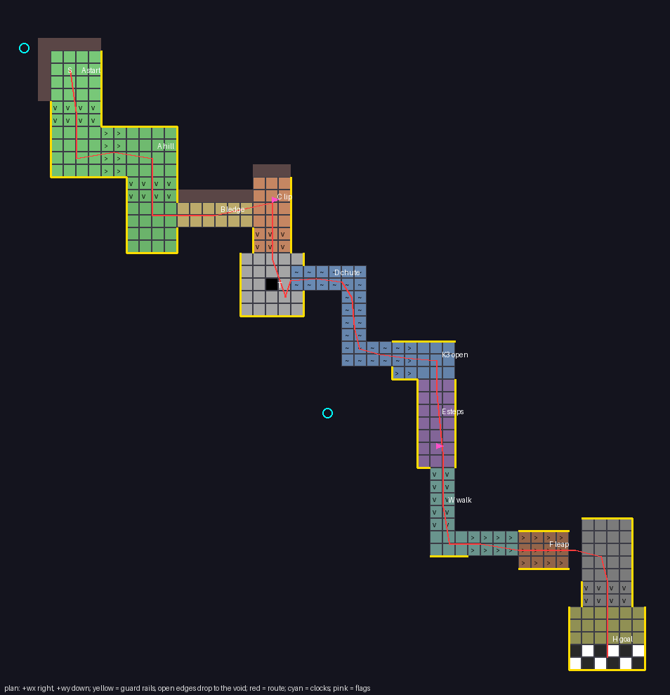
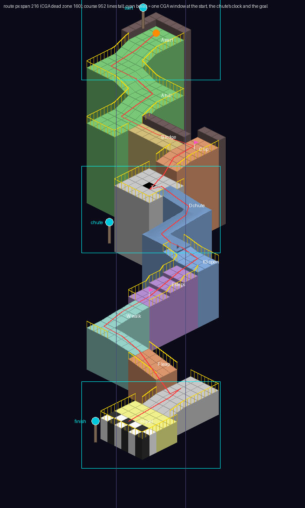

# FIRST ROLL: design sheet, attempt 1

*Status: **PEN-IN, revision 3, ready for the engine**. On paper only
(the guide's pipeline, section 3). Nothing here is built. Distances are
tiles, heights are units (8 px), and times are PREDICTED from the route's
length; the tool measures them once the course is in the engine.*

This is the shipped course 1. The prototype course of the same title
(`apps/bonanza/courses/first.bbc`) and the other prototype courses are to be
removed later, with their tests rewritten (the plan's story 11.17). Until
then this course is built under a working name of its own in the tool, and
it takes FIRST when the prototype goes.

**What each revision changed (the owner, 2026-11-18):**
- **Revision 2:**
  - the three railed corners became a SHAPED CHUTE: two tiles wide,
    unfenced, its rails back up on the exit, K3's far end open for a
    full-speed overshoot;
  - flag 0 moved to T's exit, flag 1 to the turn at the foot of E;
  - there is no flag past the leap.
- **Revision 3:**
  - **flag 0 moves to the top of C's run-up, BEFORE the lip** (the guide's
    G20: a flag stands just before what can kill, and a fall never replays
    a long stretch);
  - **the rail stub across the leap's run-up is gone** (G24: on an easy
    course rails protect, they never block);
  - **every clock stands where only the void is behind its head**, which a
    standard-part clock needs, since its art bakes in what is behind it.
    The pillar under it is fine;
  - **the rails are probably BLOCK rails** (the classic style; this course is
    open enough that they hide little). The owner decides at the first
    play.

| field | value |
|---|---|
| place | tutorial 1: the first node of the pathway, no branch |
| world | the tutorial (none) |
| families | **none**: tiles, holes, one shaped chute (FIELD cells, SPEC.md 130.28) and rails. The chute and the rails are tool work, with no family part |
| start ball | rubber, the whole way (G13) |
| finishes | one, the goal plateau; no secret |
| target time | **about 35 s** (G1). The sketch's route is 87 tiles, about 30 - 35 s (PREDICTED). The length is settled by the owner's play in the engine |
| pace | about 950 picture lines, about 120 block rows, so about 0.29 s a block row: one part, well inside the limits |
| palette | the owner's choice: a bright daytime palette, to read as the first course |
| clocks | three, placed so a STANDARD-PART clock fits (section 3; G23) |
| rails | block rails, probably (G24); decided at the first play |
| song | the owner's choice |
| the new demand (CD2) | **reading an edge**: drops kill you, and the player learns the timing at a lip, when to let the ball run and when to slow it |
| what it teaches | roll and steer; brake; ramps; a shaped chute; **drops kill you, and you need to learn the timing** (the lesson the prototype FIRST ROLL got right); a Hop is always allowed and never required |
| help it gives (CD2) | rails on nearly every edge; ramps that funnel to the centre; a chute that guides with no rail; a flag just before each hazard |

*Above: the plan. +wx is right and +wy is down. The arrows mark ramps and
their downhill direction, and `~` marks the chute's cells. Yellow is a rail,
and an edge without one drops into the void. Red is the route, cyan the
clocks, pink the flags.*

*Above: the same course in the game's projection, drawn as plain blocks with
none of the real art. The cyan boxes are one CGA window (320 x 200) at the
start, at the chute's mouth and at the goal. The two vertical lines are the
CGA camera's dead zone (160 px). `first/sketch.py` draws both pictures and
places the clocks.*

## 1. The course, section by section

Times are cumulative and PREDICTED.

| | section | what happens | what it teaches | 0 - s |
|---|---|---|---|---|
| A | **the start and the hill** | A railed plateau, then three ramps, alternately along +y and +x (the shape of SUMMIT's opening hill), each throwing onto a flat landing that a rail closes, so the throw turns the ball onto the next ramp | rolling, steering, what a ramp does to speed; nothing here can hurt | 0 - 9 |
| B | **the ledge** | Two tiles wide, a wall behind and its FRONT EDGE OPEN. Holding Down drifts the ball off the front; the edge's chord (Down+Right) runs it straight | **drops kill you**: the first fall respawns at the start, 9 s back, which the owner judged right | 9 - 12 |
| C | **flag 0, then the lip** | Flag 0 at the top of the run-up. The run-up and a ramp end in a lip 3 units above a wide landing, T. A HOLE sits where the straight full-speed landing falls. Slowing down (then steering round it), a Hop (over it), or either side of the ramp (past it) all succeed. Holding straight on fails | **timing at a lip**: the prototype FIRST ROLL's good jump, re-planned so its flight crosses about 32 px on screen, inside the dead zone (G3). A fall replays only the lip | 12 - 15 |
| T | **the landing** | Wide and railed, but for the chute's mouth | | 15 |
| D | **the chute** | A shaped channel two tiles wide (`chute 2 round`, about 10 px deep, like PLAYGROUND's), with NO rails: its shape guides the ball. It runs from T's exit along +x, round a corner down +y, and round a corner along +x, falling about 2 units. The rails come back up on D3 as it exits; K3's far end is OPEN | the shaped floor; then **braking**: a ball out of the chute at full speed overshoots K3 into the void, and Shift is the answer. A fall respawns at flag 0: the lip and the chute again, about 8 s | 15 - 23 |
| E | **the steps, then flag 1** | Three one-unit steps down onto floor, railed, turning off K3. Flag 1 is on the last step, before the walk and the leap | dropping onto a floor is fine; only the void kills | 23 - 25 |
| W | **the walk** | Two tiles wide, both edges open, an easy bend: a straight ramp, a railed elbow, a ramp the other way | steering with the drop on either side; going steady rather than slow | 25 - 30 |
| F | **the leap** | A run-up along +x, railed along its sides and open at its entry, into a ramp, a ONE-tile gap in the void, and a landing 2 units under the lip | the mirror of C: here **too slow** drops into the gap, so the player keeps the speed the run-up gives (G4: the run-up is in plain view, and the arrow held down is the whole answer). A fall respawns at flag 1, about 7 s back | 30 - 32 |
| H | **the finish** | The landing, a short ramp down, and a wide, railed goal plateau, the goal line across its far rows, all of it in view (G5). No flag: nothing here can kill | | 32 - 35 |

**C and F are the course's pair** (the owner: "Leap is good"): one punishes
too much speed, the other too little. Together they are the lesson the
owner named: drops kill you, and you learn the timing. The chute's open end
at K3 is the same lesson in a third form, coming out of a shape rather than
off a lip.

## 2. The camera plan (G2, G3)

- **Down the screen.** Every run alternates +x and +y (or uses Down, the
  grid diagonal), so the course falls about 950 lines and swings at most
  216 px across. There are no long horizontal runs.
- **The swing is a little more than the dead zone.** The CGA's is 160 px
  and the Hercules' 180 px, so the camera should make a framing move
  (LATTICE's 8 columns) or two. The intent is for those moves to come on the
  ground, in the chute or at K3. **To check (story 11.11)**: where they
  actually fall, and whether a tighter swing removes them.
- **The two jumps do not pan.** C's flight runs along +y, about 2 tiles,
  32 px left. F's runs along +x, 2 tiles including the gap, 32 px right.
  Both are about 32 px, against a dead zone of 160 px. **To check**: 11.11's
  airborne column; the sketch cannot model the camera's position at take-off.

## 3. The clocks (G9 - G12, G23)

**What is behind a clock decides whether it can be a standard part.** A
clock's picture bakes in whatever is behind it, since nothing is composited
at load. A standard-part clock therefore stands only where the same thing
is behind it at every use: in practice, only the void behind its head. The
pillar under it is fine. The sketch places each clock itself: the nearest
spot to the route that is
- inside that point's CGA window;
- with only void behind the clock's head;
- with no floor or wall in or next to its pillar's cell.

| clock | placed for | where (the sketch's) | seen |
|---|---|---|---|
| start | the start | over the void behind the start plateau's back-left corner, its head above the back wall | from the start; through A |
| middle | the chute's mouth | over the void left of T's column | from T through the chute and K3, about 15 - 23 s |
| finish | the goal | over the void in front of the goal plateau's left corner | from the leap onward and from the goal line |

- **Never two on one screen**: the clocks are more than 350 lines apart.
- **The longest stretch without a clock in view**: about the middle of A to
  T, and K3 to F, each about 6 - 8 s (PREDICTED), under 15 s.
- **To check in the engine**: what is behind each clock in the real art,
  not the sketch's blocks (11.14's tool check); whether the finish clock, in
  front of the plateau, hides any of it (the visibility check, 11.5). If a
  place cannot be kept clear, that clock is custom.

## 4. Surfaces, lifts, pads and props

- **None but the chute.** No sand, no ice, no lift, no pad, no family. The
  first course is the bare physics and one shaped floor. Its hazards are
  edges and one hole (G16 - G18). Course 2 (Hop, rubber's "and again", a
  spring) brings the first prop.
- **The chute is a candidate STANDARD PART** (the guide's section 5): a
  two-wide, two-corner S that drops about 2 units.

## 5. The owner's answers, and what is left

| question | answer (2026-11-18) |
|---|---|
| C and F, the pair | "Leap is good" |
| the ledge so early | "this pacing looks pretty good"; and the flags go just BEFORE what can kill (G20) |
| rails | "about right"; the style (guard or block) after the first play, probably block (G24) |
| the clocks' art | standard parts still open. They need a void behind the head; if a course cannot be designed round that, custom (G23) |
| the name | the prototype courses go later (story 11.17), and this course takes FIRST then |
| length | decided by the owner's play in the engine |

**Next: the engine.** The `.bbc`, `--png` previews and a playtest disk,
iterated fast (the guide's section 3). The checks 11.11 and 11.13 go in
beside it when they are cheap; demos and performance are batched later.
