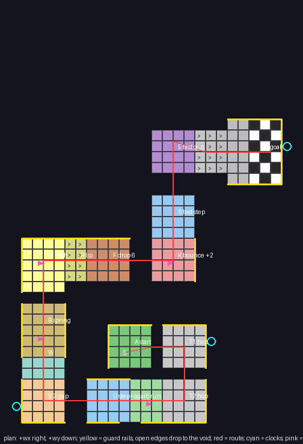
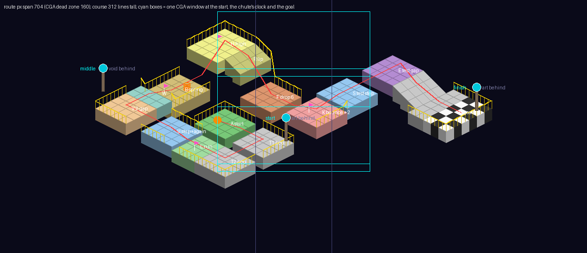

# COURSE 2, "Island Hop" (HOP): design sheet

*Status: **IN ENGINE, revision 2** (2026-11-18): `apps/bonanza/courses/hop.bbc`,
written by `hop/sketch.py --bbc --force`, compiles with every check, and the
BZROLL=1 playtest build carries it on pad 1. The owner's verdict on the gaps
is the next step; revision 2 below supersedes attempt 1's layout, which
sections 1 - 4 still describe.*

## Revision 2: what changed, and why

The owner on attempt 1: *"visibility of when something is a gap, or ledge,
will be critical ... we'll need to check visually that each gap, up or down,
reads appropriately"*; *"missing ... the 'drop from high up on a ledge, then
bounce to get across a gap' that trial bounce first demoed"*; *"Island Hop
sounds like a good name, and theme"*; *"Lets go for a different palette.
New song, new clocks, but lets get it in engine and closer to done before we
set agents on those."*

- **The reading rule.** The camera sees only an island's +x and +y faces. A
  step UP climbed moving +x or +y shows no riser (attempt 1's L-to-U step
  read as one flat slab in the engine's picture), so every climb is taken
  moving **-x or -y** (up the screen), its riser facing the player, and every
  drop moving +x or +y, the edge left behind showing its face. The legs
  alternate left and right, which also keeps the course inside the 1024 px
  picture (`width 128`, `origin 688`, the reach's 60 tiles exactly).
- **The lesson climbs -x**: T2 and L give a seven-tile run-up, U is one unit
  up, then the 2-tile gap to V. The test climbs -y: K, the step S, the gap E.
- **TRIAL's drop and bounce is in**: off H's lip down a short ramp, six units
  onto F, and rubber's rebound over a 2-tile gap onto K, two units above F.
- **Thin islands, `thick 1`.** Three-unit faces hung over most of a 2-tile
  gap; at one unit the void shows between the islands. `HOP_THICK=3` renders
  the old look for comparison.
- **The palette: `palette 0 ground 1`**, green, red and yellow islands on a
  blue sea, as the proposal (colour 0 is every black pixel too: the clocks'
  digits and the goal's dark squares turn blue).
- **`trap hop`** (SPEC.md 130.14.4.1.1): NO TRAP never pressed Space, so a
  course built on the Hop failed it at its first gap; the statement proves it
  with a Hop and its "and again" pressed too. The compile takes about 25 s.
- **Fitting the checks**: W became flat (its ramp's sloped face stacked six
  occluder records in a block), B is two units down from W, and the clocks
  moved apart (G10): the start on T1's far rail, the middle on V's left rail,
  the finish on the goal plateau's far rail.

Still to do: the owner's look at each gap and ledge on the glass, G3 (no pan
during a jump) checked by a drive once played, the song and the clocks by
agents once the course settles, and `limit 70` (hand-set: the autopilot
cannot Hop).

## Attempt 1 (superseded layout)

*Pen-in, on paper. Distances are tiles, heights are units (8 px). Every
window and time below is MEASURED from the tool's step and gap ladders
(rubber at the cap with a chord) or PREDICTED from the route's length.*

Tutorial 2, the pathway's second node, no branch. First Roll taught rolling,
braking and edges. This course teaches the **Hop** (Space) and rubber's
**"and again"** (a second press before the Hop lands, for a bigger bounce),
and a **spring**. It is built of FLOATING islands, the owner's choice for a
course after the first: *"1: Floating: For another course we'll use that,
but not this one."* The islands' faces hang 3 units into the void, so every
gap is a gap you can see.

| field | value |
|---|---|
| place | tutorial 2: the second node of the pathway, no branch |
| families | `spring` |
| start ball | rubber, the whole way |
| finishes | one; no secret |
| target time | about 35 s. The sketch's route is 72 tiles; the Hops and the step's retries make it slower per tile than First Roll (88 tiles, the autopilot's 31 s) |
| camera | not locked: the course swings 416 px across, for visual interest. **Every jump is planned not to pan (G3)**, checked in the engine by `--guide` |
| the new demand (CD2) | **timing a press in the air**: the Hop, then the Hop and its "and again" |
| help it gives | a lesson that cannot kill (the step) before the one that can (the gap); rails on every landing's far edge to catch an over-Hop; the test repeated unrailed |
| clocks | three, first guesses; the owner places them (FIRST ROLL's way) |
| palette, song | the owner's. (*Bounce Trial* is kept for course 3) |

*Above: `hop/sketch.py`'s two pictures, plain blocks in the game's
projection. Pink pennants are flags, the orange coil is the spring, the
cyan boxes are a CGA window at the start, the middle and the goal.*

## 1. The course, section by section

| | section | what happens | the numbers (the ladders) |
|---|---|---|---|
| A | **the start island** | a railed back, the tee's place | |
| T1 | **the first Hop** | a 1-tile gap, level. Rolling across falls in; a Hop crosses | a Hop crosses from 30 take-off points, a 549 ms window: wide |
| T2 | **the second Hop** | a 1-tile gap, half a unit down. Easier, as a second go | easier than T1 |
| L | **a ramp down** | down to a landing | |
| U | **the step: "and again", safely** | U is ONE UNIT up from L. A Hop alone barely climbs it; the Hop and its "and again" climbs it easily. A miss only bounces back onto L, so it cannot kill: this is the lesson | a Hop: 7 points, 128 ms (hard). The Hop and "and again": 29 points, 531 ms (easy) |
| V | **flag 0, then the 2-tile gap** | flag 0 on U. A 2-tile gap, level, onto V, railed along its sides: the same two presses now cross a gap | a Hop: 4 points, 73 ms (luck). The Hop and "and again": 19 points, 348 ms |
| W, B | **the run and the spring** | a ramp down and a run to the basin B. B's SPRING, at its back, throws the ball BACK up the screen, away from the camera (CD1: the spring and the landing are both in view), over a void row onto H, 6 units up. H's back edges are railed to catch an over-throw. Flag 1 in the basin | the spring's 768 is PEAK's spring 1, which reaches 6 units 2 tiles on |
| R, D | **the long ramp down** | from the high island down to D, for speed and a view; flag 2 on D | |
| S, E | **the test** | the step again (one unit up onto S), then the 2-tile gap again onto E, with no rails beside them. The same two moves, with the help taken away (CD2) | the same windows as U and V |
| G | **the goal** | a ramp down to a wide goal plateau, in view | |

## 2. The camera (G2, G3)

Not locked. The islands spread 416 px across, which keeps the course
visually interesting (the owner, on G2). The rule that binds is G3: no pan
during a jump the player steers. The jumps:
- T1 (+y), T2 (+x) and the two 2-tile gaps (+y) each travel 1 - 3 tiles,
  16 - 48 px across;
- the spring's throw travels about 2.5 tiles up the screen and to the
  right, about 40 px.

They are placed in the middle of their windows. `--guide`'s run half
measures it once the course is in the engine, on a run of the autopilot
(which can Hop since the shapes work) or of an author script.

## 3. Flags (G20) and clocks

- Flags stand just before what can kill:
  - **flag 0** before the taught gap (V);
  - **flag 1** in the basin before the spring (a short throw falls into
    the void row);
  - **flag 2** before the test.

  The first two Hops respawn at the start, a few seconds back.
- Clocks: first guesses, the owner to place them:
  - the start's, one block out and level with the start island;
  - the middle one, floating by the high island;
  - the finish's, on the goal plateau's rail.

## 4. Questions for the owner

1. **The lesson order**: the step (safe) and then the gap (lethal) for
   "and again". Is that the right way round, or the gap first?
2. **The spring**: a basin throwing you back up the screen onto a high
   island. Is one spring enough for the tutorial, or a second one
   (higher, or onto a smaller target) as a test?
3. **The name**: "Island Hop", NAME `HOP`?
4. **Palette and song**: the default palette again, or a second look for
   course 2? And a new song, or one we have?
5. **Length**: about 35 s PREDICTED. The tests could each get one more
   island if it plays short.
