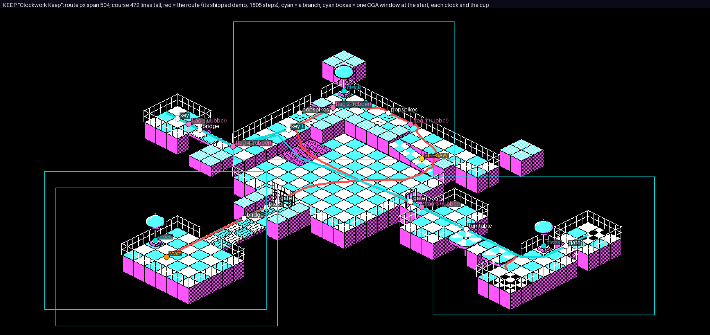
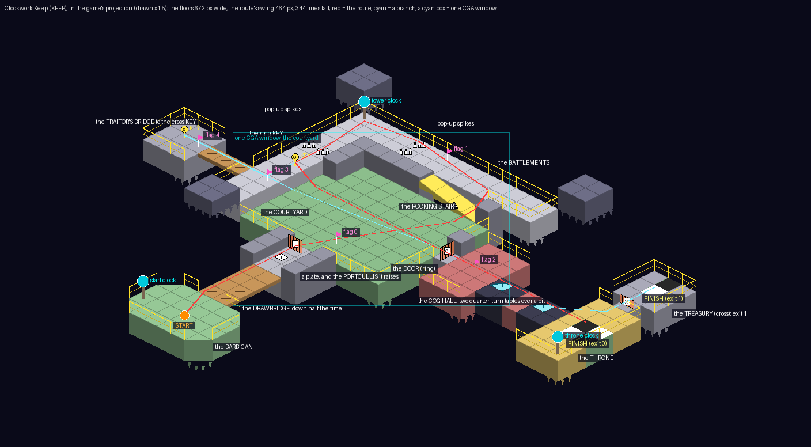

# COURSE 7, "Clockwork Keep" (KEEP): design sheet

> **After the merge of 2026-11-25** (the branch's own engine work on faces behind a
> floating cell): the same file compiles to a part of **48,151** bytes, **191** masks and
> LZ4 **15,794** (it was 47,703, 183 and 15,523 when the numbers below were taken). The
> route demo, the treasury's run and every `--guide` figure are unmoved. Headroom for the
> art step is therefore 65 masks, 3,031 LZ4 bytes and 16,873 part bytes.

*Status: **REFINED** (2026-11-25), the second step of the guide's pipeline
([README.md](README.md) section 3): the pen-in of the same day, designed for looks and
function, fitted to the engine's constraints. `apps/bonanza/courses/keep.bbc` says
`guide` and passes every check a shipped course is held to (section 10); it is NOT in
the build yet (no `BZ_COURSES` entry, no pathway pad: a later step's). `keep/sketch.py`
draws the pictures and writes the course (`--bbc`); `keep/measure.py` makes section 3's
numbers. Distances are tiles and heights are units; the cells are the engine's own. A
number marked MEASURED was run on the tool's model (`bbcourse.Physics` and its camera),
never on an emulator and never by a player; one marked PREDICTED is arithmetic. Section
11 is what refinement changed and why, section 12 each risk's outcome, section 13 the
owner's playtest list.*

**The idea.** A floating castle that is one LOCK: the first course that is not a line.
The keep's door is in sight from the courtyard, shut, with a ring on it. The key with
the same ring is up on the battlements. Everything in the castle is CLOCKWORK: a
drawbridge that folds on a timer, a stair that rocks, spikes that pop, a hall floored
with two turning cogs. A second key, across a bridge that is down a third of the time,
opens the treasury: the course's second exit, a secret.

| field | value |
|---|---|
| place | course 7, the pathway's pad 6: after LODESTONE GORGE (section 7) |
| world | a castle on floating islands (`float`, the pathway's crystal look), compact: the whole of it is two windows across |
| ball | RUBBER from start to finish. No pad |
| finishes | TWO: the THRONE (exit 0), and the TREASURY (exit 1, `hidden`: a secret finish), behind a gate only the second key opens |
| families | `gate spike seesaw turntable`, all four RESIDENT: the limit of 3 a course is on FETCHED families (`FAM_MAX`, SPEC.md 130.25.6.9), and the course has none |
| new to the pathway | the whole GATE family (a plate, two keys, three gates, two timed drawbridges); POP-UP SPIKES; the TIMED see-saw; the turntable as a 2 x 2 CHAIN |
| target time | 50 - 60 s by the throne on a first clear, 75 s with the treasury (`target 90`'s class, `limit 99`): PREDICTED. MEASURED on the model: the route demo **33.0 s** (1,805 steps), no fall and no Hop; the run to the treasury 44.2 s (section 3) |
| palette | the default (cyan, magenta, white) on black: grey stone needs white. The owner's call |
| clocks | 3: the barbican, the north-west tower, the throne's dais. A SHIELD whose crest changes (section 9) |
| song | **Clockwork Keep** (`music clockwork`, section 16): C minor at 102.4, strict; a tick-tock the speaker folds between the tune's notes, a fanfare in C major. It keeps the machines' rate, not their beat. Nobody has heard it yet |
| the one new idea | **the way on is not ahead.** A door shows what opens it; the player goes and gets it, and comes back |
| picture | 1,024 x 472 px (`width 128`, `origin 496`); the floors are 688 px across. ONE part, 47,703 bytes |






## 1. The course, section by section

```
                 NW tower (clock)                                    NE tower
                    +- flag 1 - pop-up spikes - the north BATTLEMENT - flag 0 --+
                    | spikes             [ the ROCKING STAIR ]                  |
                    |                                                           |   the TREASURY (exit 1)
                    |ring KEY --hay-- one straight roll ----> DOOR (flag 2) --> COG HALL: cog, island, cog --> the dais
                    |            the  COURTYARD               (ring)                      (clock)   the THRONE (exit 0)
   turret           |
  (cross KEY) = TRAITOR'S = flag 3
   flag 4         BRIDGE  SW tower   [ PORTCULLIS ]  (plus)
                                     [   plate    ]
                                     the DRAWBRIDGE (timed)
                                     the BARBICAN (start, clock)
```

| | section | what it does | why |
|---|---|---|---|
| S | **the barbican** | an island 6 x 5, square, railed all round but the bridge's mouth. The start is 3 tiles from the bridge, in the plate's lane. The start clock on its west side | a safe start: seven of the eight arrows held from it end in a railed corner, the eighth on the bridge (section 3) |
| D | **the DRAWBRIDGE** | 2 wide, 4 long, thin planks over the void. **UP as the play starts**; it lays down at 0.7 s, stays down 2.8 s, is up 1.9 s | **the first timer, and the first thing the player sees is the castle's clockwork working.** A ball sent at it at once arrives as it lays down; one that watches it lay down and then goes has 0.9 s in hand (section 3). A fall puts the ball back 3 tiles away |
| G | **the gatehouse** | 2 x 3 between low cheeks. A PLATE with a plus in its top in the left lane, then the PORTCULLIS with the same plus, a stone arch 2 tiles wide whose grid rises in 0.4 s | **the pairing lesson**: a plate and its gate one tile apart, the same glyph on both. The start's straight line presses it; a ball in the other lane stops at shut bars with the plate beside it (section 12, C10) |
| C | **the courtyard** | 10 x 9. From it the player sees the keep's DOOR in the east curtain, shut, a RING on it; the ROCKING STAIR on the north side; and, up on the west battlement, the ring KEY, a patch of HAY under it | the lock, stated in one screen (G4: the mechanic and its result both in view). Nothing here kills |
| W | **the ROCKING STAIR** | a TIMED see-saw 4 x 1 along the foot of the north battlement, an end wall at each end. One end is down at the courtyard (10) while the other is up at the battlement (12); they swap every 1.2 s through 0.3 s of level | the castle's lift (G18), and clockwork to look at. Roll at the battlement from beside whichever end is low: the plate carries the ball up and it rolls off (MEASURED: from either end, at every phase, with one pair held) |
| B | **the battlements** | north, then west: 2 wide, 2 units over the courtyard, crenellated (railed) on the outside, OPEN on the inside. Before each of two rows of POP-UP SPIKES a MERLON narrows the walk to one lane, and a flag stands in that lane. The rows are half a period apart (1.2 s up, 1.2 s down). The second clock on the north-west corner, under the tower | the walk to the key. A flag is one cell and a ball in the other lane of a 2-wide walk passes it by (MEASURED): the merlon is what makes every ball touch it. The open inside edge is a way down: a ball may drop into the courtyard anywhere, and comes back by the stair |
| - | **the ring KEY** | on the west battlement's inner lane, level with the door, two tiles past the second row | **one straight roll**: take the key, press east, drop onto the hay, cross the courtyard, and the door has swung open long before the ball reaches it |
| - | **the hay** | SAND, 2 x 3, at the wall's foot under the key | a ball that drops 2 units onto plain floor bounces for 2 s; on the hay it lands dead (0.6 s in the air), and the roll to the door is a roll (section 12, C11). The course's only surface, six tiles (G16) |
| K | **the DOOR and the passage** | one tile in the east curtain, a plank door in a frame with the ring on it; it opens 0.4 s after the key is touched and never shuts. Behind it one tile of passage, railed, with flag 2 on it | the payoff, in sight the whole time. The flag is on the only way in, before the cogs |
| H | **the COG HALL** | a floor 3 x 5, railed but for a 2-tile mouth; then a pit with two 2 x 2 quarter-turn tables in it, an island between them, and the dais beyond. Each table is half floor, half port, and turns a quarter every 1.2 s; the second is a quarter and a half out of phase | **the finale**: WINDMILL LANE's turntable in its harder form (no pivot to stand on; the island is the rest). Either lane of a table is a floor for a quarter of its turn, half a turn apart |
| T | **the THRONE** | the dais 3 x 6, railed. The throne's goal is 2 x 2 at its SOUTH end, to the right off the second cog; the third clock on its back-left corner | exit 0, in full view. It is not straight ahead off the cog: a ball that arrives with both keys is not swept into it (section 11) |
| X | **the TRAITOR'S BRIDGE and the turret** | off the west battlement's south end, four tiles past the key: a bridge 1 wide and 3 long, down 1.7 s in every 4.7. The turret beyond holds the CROSS key. Flag 3 on the tile before the bridge, flag 4 on the tile after it | **the secret**: in sight from the key, and easy to leave alone. It is crossed twice |
| Z | **the TREASURY** | behind a one-tile gate with a cross on it, off the dais's north end: a room 3 x 3 and the second goal | exit 1. The gate is in view from the throne: a player who finishes by exit 0 has seen a door they could not open |

### The lock, in order

| | the player... | and now... |
|---|---|---|
| 1 | watches the drawbridge lay down, and crosses | knows the castle runs on timers |
| 2 | rolls over the plus plate | the portcullis rises: plate and gate share a glyph |
| 3 | sees the door and its ring, and the key up on the wall | knows what to fetch |
| 4 | rides the rocking stair | is on the battlements |
| 5 | passes two rows of spikes | has the key in front of them |
| 6 | takes the key and rolls east | the door is open ahead |
| 7 | rides the two cogs | turns right to the throne |
| (s) | instead of 6, goes on south, over the traitor's bridge and back | has both keys: at the dais the treasury is to the left |

## 2. Flags, clocks and the camera

- **Flags (5, all rubber)**. A flag stands just before what kills (G20), on a tile
  every ball crosses:

  | | cell | where | before |
  |---|---|---|---|
  | 0 | (24, 18) | the north battlement's outer lane, a merlon filling the inner one | the first row of spikes, two tiles on |
  | 1 | (19, 20) | the west battlement's inner lane, a merlon filling the outer one | the second row, two tiles on |
  | 2 | (31, 24) | the keep's passage, one tile wide | the cogs |
  | 3 | (18, 28) | the tile the traitor's bridge leaves the battlement from | the bridge |
  | 4 | (14, 28) | the turret's tile at the bridge's end | the bridge, going back |

  There is no flag in the courtyard (the pen-in's flag 0): nothing between the
  drawbridge and the first spikes kills, and a flag stands only before what can. A key
  is kept through a respawn (the family's channels latch for the attempt, SPEC.md
  130.41.1 D3), so a fall never undoes a fetch. NO TRAP passes from the start and each
  flag.
- **Clocks (3)**, positions FINAL (section 9 says what is behind each):

  | | cell | where | its digits (px, line) |
  |---|---|---|---|
  | start | (22, 39) | the barbican's west edge, two tiles from the start and off the way to the bridge | 216, 304 |
  | tower | (18, 18) | the battlements' north-west corner tile, under the tower | 488, 88 |
  | throne | (40, 22) | the dais's back-left corner | 776, 312 |

  G9: the start's window holds clock 0. G10: no two fit one window - start and tower
  are 288 x 224 px together (a window is 320 x 200: 24 lines to spare), tower and
  throne 304 x 232 (32 lines), start and throne 576 px apart. Each of the six goal
  cells (four the throne's, two the treasury's) has the throne clock in the window
  centred on it (`finish_clock_rule`). G11: no run touches a clock (the tower clock is
  in the corner of an L, and flag 1's inner lane keeps the route off it: section 12,
  K16). G12: the longest stretch with no clock in view is **8.3 s** on the CGA and 3.0 s
  on the Hercules on the throne's run, 8.3 and 8.5 s on the treasury's (MEASURED,
  `--guide`): the courtyard and the stair on one card, the turret and the bridge back on
  the other.
- **The camera** (G2, G3), MEASURED on the route demo:
  - **86 columns across on the CGA (2.6 a second) and 113 on the Hercules (3.4), all on
    the ground**; no reversal, no stall, no column run (`--pans`).
  - **Two flights on the throne's run, four on the treasury's, none panned on either
    card.** They are the 0.6 s drop off the battlement onto the hay (twice on the
    treasury's run) and the 4 px a ball settles as it leaves a spike's cell. Neither run
    presses the Hop.
  - **`origin 496` is the one lattice that does it.** The camera's lattice is 64 px of
    the picture, so there are four framings. MEASURED over both runs and both cards at
    each: at 496 (and 432) no flight pans; at 448 and 512 the drop on the way back from
    the turret pans 6 columns on the CGA; at 464 and 528 it pans 11 on the Hercules; at
    480 and 544 it pans 2 on the CGA. The reach's void needs 320 at the least and the
    picture's right edge allows 544 (at 560 the north-east tower is past 1,024 px).
  - **The courtyard's screen** (the signature: door, key and stair in one window): the
    three are 240 px across, so a 320 px window holds them from one lattice position. On
    the route demo, of the 313 CGA frames from the gate to the stair's foot, the door is
    whole in the window on 259, the stair on 251, the key on 105, and **all three at once
    on 93 (1.6 s), from 1 s after the ball comes through the gate**; on the Hercules 114
    of 267. Over the whole run all three share the window on 292 CGA frames. A player
    who stops in the west half of the yard has all three for as long as they stand
    there. (At `origin 480` it would be 500 frames - and the drop would pan.)
  - **The camera's guarantees** (SPEC.md 130.17.6.5, `--camcheck`): section 10.

## 3. What was MEASURED on the model

*`keep/measure.py` on the course file as it stands. "An arrow" is one key (the ball
moves on the screen's diagonal); "the pair" is the two that move it along a tile axis.
"A phase" is a step of the 256-step cycle the timers read; a play starts at 0.*

- **The start.** Each of the eight arrows and pairs held 12 s from the first step:
  seven end at rest in a railed corner or against a rail of the barbican; the pair at
  the bridge is in the gatehouse in 2.1 s. No fall.
- **The drawbridge** is whole for steps 40 - 192 of every 256 (2.8 s of 4.7).
  - From the START, the pair toward it first pressed on step d of the play: across for
    d from 216 round to 90, 132 of 256. So a ball sent at once crosses; so does one sent
    any time in the first 1.6 s; one sent from 1.7 to 3.9 s is dropped at the far end or
    meets it up. (The pen-in's bridge was DOWN at the start for 2.3 s: a ball sent in
    the first 0.5 s crossed and one sent after that was dropped by a bridge that looked
    whole when it set off. MEASURED: d 188 round to 28.)
  - From rest on its edge: across for d 6 - 124 (120 of 256), in 1.6 s.
- **The gatehouse.** In the plate's lane the pair held from rest goes over the plate and
  through the portcullis in 1.7 s. In the other lane it ends at rest at the bars, no
  fall, the plate the tile beside the ball; the pair toward the plate presses it in
  0.5 s and the pair at the bars is through 1.2 s later.
- **The rocking stair** (period 128 steps, 2.3 s; level for 16 of each 64). From rest on
  the courtyard tile beside EITHER END, the pair at the battlement held and nothing
  else: on the battlement from 32 of 32 phases, in 1.3 - 3.4 s. From beside its two
  middle cells: never (the plate is a wall or a hole there). At rest ON each of its four
  cells, each of nine keys held from eight phases until the ball is off it: 288 runs,
  off onto the yard or the battlement on 188, still riding on 100, **no fall**.
- **The spikes.** Each row is all down for 1.1 s of every 2.3 (the north row steps 64 -
  126 of 128, the west row 0 - 62). From rest on the tile before a row, the pair held:
  across from 64 of 128 phases in the outer lane and 62 in the inner; with one Hop in
  the first 0.4 s, from 82 and 80. So a row is passed by waiting for it to drop, or by
  hopping it from two phases in three.
- **The key and the door** (C11). Without the key the pair east across the courtyard
  ends at rest against the door. From rest on the key the pair east held: through the
  door in 3.0 s; **0.58 s in the air at the most** (the drop onto the hay; no bounce).
  From the key's tile at 5 places across it, drifting along the walk at 0, 40 or 80
  either way, the pair pressed 0 - 0.2 s late: 75 runs, **through the door on 31; the
  other 44 end at rest against the east curtain on the tile beside the door (42) or
  against its post (2)**, no fall. Rolling east over the key at 120, 240 and the cap:
  through on 9 of 15. The door is one tile wide, ten tiles off: a ball not centred or
  still drifting needs one nudge at the end (section 13).
- **The cogs** (a quarter turn every 64 steps, 1.17 s; a full turn 4.7 s). From rest at
  the hall's mouth, the pair east held from phase d: across the first cog to the island
  for 66 of 256 phases in the back lane (d 206 - 14) and 40 in the front lane (d 100 -
  138), in 1.1 s; from the island across the second for 66 (d 110 - 174) and 40 (d 4 -
  42). So each lane is good for a quarter of the turn or less, and the two lanes half a
  turn apart: a player who reads both waits at most 2.3 s. A ball at rest on the island
  is still there after 5.5 s from each of 64 phases (128 of 128). **The brave line**: one
  Hop (or the Hop and its "and again") from the island clears the second cog onto the
  dais from 47 of 64 phases.
- **The traitor's bridge** is whole for steps 160 - 253 (1.7 s of 4.7). From rest on
  flag 3, the pair held from phase d: across for d 130 - 190, **62 of 256 (1.13 s of
  grace)**, 30 of them before the bridge has laid down; back from flag 4, 58 of 256. The
  same bridge with shorter windows (`on 80`, `on 64`): 46 and 30 of 256 - and **at a
  quarter of the period every one of the 30 is BEFORE it lays down**: a ball that waits
  to see it and then goes is always dropped (section 12, C2).
- **The treasury's gate.** Without the cross key the pair at it ends at rest in front of
  it. With it: in the treasury's goal, exit 1, in 1.3 s.
- **Every arrow from rest on every tile.** 236 tiles, each of 8 keys held 8 s from 4
  phases with no channel open, with the plus and the ring, and with all four (22,656
  runs): no tile every key leaves the ball on, and **every fall's last tile on the
  ground is a timed bridge's, a spike's, a cog's or the island's, or the tile before
  one**. No edge falls that the design did not choose. (The pen-in on the same
  measure: 2,843 of its 6,837 falls were off 20 tiles with an edge nobody chose - section
  12, K14.)
- **NO SOFTLOCK, the channels remembered.** The states a player can be in are (tile,
  channels open). From the start with none open, moves of one arrow or pair held 0.5 -
  5.5 s from 4 phases and let go: **866 states** reached (no channel 40, plus 179, plus
  and ring 220, plus and cross 189, all three 238). **The throne is reachable with no
  fall from all 866, and so is the treasury**: a player is never past the point of going
  back for the second key.
- **The whole course.**
  - The route demo (to the throne): COMPLETE, 1,805 steps (33.0 s), rubber, exit 0, **no
    fall, no return, no Hop**, 3 of 5 flags (the other two are the secret's). It stands
    for the stair (1.7 s at its foot, then 1.2 s of ride), before the first spikes
    (1.8 s), at the pit's edge (1.9 s) and on the island (2.1 s).
  - The branch VAULT (to the treasury): 2,416 steps (44.2 s), exit 1, no fall, no Hop,
    all 5 flags, the three channels open at the end. It stands on the turret for the
    bridge to come back (2.9 s).
  - **From every phase.** The same search from a play begun on step d of the timers'
    cycle, d 0, 8 .. 248: a route from all 32, **29.2 - 36.0 s, median 33.9, mean
    33.7** (at 55 steps a second, as `--guide` counts: the demo's own is 32.8 so), no Hop and no fall in any; 35 s or more from 8 of them. A course of timers
    has no one route time: a cog missed by a step costs a turn (4.7 s).

## 4. Balls, surfaces, lifts

- **Rubber only** (G13). The battlement is 2 units up: rubber drops off it safely, and
  cannot Hop back up it (its Hop reaches 0.7 units, with its "and again" 1.2: MEASURED).
- **Surfaces**: the hay, six tiles of sand under the key (section 1).
- **Lifts**: the rocking stair, the only way up to the battlements (G18).

## 5. Precision elements, and the answers to each (G4, G22)

| element | what the player sees | the answers (MEASURED, section 3) |
|---|---|---|
| the drawbridge | up at the start: its eight planks lay down from the near end, and fold again | go as it lays down. 4 tiles take 1.6 s from its edge of a 2.8 s window |
| the rocking stair | the plate, its two end walls, its banded fulcrum | roll at the battlement from beside whichever end is low, and keep rolling: one pair, any phase |
| the spikes | two rows, each across the whole walk, one up while the other is down; a flag before each | (1) cross a row while it is down; (2) Hop it. There is no way round: the stair comes up behind the first row |
| the door | the ring on it, the same ring on the key across the yard | take the key and roll east |
| the cogs | each table's floor half and port half, the seam that shows 0.3 s before a floor opens, the island between | ride either lane as it comes round; rest on the island; a Hop from the island to the dais is the brave line |
| the traitor's bridge | 1 wide, 3 long, down 1.7 s in 4.7; a flag at each end | go as it lays down (1.1 s of grace). Twice |

## 6. The place on the curve (CD2)

After LODESTONE GORGE, and the hardest of courses 5 - 7. Not because any one obstacle is
hard: each is the easy form of its kind. It is the first course where the player has to
hold a plan (door, key, back), and where five different machines each want a moment's
watching.

- **The one new demand**: find what opens the way, fetch it, return.
- **Help given**: the door and its key in one screen; a plate one tile from its gate
  first, on the start's own line; the key in line with the door; a drawbridge that
  shows itself working before it is needed; every timer generous (half its period open;
  a third for the secret's); hay to land on; a flag before each thing that kills, on a
  tile no ball misses; keys kept through a fall.
- **Help a later course can remove** (G21): the key out of sight of its door; a plate
  far from its gate; a key that needs a second ball; shorter windows; a switched bridge
  whose plate is across a hazard; spikes two cells deep.

## 7. The pathway, and the second exit

KEEP takes pad 6, where the test course PLAYGROUND stands in today, after LODESTONE
GORGE (`route 5 6 exit 0`). It has **two exits**. Nothing of this is wired: `path.bbc`
and `BZ_COURSES` are a later step's. **What the pathway has to add** (`path.bbc`'s
grammar, SPEC.md 130.22.2):

- `pad 6 KEEP <wx> <wy>` in PLAYGROUND's place, and its `icon` (section 9).
- **exit 0, the throne**: the route that leaves pad 6 today, `route 6 7 exit 0 gate ...
  path ...`, unchanged.
- **exit 1, the treasury**: one more route keyed (KEEP, 1):
  `route 6 <B> exit 1 secret path <pad 6's cell> ... <pad B's cell>`.
  - `secret` is allowed because the course's second goal says `hidden` (a secret
    finish, SPEC.md 130.19.4: counted in "found n of m", drawn on the map only once
    found). The tool refuses a secret route keyed to an exit that is not hidden, and a
    `gate` on a secret route.
  - B is the pathway's to choose. The tool then prints which kind it is: a SHORTCUT (B
    reaches the map's end in fewer pads than the open way from pad 6) or a SIDE (a pad
    only the secret reaches, `HIDDEN` until found). The pen-in PROPOSED KITE HILL's pad,
    joining the map's two branches; from pad 6 that is not nearer the end, so the tool
    will say which it accepts, and a SIDE pad (a bonus course's) is the other reading.
    The owner's.
  - If the owner would rather the treasury were a plain second way on (as DOWNHILL
    DECISION's two exits are), the `hidden` word comes off the course's goal and the
    route loses `secret` and gains a `gate`: one word in `keep/sketch.py`.
- Every (course, exit) is keyed by at most one route, and both of KEEP's exits have to
  be keyed for the build's exit proofs to pass.

## 8. Patterns for the props it uses first (the guide's section 4)

| prop | what it is for | how it is introduced | easy and hard forms | what to avoid |
|---|---|---|---|---|
| **the plate and its gate** (`prop plate`, `prop gate`) | a way that opens when something is pressed | the plate ONE tile before its gate, on the start's own line, the glyph on both | easy: adjacent, pressed in passing. Hard: the plate out of the way, across a hazard, or reached only by another ball | two channels' glyphs in one window before the first has been learned; a plate that a fall could leave the ball on the wrong side of (a channel latches, so in this engine it cannot) |
| **the key and its door** (`prop key`, a gate with `art`) | a fetch: the course stops being a line | the door first, shut, in the middle of the screen; the key in sight of it | easy: the key in LINE with the door, something soft to land on. Hard: out of sight; behind a second lock | a key in one lane of a 2-wide walk where it can be rolled past unseen (a key is one cell: KEEP's is on the inner lane, the one the flag before it puts the ball in); a ONE-tile door at the end of a long roll with nothing to guide the ball in |
| **the timed drawbridge** (`prop bridge ... period`) | a crossing that exists part of the time | **UP when it is first seen**, wide, most of its period down, the respawn beside it | easy: 2 wide, 160 of 256, 4 long. Hard: 1 wide, 96 of 256, crossed twice | **a bridge that is down as the play starts** (a ball sent a second late is dropped by a bridge that looked whole); a window under a third of the period for a 3-tile crossing from rest (it can only be made by setting off before the bridge is there); a bridge with no flag on the tile before it |
| **pop-up spikes** (`prop popspikes`) | a timing gate on a walkway | two rows, opposite phases, a flag before each | easy: one row to cross, one cell deep (a Hop clears it). Hard: two cells deep, or rows a cell apart | a spiked cell beside a LOWER floor (the tool refuses it: a parapet on that side); a flag in ONE lane of a 2-wide walk (half the balls miss it): narrow the walk to the flag's lane with a merlon |
| **the timed see-saw** as a stair (`seesaw ... period`) | a lift made of a rocking plate | in a safe yard, an end wall at each end, entered from the side at an end | easy: 4 x 1, a wall at each end, nothing to fall off. Hard: no wall (the ball rolls off the low end), or over a void | a flag, a spike or a clock within a tile of the plate (their lanes collide); a rail beside it (refused); a way point ON it (the autopilot's is refused there: aim across it) |
| **the turntable chain** (two 2 x 2 tables, an island between) | a crossing in two rides | after WINDMILL LANE's 3 x 3 with its pivot | easy: an island tile between, phases apart, rails either side of each mouth. Hard: no island; three in a row | the finish straight ahead off the last table (a ball that rode it fast is in the goal before the player has chosen); a clock whose head is in front of the tables |
| **a merlon** (a `wall` half a unit proud, one tile) | narrowing a 2-wide walk to one lane for a tile | beside a flag | on the inner lane where the edge beside the flag is railed; on the outer where it is a parapet | the flag's lane left beside an open drop |

## 9. The art and music wishlist

### The song (for the music agent)

- **Mood**: a clock tower and a toy castle. Stately, precise, a little sly. A march for
  wind-up soldiers.
- **Feel**: strict, never rubato. A tick-tock ostinato (two pitches, a fifth or an
  octave apart, one a beat) under a short baroque tune in a minor key; ornaments like a
  music box's. A fanfare cadence to end the loop, for the throne.
- **On the PC speaker**: the tick-tock IS the arrangement: tick, tune note, tock, tune
  note.
- It should not sound like WINDMILL LANE's (a turning figure, cheerful): this is the
  same idea grown stern.
- **Length**: a first clear is 50 - 60 s PREDICTED and the limit is 99 s. On the route
  demo's 33.0 s the ball is through the portcullis at 4.5 s, at the stair's foot at
  8.0 s and on the battlement at 11.0, past the first spikes at 15.6 and the second at
  19.4, on the key at 20.1, through the door at 23.9, on the island at 28.7, on the dais
  at 31.7 and in the goal at 33.0.

**C12, the facts** (read off SPEC.md 130.20.1 and `apps/bonanza/bzsound.inc`,
`bzphys.inc`, `bzgame.inc`; nothing was run):

- **The song's clock and the timers' clock are the same clock, counted twice.** Both
  step once for every physics SUB-TICK, 54.6 Hz (`BZ_SUB`, three to a system tick). The
  timers read the low byte of `bz_nstep`, the play's step counter; the sequencer counts
  its own sub-ticks (`bzs_nsub`, stepped by `bzs_frame` from `bz_subs`). So the RATES are
  equal by construction, on every card.
- **A song row is a whole number of sub-ticks.** A 16th of 8 sub-ticks is a beat of 32
  steps, **102.4 beats a minute exactly**. At that tempo a bar of four beats is 128
  steps, the stair's and the spikes' whole period; two bars are 256, the drawbridges'
  and the cogs'.
- **Nothing ties the two counters' PHASE.** `bz_nstep` starts at 0 with the play and is
  not reset by a respawn; the song is started by the bracket, not by the play's first
  step, and its counter is its own. They will keep whatever offset they start with only
  while neither misses a tick: the sequencer steps at most 8 sub-ticks a frame
  (`BZS_MAXT`) and the simulation has its own catch-up rule, and the finish's sequence
  takes steps back off `bz_nstep`. A song whose LOOP is not a multiple of 256 sub-ticks
  changes its offset every time round. So "the music ticks with the castle" is true of
  the tempo at 102.4 and not, today, of the downbeat: whether the downbeat can be held
  is an engine question (section 14).
- **The timers**, all off the low byte of the play's step counter n (a step is 18.3 ms;
  64 steps 1.17 s, 128 2.34 s, 256 4.69 s):

  | machine | period | what it does over n | in beats at 102.4 |
  |---|---|---|---|
  | the drawbridge (8 cells) | 256 | whole for n 40 - 192; laying down 33 - 40 from its near end, folding 193 - 200 | 8 beats: down for 5 from beat 1.25 |
  | the rocking stair | 128 | its east end down 0 - 47, level 48 - 63, up 64 - 111, level 112 - 127 | 4 beats: it swaps on beats 1.5 and 3.5 |
  | the north spikes | 128 | up 0 - 63, down 64 - 127 | up beats 0 - 2, down 2 - 4 |
  | the west spikes | 128 | down 0 - 63, up 64 - 127 | the other half |
  | the first cog | 256, a quarter turn every 64 | turns on n 0, 64, 128, 192 (its four cells over 4 steps); a seam shows 16 steps before a floor opens | a turn every 2 beats |
  | the second cog | 256 | turns on n 32, 96, 160, 224 (`seed 96`) | on the off beats of the first |
  | the traitor's bridge (3 cells) | 256 | whole for n 160 - 253 | 8 beats: down for 3 from beat 5 |
  | the portcullis, the door | - | open 16 - 24 steps after the plate or the key | under a beat |

### The art (for the art agent)

- **Theme**: a storybook castle on floating crystal islands, everything driven by
  gears. Grey stone, white highlights, banners in the channel inks.
- **Clocks**: a SHIELD on a post, the digits across it. Its CREST says where the player
  is: a shut PADLOCK at the barbican, a KEY at the tower, a CROWN at the dais. No flat
  panel (G23): the shield is curved and hangs from a bracket.
- **The three clocks' places are final** (section 2's table). What is BEHIND each head
  in the picture as it stands (a clock's art bakes it in):

  | clock | cell | behind its head | beside it |
  |---|---|---|---|
  | start | (22, 39) | the void, and the top rail of the barbican's west side across its lower half | the barbican's floor at its foot; the start two tiles east |
  | tower | (18, 18) | the north-west TOWER's two near faces (its block stands a tile up and left: magenta, the right one dithered) and the edge of its top | the battlements' corner rails at its foot; flag 1's merlon two tiles down the west walk |
  | throne | (40, 22) | **the void alone** (the pit north of the second cog): a standard frame can stand here | the dais's back and west rails at its foot; the treasury's gate one tile to its right; the second cog below it |

- **Gates** (each a `.bba` of 4 frames, SPEC.md 130.41.12). C13, as the course stands:
  - the PORTCULLIS, 2 tiles, `art portcullis`: the gate lab's file
    (`courses/gates/portcullis.bba`). WANTS its own: the castle's stone, the plus on its
    keystone;
  - the keep's DOOR, 1 tile, `art door`: the gate lab's (`gates/door.bba`). WANTS its
    own: iron-bound planks, the ring as its knocker. The lab's open frame is a leaf swung
    back and reads weakest of its four (SPEC.md 130.41.12.6): draw the way visibly clear;
  - the TREASURY's gate, 1 tile: the PRESET grille (no `art`, no `style`), 15 px wide. It
    is the least castle-like thing in the picture and the smallest. WANTS its own: a
    strongroom's bars with the cross on the lock plate, sliding aside;
  - a new file is named on the course's `prop gate` line (`art <name>`), or once for
    every gate with `gateart`. `gates/crumble.bba` is the lab's third and is not used.
- **The drawbridges**: `style picket` on the first (a planked deck). The traitor's
  bridge has no style (the plain seam): a timed bridge takes a preset `style` and no
  `art` (SPEC.md 130.41.12 A3). One plank wide and visibly rickety is a style's job, if
  one is added.
- **The plate**: its plus is drawn into its top (SPEC.md 130.41.13), white with a black
  edge, black when pressed. LOOKED AT in the previews on both cards: it reads.
- **Signs and decals** (a sign says what to do next, where it is done):
  - on the barbican before the bridge: a bridge with an hourglass, or "WAIT" - the one
    thing the first screen has to say;
  - in the gatehouse's right lane, on the floor before the bars: an arrow to the plate
    (C10: the lesson for a ball that came up the wrong lane);
  - the three GLYPHS large and clear wherever they appear (plus, ring, cross): they are
    the course's whole language. On the door the ring is the knocker; on the treasury's
    gate the cross;
  - at the stair's two ends, on the courtyard floor: an up arrow each;
  - the HAY: straw over the six sand tiles, at the foot of the wall under the key;
  - a red carpet from the door through the passage and the hall to the dais, turning
    right to the throne; the THRONE itself as a decal behind the goal (the dais's south
    end);
  - gear teeth on the stair's fulcrum and round each cog;
  - banners on the towers; a heap of crystals in the treasury; an arrow-slit pattern on
    the tower faces.
- **The pathway icon** (32 x 24): a tower with a gear for its clock face and a key
  beside it. Idle animation: the gear turns a tooth.
- **The pathway**: a secret route has no gate of its own (the tool refuses one).
- **Limits the art has to keep** (re-run `python3 tools/bbcourse.py -o DIR keep.bbc`
  and `--guide` with both logs after any frame, decal or gate file: section 15):
  - **the origin**: `origin 496` is the one camera lattice on which no flight pans
    (section 2). A picture that needs more room takes nothing from it: the width is at
    its 1,024 px limit already, and the origin can only go to 432 (the same lattice).
  - **G10**: start and tower are 24 lines over one window together and tower and throne
    32. A frame that moves a clock's digits by less than that keeps them apart.
  - **the masks**: the course names **183 occluder masks of one table's 256** (73 to
    spare). A clock frame and a gate's art are solid things a ball can be behind, so
    they move the count; the way out past 256 is `masks banded` (SPEC.md 130.52), not a
    smaller clock.
  - **the budget**: LZ4 15,523 against the 90 s class's 18,825: **3,302 bytes of room**
    before the class is crossed, and 12,714 before its 1.5x line. The part is 47,703
    bytes of 65,024 (17,321 to spare).
  - **the lanes**: a gate's art is cut into lanes where its frames differ, and a lane may
    not meet another prop's lane's blocks (refused, naming the block). The portcullis's
    two lanes and the door's two stand a tile from the plate's and the flag's now.
  - **the timers' pictures**: 11 pose changes can fall due on one step in the courtyard's
    window (the stair's 5 lanes, a clock's 2 digits, a gate's art, a cog, an event), the
    wheel lists 6 a frame and the rest are drawn a frame later (SPEC.md 130.19.10 item
    14). The pen-in had the same 11. Art that adds lanes to the stair's window adds to
    it: section 12, C7.

## 10. What the course passes (MEASURED, the file as it stands)

| check | result |
|---|---|
| the compile (`bbcourse.py -o DIR keep.bbc`, alone: about 30 s) | passes, and under `--strict` (the same part, byte for byte); no warning, nothing `accept`ed |
| the part | ONE part, **47,703 bytes** of 65,024 (17,321 to spare): map 15,104, 700 blocks, 2,208 occluder records, **183 masks** of 256 (no `masks banded`, no `noocclude`), grid 5,184 |
| the course budget (reported, never refused: SPEC.md 130.27.5) | LZ4 **15,523** against the 90 s class's 18,825: UNDER its class (3,302 to spare), where every shipped course is over its own; as the package stores it (LZB) 12,943 |
| the occluder pass | at most 6 records in a block, 29,530 clocks (bound 50,050), 100 in a block row (128) |
| the families | four, all resident, none fetched (the limit of 3 is on fetched ones). Elements: GATE 22 (a plate, 2 keys, 4 gate cells, 11 bridge cells, 4 art lanes), SPIKE 4, SEESAW 1 plate and 5 lanes, TURNTABLE 8 cells; 40 of the course's 51 props (the rest 5 flags and 6 clock digits), 47 lanes |
| the windows' bounds (130.19.10) | no FAST lane; 28 lanes in the worst CGA window, 31 in the worst Hercules one (unbounded); 11 pose changes that can fall on one step (6 listed a frame, the rest a frame late: reported, not refused) |
| the finish's reach (`finish_reach_rule`) | all 6 finish cells reachable past the 3 clock posts |
| the finish's clock (`finish_clock_rule`) | every goal cell of both exits sees clock 2 |
| NO TRAP | the start and each of the 5 flags, with the channels remembered and the drawbridge waited for (SPEC.md 130.14.4.1.4): 2,004,352 steps of the model, 3,461 states |
| visibility | 0 marks below, 0 hidden stretches over 0.5 s on either run; the ball over half hidden on 23 of the route demo's 1,805 steps and 24 of the treasury run's 2,416, never wholly |
| `--guide`, the route demo and the treasury's run (`--log BZDKEEP.BIN --log BZDKEEP-VAULT.BIN`), both cards | G1 33.0 s and 44.2 s (it prints 32.8 and 43.9: it divides by 55); G3 2 flights and 4, 0 panned; G9; G10 3 clocks; G11 none touched; G12 8.3 s / 3.0 s and 8.3 s / 8.5 s |
| the route demo | 1,805 steps (33.05 s), rubber, COMPLETE, exit 0, 0 falls, 0 returns, 0 Hops, 3 of 5 flags, 1,252 bytes |
| the treasury's run (the branch VAULT, the tool's search; `keep/measure.py --vault` writes its log) | 2,416 steps (44.23 s), exit 1, 0 falls, 0 Hops, 5 of 5 flags |
| `--pans` (LATTICE, the route demo) | 86 columns (2.60 a second) and 201 rows on the CGA, 113 and 96 on the Hercules; 0 reversals, 0 stalls, 0 column runs |
| the camera's guarantees (`--camcheck`, the eight shipped and nine test courses with KITE, LODE and KEEP in the list) | **13 items green, none red**: guarantees 1 - 3 over 62 runs (105,787 frames), the two-row check, every tube exit, the side check, MILL's ramp bottom, and the DITHER MAP - 0 of 1,632, 1,612 and 1,550 samples reverse a pan at taps of 8, 15 and 25 steps - with all seven controls red. The stair is a climbed slope with a flat top (KITE's K13) and does not trip it |
| `--selfcheck` on this course alone (24 sections: `courses`, `gaps`, `routes`, `camcheck`, `clockvis`, `flags`, `hud`, `demos4`, `inc`, `compact`, `dither`, `budget`, `clockrule`, `av`, `guard`, `kit`, `width`, `blocks`, `camstop`, `reachpath`, `gate`, `spike`, `tilt`, `turn`) | **268 items green**. The 10 red are the list's, not the course's: each names a shipped course a one-course list has not got (TRIAL's and MOON's clock controls, MILL's two stops, an AUTHOR course, a lift, a course with moving air, a pre-clock demo, the pathway's ROLL, and the reach's red arm) |
| `--selfcheck` with the eight shipped, KITE, LODE, KEEP and the nine test courses, 25 sections (the ones above with `grammar` and `hopplan`, less `camcheck`) | **1,126 items green, none red** (section 12, K18, is what `courses` said of a gate's art before): all 11 shipped and candidate demos inside their reach and the red arm left by HOP's, `grammar`'s new item with both red arms red, `hopplan`'s new item 8 with its red arm red |
| `--gaps` | 15 candidates, none marked (`gap` is marked by hand, SPEC.md 130.57: the owner's or the art's) |
| in a private build with the eight shipped courses, KITE and LODE (`make BUILD=<dir> BZ_COURSES="<the eight> kite.bbc lode.bbc keep.bbc" bonanzadisk`, against the same build without KEEP) | course 10 of that build, `BZ10.BIN` the part above (in a row the package already reserves: 46 part rows in both). `BONANZA.O88` 203,126 -> **216,662** (+13,536). `bonanza.bin` 53,650 both (19 bytes of its tables differ; they are `BZ_CRS_MAX` wide already); `BZ_PROPMAX` 50, `BZ_PROPALL` 68, `BZ_FSTB` 22 and `BZ_CRS_MAXCLAIM` 8,256 paragraphs all unmoved: **no bss and no claim grows**, though the four families are new to a shipped list (KEEP has 47 lanes and 51 props; the largest course of the build has 50 and 68, and its claim is the larger). Their parts are in the resident bundle in both (`bzfbun.bin` 36,128 bytes, byte-identical; `bzf-gate.bin`, `bzf-spike.bin`, `bzf-seesaw.bin` and `bzf-turntable.bin` too), so KEEP's launch fetches no family. The four disks verify: 1.44MB 410 -> 437 clusters of 2,847, 1.2MB 410 -> 437 of 2,371, 720KB 207 -> 220 of 713, 360KB 207 -> **220 of 354**. Every other course's part and demo, the pathway, the title and the kit are byte-identical in the two builds (the four lists - `bzcourse.inc`, `bzparts.lst`, `bzdemo.lst`, `bzlink.inc` - and the shell part's course table are what differ) |

**Not run here, named for the pass that wires the course in** (they are emulator or
soak rows): `bonanzacourse` (the whole selfcheck with KEEP in `BZ_COURSES`),
`bonanzaphyshost` (its poisoned plays and the four families' hosts), `bonanzaexit` (both
exits), `bonanzapath`, `bonanzaring` and `bonanzaperf` (the frame with the portcullis
rising while the stair swings: section 12, C7), `bonanzagame`. No emulator was booted
for this step.

## 11. What refinement changed, and why

*The pen-in is commit `0d33d38b`'s `keep.bbc`; its sheet's section 10 listed thirteen
risks (section 12 here). What a player would notice:*

| | the pen-in | as refined | why |
|---|---|---|---|
| **the drawbridge** | down for 2.3 s from the play's first step, then up 2.3 | UP at the start; down at 0.7 s for 2.8 s of every 4.7 | from the start, a ball sent in the first 0.5 s crossed and one sent after that was dropped by a bridge that looked whole when it left (MEASURED). Now the first thing on the screen is the bridge laying down. It needed C2's fix: the check could not prove a bridge that is up at step 0 |
| **the barbican** | 6 x 4, four diagonal corners, the start 2 tiles from the bridge | 6 x 5, square, railed, the start 3 tiles off | a held arrow rolled the ball off each cut corner (MEASURED: 1,281 of the pen-in's 6,837 falls); a start is safe and has roll room (the guide's 1.10) |
| **the start's lane** | the right lane; the plate in the left | the plate's lane | the straight line from the start presses the plate (C10) |
| **the courtyard** | 10 x 8, a flag in front of the gate | 10 x 9, no flag | a row for the gatehouse's approach; the flag guarded nothing, and one cell of a 10-wide yard was touched by half the balls |
| **the hay** | none: a 2-unit drop onto plain floor | six tiles of sand under the key | C11: rubber bounced for 2 s and five tiles after the drop (MEASURED); on the hay the drop is 0.6 s and the roll is a roll. And G3: the one planned flight is short |
| **the battlements' flags** | flag 1 in one lane of the 2-wide north walk; none before the second row | a merlon and a flag before EACH row, the flag on the one lane left | a ball in the other lane never touched the flag (MEASURED) and a fall at the second row went back past the first |
| **the tower clock's corner** | the route went round the outside of the corner, past the clock's tile | the second flag's lane is the INNER one: the route turns inside | G11: the ball's footprint brushed the clock's cell |
| **the keep's west wall** | the hall's floor open to the void either side of the door | a railed 1-tile passage behind the door, the hall railed all round but for the cogs' mouth | four tiles of its west side open to a fall nobody chose (MEASURED); and flag 2 on the passage is on every ball's way in |
| **the pit's edges** | the hall's and the dais's whole edges open onto the pit | railed either side of each cog's 2-tile mouth | the same; the fall that is left is the one the cogs are |
| **the throne** | its goal 1 tile straight on from the second cog | at the dais's SOUTH end: a right turn off the cog; the treasury's gate a left turn | a ball that rode the cog with both keys was in the throne's goal before its player had chosen (the pen-in's "planner drives the secret's detour to a finish" finished at the THRONE, and never touched the cross key: K15) |
| **the throne's clock** | on the dais's front corner, where the goal is now | on its back-left corner, only the void behind its head | G5 and G23: tried on a tile of its own past the east rail, its head stood in front of the treasury's gate |
| **the turret** | its side by the bridge open | railed either side of the bridge | two open edges nobody chose, beside the cross key |
| **the traitor's bridge** | off the battlement 2 tiles past the key, a flag in the walk's inner lane | off its south end, 4 tiles past the key; a flag on the tile it leaves from and one on the tile it lands on | the flag is on the one tile every crossing starts from. And 4 tiles: the route search's flag pass spent its whole budget (45 s of every compile) hunting a flag it could never add to the throne's route (K17) |
| **the bridges' phases** | both on one timer, both down from step 0 | the drawbridge whole for steps 40 - 192, the traitor's for 160 - 253 | C2: they are the design's now, not the check's |
| **the treasury's goal** | exit 1 | exit 1 `hidden` | the pathway's `secret` route needs the word (section 7) |
| **the picture** | 1,024 x 464 px, 45,359 bytes, 181 masks, LZ4 14,736 | 1,024 x 472, 47,703 bytes, 183 masks, LZ4 15,523 | one more row of yard, a deeper barbican, the passage, 15 more rails |
| **the route demo** | 31.6 s: 4 Hops (two on the spot, to pass the time at the stair and the door), 3 flags by luck | 33.0 s: no Hop; it stands and waits at each timer | C5: SPEC.md 130.14.7.4.6. Searched the same way, the pen-in is a 27.4 s course (and G3 refused it) |
| **the compile** | 66 s | 30 s | K17 |

**Not changed**: the lock and its order, the key in line with its door, the plate one
tile from its portcullis, the stair, the two rows of spikes and their timing, the two
cogs and their phases, rubber only, the courtyard's screen, the traitor's bridge's
third of a period.

**The length** (the guide's G1: "at least 25 s, usually 35 s or more"). The route demo
is 33.0 s, and over the phases a play can meet the cogs at it is 29.2 - 36.0 s with a
median of 33.9 (section 3). The pen-in's 31.6 s was 27.4 s of course and 4 s of Hops on
the spot. What refinement added is real: a start with roll room, a row of yard, the
passage, the turn to the throne, and an autopilot that waits at timers as a player does
- 5.6 s. It is still under 35 by the demo. Nothing more fitted without padding: the
courtyard cannot be wider and keep its screen (door, key and stair are 240 px across
already), the battlements cannot go round the south and east sides without hiding the
yard, and the obstacles are the easy form of their kind on purpose (section 6). The
lever that is left is the owner's: a third cog and a second island would add about 3 s
and make the finale three rides (section 13).

## 12. The pen-in's risks, each one's outcome

| | risk | outcome |
|---|---|---|
| **C1** | NO TRAP forgets a key | **RESOLVED in the tool** (SPEC.md 130.14.4.1.4). The check was wrong about the engine: a channel latches for the attempt and a respawn keeps it, and the search's state had no channels in it. A state is (cell, material, open channels) now; a run starts with its state's channels open and every state it reaches carries the ones open then. They only open, so the search is as finite as it was. **Sound**: a key BEHIND its own door is still refused, and a key in a nook round the corner from its door is refused again with the channels forgotten (`--selfcheck`'s `grammar`, red arm `_TRAPNOCHAN`). **Bounded**: KEEP's proof is 2.0 million steps of the model (32 s on one core, 10 s of its compile on four); PLAYGROUND, the biggest course with a gate, +6.8%. **Nothing else moves**: each of the 39 other course files compiled alone under the tool before and after gives the same files byte for byte and the same verdict, and the build's own run over the eight shipped, KITE, LODE and the nine test courses writes 37 files, all identical. **What the layout does with it**: nothing has to move. The key is in line with its door and the plate one tile from its gate because that is the help this course gives (section 6), and KEEP.md's pen-in said both read well; they are no longer the check's conditions. Measured: with the ring key three tiles south (out of the door's line) the pen-in was REFUSED from the start, and the same file passes now. The art, the owner and the builder can move a key |
| **C2** | NO TRAP reads one timer phase and never waits | **RESOLVED in the tool, for timed bridges** (the same section): a run that meets a timed drawbridge is run from eight phases 32 steps apart, as one that meets a lift is. A 4-cell bridge up at step 0 passes and is refused again at one phase (red arm `_TRAPNOWAIT`); a 7-cell bridge down 16 steps of 256 is refused at every phase. **What the layout does with it**: (1) the DRAWBRIDGE is up at the start (section 11): the course's opening is the change this bought. (2) the TRAITOR'S BRIDGE is off the drawbridge's timer (whole for steps 160 - 253). (3) **its window stays a third of the period, not the quarter the design wanted**: MEASURED, from rest on its flag a quarter is crossed only by a ball that set off 0.1 - 0.5 s BEFORE the bridge appeared; a third leaves 0.6 s after it lays down. The check does not decide this (it finds a quarter passable, and worse: section 14). Pop-up spikes, the see-saw and the cogs are still read at step 0 by NO TRAP, which passes them by the Hop |
| **C3** | lanes collide near a see-saw | **KEPT as a rule of thumb** (section 8): nothing with a lane within a tile of a plate. Flag 0 and its merlon are two tiles from the stair's west end, as the pen-in's flag was |
| **C4** | a spiked cell may not stand beside a lower floor | **KEPT**: the north row's inner cell is beside the stair's parapet, the west row's beside a 2-tile buttress in the yard's corner |
| **C5** | the autopilot Hops the timers | **RESOLVED in the tool** (SPEC.md 130.14.7.4.6): on a `guide` course the route search STANDS before every timed element (a timed drawbridge, a popspike, a timed see-saw, and beside its raised end), as it did for a turntable alone. No Hop in either run. Only `guide` courses, and none had a timed element: nothing else moves (the same two builds). The search is under a second where it was 45 |
| **C6** | a floating face is at most 3 units | **ACCEPTED**: the towers are 3 units over the battlements (2 in front). Taller wants a taller `thick`: section 14 |
| **C7** | many lanes in the courtyard's window | **OPEN, MartyPC's to measure** (`bonanzaperf`). The count is the pen-in's: 47 lanes, 28 in the worst CGA window, 11 pose changes that can fall on one step against the 6 the wheel lists a frame. It is a sum of worst cases (the stair's 5 lanes turn together; 2 clock digits; a gate's art; a cog; an event), reported and never refused: the lanes past the sixth are drawn a frame later. If the stair's picture tears: a 2-lane stair (2 x 1, as MILL's) or the tower clock a tile further from it |
| **C8** | `guide` is not declared | **RESOLVED**: declared, and G1, G3, G9 - G12 pass on both exits' runs (section 10) |
| **C9** | the second exit needs the pathway | **WRITTEN for the pathway's agent** (section 7): one `route 6 <B> exit 1 secret ...`. The course's half is done: its second goal says `hidden`, without which the tool refuses a secret route |
| **C10** | the gatehouse's plate is in one lane of two | **KEPT, decided: a fair lesson.** The start is in the plate's lane now, so the straight line presses it and the player watches the bars rise. A ball in the other lane stops at shut bars with nothing that can hurt it and the plate on the tile beside it (MEASURED: 0.5 s to press, 1.2 s more to be through); the glyph is on both. A gate that opens for every ball teaches nothing about the door. A floor arrow in the right lane is on the art's list |
| **C11** | the drop off the battlement after the key | **RESOLVED for the bounce, MEASURED for the aim.** The hay: 0.58 s in the air at the most, no bounce. The aim: from rest and centred the pair east goes through the door every time; off centre or still drifting, 44 of 75 runs end at rest on the tile beside the door (section 3). No fall, one nudge. Section 13 |
| **C12** | the music's tempo against the step clock | **ANSWERED with the facts** (section 9): the same 54.6 Hz clock, counted separately; 102.4 beats a minute is exact; the phase is not tied. **The song is written to it** (section 16): 102.4, a bar the stair's period, the loop 12 x 256 sub-ticks; and a pause and a cut each move the phase |
| **C13** | the gates' art | **LISTED** (section 9): the portcullis and the door use the gate lab's files, the treasury's gate the preset grille; all three want the castle's own |

**Found in refinement** (not on the pen-in's list):

| | what | outcome |
|---|---|---|
| **K14** | **Open edges nobody chose**: the barbican's four diagonal corners, the hall's west and east edges, the dais's west edge, the treasury's front, its gate's tile, the turret beside the bridge (20 tiles) | **RESOLVED**: squared or railed, each found by holding every arrow from rest on every tile (section 3). The falls that are left are the timers' |
| **K15** | **The pen-in's "run to the treasury" finished at the throne.** The branch's way points reached a goal, so the tool called it a finish: it was exit 0, and the cross key had never been touched (a way is taken 12 px short of its tile; a key is one cell) | **RESOLVED**: the throne is off the cogs' line, the branch's way is the tile PAST the cross key, and `keep/measure.py` prints each run's exit (1) and channels |
| **K16** | **G11**: the route brushed the tower clock's cell | **RESOLVED**: section 11 |
| **K17** | **45 s of every compile** went to the route search's flag pass. Flag 3 was within 3 cells of the throne's route, so the pass ran, and it takes a goal only with EVERY flag touched: flag 4 is on the turret | **RESOLVED in the course**: the bridge and its flag are 4 tiles from the key. (A flag pass that asked only for the flags near the route would be the tool's fix: section 14) |
| **K18** | **`--selfcheck`'s `courses` section FAILED on any course with a gate's art**: the record that owns an art gate's first cell is its art's lane (kind 76, laid before the gate), and item 4 asked for the gate's own. GATE, the lab, fails it under the tool as it was; only a knob build lists GATE. KEEP is the first real course with a gate's art, and `bonanzacourse` would have gone red when it was wired in | **RESOLVED in the tool**, the check's expectation only (SPEC.md 130.41.12.1): no compile reads it, the guest equals the model on GATE's art scenes, and a lane of any other element still fails. GATE passes `courses` now |
| **K19** | **Flags a ball rolls past**: a flag is one cell, and three of the pen-in's five stood in one lane of a wider walk | **RESOLVED**: section 2 |
| **K20** | **The drawbridge dropped a ball that set off 0.5 s after the start** | **RESOLVED**: section 11 |

## 13. For the owner's playtest

*What only play can settle. Each is one number or one statement in `keep/sketch.py`.*

1. **The opening.** The bridge is UP for the first 0.7 s. Does a first player read
   "wait" - or roll into the gap? (A ball sent at once arrives as it lays down, so
   impatience is not punished; a ball sent 1.7 - 3.9 s after the start is.) `seed 216`,
   `on 160`.
2. **The plate in one lane** (C10): fair lesson, or does a ball at shut bars read as a
   bug? The cure is a 1-wide gatehouse or a second plate in the other lane (one line).
3. **The stair.** "Roll at the wall from beside the low end and keep rolling" always
   works. Does a player find the low end, or push at the plate's middle? Two arrows on
   the floor are on the art's list.
4. **The door is one tile wide, ten tiles from the key.** Centred and at rest the roll
   goes through; otherwise the ball stops beside the door (44 of 75). Is the last nudge
   a nuisance? A 2-tile door wants a 2-cell art; a kerb either side of the line would
   guide the ball in and cost masks.
5. **The cogs can be hopped.** From the island one Hop reaches the dais from three
   phases in four: the finale has a shortcut that is easier than the ride. A 3 x 3 with
   a pivot (MILL's) cannot be hopped; an island two tiles further can.
6. **The length**: 33.0 s for an autopilot that waits at every timer, 29 - 36 s over the
   phases. A third cog and island is about 3 s and a harder finale. The owner's.
7. **The secret.** Is the walk on past the key, with a flag at its end, invitation
   enough? And the bridge at a third of its period, crossed twice (1.1 s of grace each
   way)?
8. **The treasury on the map**: a `secret` route (the course says `hidden`), and to
   which pad (section 7).
9. **The frame** (C7): the portcullis rising while the stair swings, the tower clock in
   the window. No emulator was booted for this step.
10. **The first clear**: 50 - 60 s is still PREDICTED.

## 14. Proposed to the owner (the course plays without them)

- **A dial** (the pen-in's): `prop dial <wx> <wy> period <P> [seed <S>]`, a small lane of
  4 poses that turns with a timer - a gear, or a clock face with one hand. It does
  nothing but SHOW the phase: stood beside the drawbridge, the stair or a row of spikes
  with the same period and seed, it lets the player read the machine from across the
  yard. A POSE hook on the step counter and nothing else: PREDICTED about 30 bytes of
  `fam/gate.asm` and one kind.
- **A warning before a timed bridge folds** (SPEC.md 130.41.10's open question 3): the
  turntable has one (a seam, 16 steps). Any timed bridge drops a ball that set off in
  the last second of its window, and nothing on the screen says so. One pose.
- **NO TRAP and a human's window.** The check passes a bridge that is down 8 steps of
  256 (a Hop and one bounce off its deck at the right phase crosses 4 cells). It proves
  a way on exists, as it always has; what a player can DO at a timer is this sheet's to
  measure. A rule for it would be "a timed bridge is crossed by a plain run, with no
  Hop, from at least N phases": the grace this sheet measured as 62 of 256.
- **NO TRAP at every timer.** Its phases are a timed bridge's and a lift's. Pop-up
  spikes, a timed see-saw and a turntable are read at step 0, and KEEP's proof passes
  them by the Hop. The same eight phases for a run that meets one would prove the
  course without a Hop, and cost every course with a turntable (MILL) about four times
  its runs there.
- **NO TRAP from more than no channel.** The start and the flags are proved with no
  channel open, the least a respawn can find. `keep/measure.py`'s `soft` asks the
  stronger question on the model - every state a player can reach, channels and all,
  still reaches both finishes - and KEEP passes it (866 of 866). As a rule of the tool
  it is the guide's G7 in full; it wants the Hop in its closure to be sound.
- **The route's flag pass asks for the flags NEAR the route** (K17), not every flag: a
  course with a secret would not spend its budget on a flag the main route cannot touch.
- **A route to a named exit.** A `branch` is finished by any goal (K15). `branch VAULT
  exit 1` would make the tool's own search, and `--guide`, check a second exit's run
  without a script.
- **The downbeat** (C12): starting the song's row counter on the play's first step and
  holding the two counters together would make a 102.4 song tick WITH the castle. An
  engine change in `bzsound.inc`. *(From the song's step, section 16: holding them
  together is more than a common start. The song steps on through a pause while the play
  does not, and a cut and a slow frame drop sub-ticks from each side separately. The
  whole of it would be to step the song by the PLAY's steps while a play runs - the count
  the frame loop already has - and to decide what a pause does: hold the song, or let it
  run and wait for the next bar line of `bz_nstep` (128 steps) before it joins again. The
  song as written needs neither: it is right at any offset.)*
- **A taller floating face** (C6): `float ... thick` over 3 units, for towers.

## 15. How the pictures and the course are made

```
python3 docs/plans/bonanza-courses/keep/sketch.py                 # plan.png, iso.png, the clocks' spacing
python3 docs/plans/bonanza-courses/keep/sketch.py --bbc --force   # apps/bonanza/courses/keep.bbc
python3 tools/bbcourse.py -o DIR apps/bonanza/courses/keep.bbc    # alone: about 30 s; DIR/BZDKEEP.BIN is the route demo
python3 docs/plans/bonanza-courses/keep/measure.py --vault DIR    # DIR/BZDKEEP-VAULT.BIN: the treasury's run, exit 1
python3 tools/bbcourse.py --guide apps/bonanza/courses/keep.bbc --log DIR/BZDKEEP.BIN --log DIR/BZDKEEP-VAULT.BIN   # G1, G3, G11, G12, both exits
python3 tools/bbcourse.py apps/bonanza/courses/keep.bbc --png DIR # the engine's own picture, both cards
python3 tools/bbcourse.py --camcheck <the eight shipped> apps/bonanza/courses/kite.bbc apps/bonanza/courses/lode.bbc apps/bonanza/courses/keep.bbc <the nine test courses>   # the camera's guarantees: 7 minutes
python3 tools/bbmap.py apps/bonanza/courses/keep.bbc -o docs/plans/bonanza-courses/keep/map.png --log DIR/BZDKEEP.BIN
python3 docs/plans/bonanza-courses/keep/measure.py                # section 3's numbers, on the model: about three minutes on four cores
```

`../penkit.py` is the pen the three sketches of courses 5 - 7 share. The route demo is
the tool's own (the autopilot on the course's `way` points, as ROLL's, HOP's, DOWN's,
MILL's, KITE's and LODE's are): there is no `demos/keep.bzd` to keep in step. The
treasury's run is the tool's search over the `branch VAULT` way points; nothing ships
it, and `--guide` reads it as a log.

## 16. The song (written 2026-11-25; NOT YET HEARD)

`apps/bonanza/music/clockwork.bmu`, song 12 of `tools/bbmusic.py`'s manifest, "Clockwork
Keep"; the course names it (`music clockwork`, which `keep/sketch.py` writes). The file's
own header is the full account; this is the summary and what was checked.

| | |
|---|---|
| the idea | a march for wind-up soldiers over a CLOCK. A tick on beats 1 and 3 and a tock an octave below it on 2 and 4, each a six-sub-tick pluck of the chord's root (C4, C3 over C minor), and the tune in the three 16ths BETWEEN them. Its motif is a MORDENT through the leading tone (C B C, a music box's ornament) and a leap to G; the next three bars keep that rhythm exactly. B is the WORKS: three 16ths after every tick and tock, the chords falling by fifths two to a bar (Cm Fm, Bb Eb, Ab Ddim, G G7). The loop ends on a trumpet FANFARE, Fm, G, C MAJOR, whose last C is held while the clock goes on under it |
| key | C minor (Windmill Lane's C major, grown stern); the cadence C major |
| tempo | 4/4 at **102.4 exactly**, no swing: `groove 8`, a beat 32 sub-ticks, a bar 128 (2.34 s), a bar a pattern |
| length | 26 bars a pass. Intro 2 bars (**256** sub-ticks, 4.69 s: the clock alone, then the key winding); **the loop 24 bars, 3,072 sub-ticks (12 x 256), 56.24 s** (A B A' F, order rows 2 - 25) |
| bytes | 967; KEEP's part 48,151 -> 48,287 bytes in RAM with it, of 65,024 |
| the speaker | tick, tune, tock, tune - with ONE voice. The ticks are the BASS channel's, so `spkbass` plays them wherever the lead is silent; every tune note before a tick ends two sub-ticks early so the tick falls ON the beat, and stops two sub-ticks before the tune comes back. Lead G4 - D6 (392 - 1,175 Hz), ticks G2 - F4 (98 - 349 Hz). The kick blips once a bar; in the fanfare the trumpet plays through the ticks. 10.8 tones a second; 22% of the time is silence, on purpose |
| the AdLib | fiddle (the tune), music box (the ticks, `v10`), organ (each chord a bare fifth, held), trumpet (the fanfare); a kick on the bar and hats on the off 8ths |

**C12, checked** (section 9's facts were read from the code, not run; so are these - no
engine was run by this step either, and nothing in `apps/bonanza/*.inc` was changed):

- **The rate: CONFIRMED.** `bzs_frame` steps the song once for every sub-tick `bz_subs`
  counted since the last frame (`bzs_lsub`, `bzs_steps`), and the frame loop steps the play
  off the same `bz_subs` (`bz_lsubs`, after `bz_t0`). A row of 8 sub-ticks is a 16th at 102.4; the song
  was written to it: a bar is the stair's and the spikes' period, two beats a cog's
  quarter turn, two bars a drawbridge's, and the intro and the loop are whole multiples
  of 256, so going round the loop moves nothing.
- **The phase: NOT TIED, and three things move it**, each read in the code. (1) THE
  START: `bzs_open`'s first frame only takes the clock (`bzs_snap`), and the play's first
  frame discards its sub-ticks (`bz_disc`), each by its own rule. (2) **A PAUSE: the song
  plays on.** `bz_pause`'s wait loop (and the info card's, `bz_kinfow`) calls `bzs_frame`
  every turn, then sets `bz_lsubs` to now: the play loses the pause, the song does not,
  so every pause shifts the two by its own length. (3) A CUT OR A SLOW FRAME: a cut (a
  respawn that lands outside the window is a centred full write, `bz_disc`) discards the
  play's sub-ticks and not the song's, and each side caps a frame's catch-up at 8 by
  itself (`BZS_MAXT`, `BZ_STEPS`). The finish's sequence also
  takes steps back off `bz_nstep`.
- **So the song was not written to land on the machines' beat**, and its header says so.
  What a player should hear is a tick at the pace the cogs turn (two beats a turn) with
  an offset that is constant between pauses and respawns. If the offset at the start
  turns out stable on the guest, that is luck to measure, not a design.

**What was checked, on the host** (`bbmusic --selfcheck`: 13 songs, 0 problems; the model's
keys; both arms rendered to WAV and the WAVs read back):

- Every one of the 196 lead keys of a pass sounds on the speaker at its sub-tick (13 after
  the kick's blip), and the first bar of the theme reads, in sub-ticks: kick 0 - 1, tick
  2 - 5, C B C from 8, tock 32 - 37, G from 40, tick 64 - 69, E-flat from 72, tock 96 -
  101, D C from 104. The speaker WAV's pitch is the model's on all 2,152 measurable
  sub-ticks of the full pass and silent on the 454 the model is silent on.
- The loop: keys and speaker tones repeat exactly from the second pass; nothing is held
  across the loop point.
- Loudness: speaker -14.8 dB RMS (the silences); AdLib -19.0 dB, peak 0.44 (0.54 in the
  fanfare), nothing clipped. The lead alone is 2.9 dB over the accompaniment alone (the
  shipped songs -1.3 to +3.3). On the lead's notes of 9 sub-ticks or more the loudest
  spectral peak is the lead's on 44 of 47 (Bounce Trial: 63 of 74); on the other three a
  tick's ring is.
- Two instruments were changed BY MEASUREMENT: the ticks were the damped pluck (`stab`),
  which rendered at -35.7 dB a bar of ticks against the music box's -19.4 at the same
  volume, and in the song 16 dB under the tune; and the ORGAN is additive, so a `v` moves one of its two
  operators (two steps of volume took 0.4 dB off a held chord, not 3): its chords were
  thinned to bare fifths instead, 1.8 dB.
- Recompiled with the song, the route demo (`BZDKEEP.BIN`, 1,252 bytes) is byte-identical
  and the part differs only from the song's offset on (and the directory's offset word).

**Still owed**: a LISTEN - nobody has heard a note of it. The renders are
`12-clockwork-spk.wav` and `12-clockwork-fm.wav` (40 s) and the full pass, with the works'
second half and the fanfare, under `full/` (`python3 tools/bbmusic.py wav -o DIR --song
12`). Above all the speaker's tocks (98 - 175 Hz for 110 ms: are they a tock or a thud?)
and whether a tick six sub-ticks long reads as a clock or as part of the tune. Then the
guest: `bonanzamusic` covers the song; the offset against the machines and the frame cost
on the XT are not measured.

