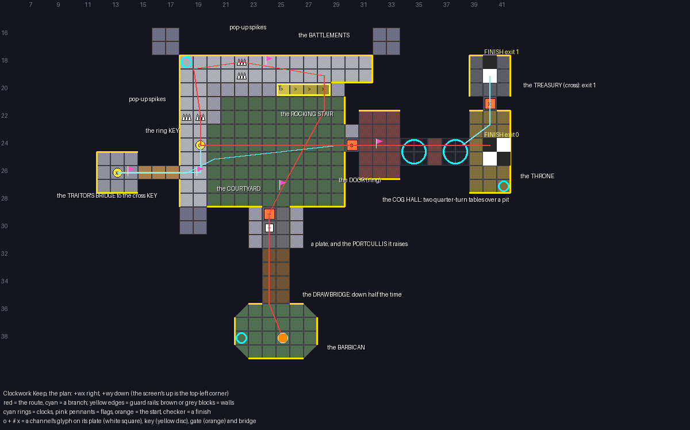

# COURSE 7, "Clockwork Keep" (KEEP): design sheet

*Status: **PEN-IN, attempt 1** (2026-11-25), the first step of the guide's pipeline
([README.md](README.md) section 3): designed for LOOKS and FUNCTION. The engine's
constraints it meets are listed in section 10, "Risks for refinement", for the step
after this one. `keep/sketch.py` draws the pictures and writes the course (`--bbc`),
which is `apps/bonanza/courses/keep.bbc`. It COMPILES with `tools/bbcourse.py`, NO TRAP
included, and its route demo finishes. It is not in the build, not on the pathway and
not a `guide` course yet. Distances are tiles and heights are units; the cells are the
engine's own. A number marked MEASURED was run on the tool's model
(`bbcourse.Physics`), never on an emulator; one marked PREDICTED is arithmetic.*

**The idea.** A floating castle that is one LOCK: the first course that is not a line.
The keep's door is in sight from the gate, shut, with a ring on it. The key with the
same ring is up on the battlements. Everything in the castle is CLOCKWORK: a drawbridge
that folds on a timer, a stair that rocks, spikes that pop, a hall floored with two
turning cogs. A second key, across a bridge that is down a third of the time, opens the
treasury: the course's second exit.

| field | value |
|---|---|
| place | course 7, the pathway's pad 6: after LODESTONE GORGE (section 7) |
| world | a castle on floating islands (`float`, the pathway's crystal look), compact: the whole of it is two windows across |
| ball | RUBBER from start to finish. No pad |
| finishes | TWO: the THRONE (exit 0), and the TREASURY (exit 1), behind a gate only the second key opens |
| families | `gate spike seesaw turntable`, all resident |
| new to the pathway | the whole GATE family (a plate, two keys, three gates with their own art, two timed drawbridges); POP-UP SPIKES; the TIMED see-saw; the turntable as a 2 x 2 CHAIN |
| target time | 50 - 60 s by the throne on a first clear, 75 s with the treasury (`target 90`'s class, `limit 99`). MEASURED on the model: the route demo 31.6 s, no falls |
| palette | the default (cyan, magenta, white) on black: grey stone needs white. The owner's call |
| clocks | 3: the barbican, the north-west tower, the throne. A SHIELD whose crest changes (section 9) |
| song | NEW, the music agent's (section 9): a clockwork march that ticks. `music fairway` stands in |
| the one new idea | **the way on is not ahead.** A door shows what opens it; the player goes and gets it, and comes back |
| picture | 1,024 x 464 px (`width 128`, `origin 496`); the floors are 672 px across |




## 1. The course, section by section

```
                 NW tower (clock)                                    NE tower
                    +---- pop-up spikes ---- the north BATTLEMENT ---- flag 1 --+
                    |                    [ the ROCKING STAIR ]                  |
    turret          |pop-up                                                     |
   (cross KEY) = the|spikes      the  COURTYARD  (flag 0)          the TREASURY (exit 1)
   TRAITOR'S        |                                                    | gate: cross
   BRIDGE ===  flag 3   ring KEY ------ one straight roll ----> DOOR --> COG HALL (flag 2): cog, island, cog --> THRONE (exit 0)
                    |                                          (ring)
                 SW tower            [ PORTCULLIS ]  (plus)
                                     [   plate    ]
                                     the DRAWBRIDGE (timed)
                                     the BARBICAN (start)
```

| | section | what it does | why |
|---|---|---|---|
| S | **the barbican** | an island 6 x 4, its corners cut, railed. The start is 2 tiles from the bridge. The start clock on its west side | a safe start; the whole castle is in the window from it |
| D | **the DRAWBRIDGE** | 2 wide, 4 long, thin planks over the void: down for 2.3 s in every 4.7, folding a cell at a time | **the first timer**, at its easiest: wide, a long window, and a fall puts the ball back 2 tiles away. It teaches "watch it, then go" before anything is at stake |
| G | **the gatehouse** | 2 x 3 between low cheeks. A PLATE with a plus on it, then the PORTCULLIS with the same plus, a stone arch 2 tiles wide whose grid rises in 0.4 s | **the pairing lesson**: a plate and its gate one tile apart, the same glyph on both. The ball presses the plate on its way to the bars |
| C | **the courtyard** | 10 x 8. Flag 0. From its middle the player sees: the keep's DOOR in the east curtain, shut, a RING on it; the ROCKING STAIR on the north side; and, up on the west battlement, the ring KEY | the lock, stated in one screen (G4: the mechanic and its result both in view). Nothing here kills |
| W | **the ROCKING STAIR** | a TIMED see-saw 4 x 1 along the foot of the north battlement, an end wall at each end. One end is down at the courtyard (10) while the other is up at the battlement (12), and they swap every 1.2 s. The ball rolls onto the low end from the side, leans on the end wall, is carried up, and steps off onto the battlement | the castle's lift (G18), and clockwork to look at: the two ends are always at the two heights, so whichever is low is the way up |
| B | **the battlements** | north, then west: 2 wide, 2 units over the courtyard, crenellated (railed) on the outside, OPEN on the inside. Two rows of POP-UP SPIKES cross them, half a period apart (1.2 s up, 1.2 s down). Flag 1 two tiles before the first row. The second clock at the north-west corner, under the tower | the walk to the key. The spikes are a timing gate with two answers (section 5). The open inside edge is the way down: a ball may drop into the courtyard anywhere, and comes back by the stair |
| - | **the ring KEY** | on the west battlement, level with the door | **one straight roll**: take the key, keep rolling east, drop off the battlement, cross the courtyard, and the door has swung open by the time the ball reaches it |
| K | **the DOOR** | one tile in the east curtain, a plank door in a frame with the ring on it. It opens 0.4 s after the key is touched and never shuts | the payoff, in sight the whole time |
| H | **the COG HALL** | a floor 3 x 5 (flag 2), then a pit with two 2 x 2 quarter-turn tables in it, an island tile between them, and the dais beyond. Each table is half floor, half port, and turns a quarter every 1.2 s; the second is a quarter and a half out of phase | **the finale**: WINDMILL LANE's turntable in its harder form (G21: no pivot to stand on; the island is the rest). Ride the first across on its turn, wait on the island, ride the second |
| T | **the THRONE** | the dais 3 x 6, railed; the goal 2 x 2 on it; the third clock at its front | exit 0, in full view |
| X | **the TRAITOR'S BRIDGE and the turret** | off the west battlement, south of the key: a bridge 1 wide and 3 long, down 1.8 s in every 4.7. The turret beyond holds the CROSS key. Flag 3 before the bridge, flag 4 on the turret | **the secret**: in plain sight and easy to leave alone. It is crossed twice |
| Z | **the TREASURY** | behind a gate with a cross on it, off the back of the dais: a room 3 x 3 and the second goal | exit 1. The gate is in view from the throne: a player who finishes by exit 0 has seen a door they could not open |

### The lock, in order

| | the player... | and now... |
|---|---|---|
| 1 | crosses the drawbridge | knows the castle runs on timers |
| 2 | rolls over the plus plate | the portcullis rises: plate and gate share a glyph |
| 3 | sees the door and its ring, and the key up on the wall | knows what to fetch |
| 4 | rides the rocking stair | is on the battlements |
| 5 | passes two rows of spikes | has the key in front of them |
| 6 | takes the key and rolls straight on | the door opens ahead |
| 7 | rides the two cogs | finishes at the throne |
| (s) | instead of 6, goes on south, over the traitor's bridge and back | has both keys, and the treasury opens |

## 2. Flags, clocks and the camera

- **Flags (5)**: flag 0 in the courtyard, past the gatehouse. Flag 1 on the north
  battlement, two tiles before the first spikes. Flag 2 in the cog hall's near floor,
  before the cogs. Flag 3 on the west battlement, before the traitor's bridge. Flag 4
  on the turret, so the way BACK across is not played from the far side of the castle.
  A key is kept through a respawn (the family's channels latch for the attempt, SPEC.md
  130.41.1 D3), so a fall never undoes a fetch.
- **Clocks (3)**: the barbican's west side; the north-west corner of the battlements
  (under the tower: the castle's clock tower, in view from the courtyard and the whole
  wall); the dais's front (in both finishes' windows). On a scratch copy that says
  `guide`, G9 and G10 pass (MEASURED).
- **The camera.** The castle is 672 px across and 344 lines tall: two windows wide, two
  tall. The play stays in three screens (the gate, the courtyard and walls, the hall),
  so it pans across twice on the main line, both times on the ground. Its flights are
  short: a 2-unit drop off the battlement, a Hop over a row of spikes.

## 3. What was MEASURED on the model

- **The portcullis**: from the gatehouse with the arrow held at it, the ball is on the
  plate at 0.5 s, waits at the bars, and is through at 1.3 s.
- **The rocking stair**: from the courtyard onto the plate's low end, the arrow held at
  the end wall, then at the battlement once the end is up: on the battlement in 1.8 s.
- **The door**: without the key a straight roll east across the courtyard stops at the
  door. Starting ON the key's tile, the same roll goes through it and reaches the first
  cog.
- **The treasury**: without the cross key the ball stops at its gate; with it, the ball
  is in the treasury's goal (exit 1) in 1.1 s.
- **The whole course**: the tool's route demo is COMPLETE, 1,725 steps (31.6 s), rubber,
  no falls, 4 Hops. The planner also drives the secret's detour - the battlement, the
  traitor's bridge, the turret and back - and on to a finish in 1,759 steps (32.2 s).
- **NO TRAP passes** from the start and from all five flags (section 10, C1 and C2, say
  what that took).

## 4. Balls, surfaces, lifts

- **Rubber only** (G13). The battlement is 2 units up: rubber drops off it safely.
- **Surfaces**: none.
- **Lifts**: the rocking stair, the only way up to the battlements (G18).

## 5. Precision elements, and the answers to each (G4, G22)

| element | what the player sees | the answers |
|---|---|---|
| the drawbridge | its planks folding away a cell at a time from the near end, and laying down again | wait for it to lay down, then cross. 4 tiles take 1.2 s of a 2.3 s window |
| the rocking stair | the plate, its two end walls, its banded fulcrum | roll onto whichever end is low and lean on the wall |
| the spikes | two rows, each across the whole walk, one up while the other is down | (1) cross a row while it is down; (2) Hop it: rubber's Hop clears one row (SPEC.md 130.38.1). There is no way round: the stair comes up behind the first row |
| the cogs | each table's floor half and port half, the seam that shows 0.3 s before a floor opens, the island between | ride a floor half as it comes round; rest on the island; a Hop from island to dais over the second table is the brave line |
| the traitor's bridge | 1 wide, 3 long, down 1.8 s in 4.7 | cross on the cell it lays down. Twice |

## 6. The place on the curve (CD2)

After LODESTONE GORGE, and the hardest of courses 5 - 7. Not because any one obstacle is
hard: each is the easy form of its kind. It is the first course where the player has to
hold a plan (door, key, back), and where five different machines each want a moment's
watching.

- **The one new demand**: find what opens the way, fetch it, return.
- **Help given**: the door and its key in one screen; a plate one tile from its gate
  first; the key in line with the door; every timer generous (half its period open); a
  flag before each thing that kills; keys kept through a fall.
- **Help a later course can remove** (G21): the key out of sight of its door; a plate
  far from its gate; a key that needs a second ball; shorter windows; a switched bridge
  whose plate is across a hazard.

## 7. The pathway, and the second exit

KEEP takes pad 6, where the test course PLAYGROUND stands in today, after LODESTONE
GORGE (`route 5 6 exit 0`). It has **two exits**:

- **exit 0, the throne**: on along the map to pad 7.
- **exit 1, the treasury**: a `secret` route (SPEC.md 130.22.2). PROPOSED: it runs
  across the map to KITE HILL's pad, joining the left-hand branch to the right-hand one
  - so a player who took DOWNHILL DECISION's steel exit and never saw WINDMILL LANE's
  side gets a way over. The art agent and the owner place it; the course asks only for
  a second route keyed (KEEP, 1).

## 8. Patterns for the props it uses first (the guide's section 4)

| prop | what it is for | how it is introduced | easy and hard forms | what to avoid |
|---|---|---|---|---|
| **the plate and its gate** (`prop plate`, `prop gate`) | a way that opens when something is pressed | the plate ONE tile before its gate, on the only line to it, the glyph on both | easy: adjacent, pressed in passing. Hard: the plate out of the way, across a hazard, or reached only by another ball | two channels' glyphs in one window before the first has been learned; a plate in a 2-wide lane where half the players roll past it and stop at shut bars (the gatehouse's plate is in one lane of two: watch this in play) |
| **the key and its door** (`prop key`, a gate with `art`) | a fetch: the course stops being a line | the door first, shut, in the middle of the screen; the key in sight of it | easy: the key in LINE with the door, so the fetch ends in one roll. Hard: out of sight; behind a second lock | a door met before its key can be seen; a key the player can be stranded after taking (they latch, so in this engine they cannot) |
| **the timed drawbridge** (`prop bridge ... period`) | a crossing that exists part of the time | at the start, wide, half its period down, the respawn beside it | easy: 2 wide, 128 of 256. Hard: 1 wide, a third of the period, crossed twice | a window shorter than the crossing at a walk; a bridge whose folding the player cannot see from where they wait |
| **pop-up spikes** (`prop popspikes`) | a timing gate on a walkway | two rows, opposite phases, a flag before | easy: one row to cross, one cell deep (a Hop clears it). Hard: two cells deep (no Hop), or rows a cell apart | a spiked cell beside a LOWER floor (the tool refuses it: section 10, C4); spikes where a waiting ball stands |
| **the timed see-saw** as a stair (`seesaw ... period`) | a lift made of a rocking plate | in a safe yard, an end wall at each end, entered from the side | easy: 4 x 1, a wall to lean on. Hard: no wall (the ball rolls off the low end), or entered along its length (it is a ramp half the time and a wall the other half) | a flag, a spike or a clock within a tile of the plate (their lanes collide: C3); a rail beside it (refused) |
| **the turntable chain** (two 2 x 2 tables, an island between) | a crossing in two rides | after WINDMILL LANE's 3 x 3 with its pivot | easy: an island tile between, phases apart. Hard: no island; three in a row | a clock in the tables' window without counting its pose changes |

## 9. The art and music wishlist

### The song (for the music agent)

- **Mood**: a clock tower and a toy castle. Stately, precise, a little sly. A march for
  wind-up soldiers.
- **Tempo and feel**: strict, never rubato. A tick-tock ostinato (two pitches, a fifth
  or an octave apart, one a beat) under a short baroque tune in a minor key; ornaments
  like a music box's. A fanfare cadence to end the loop, for the throne.
- **An idea to weigh, not a requirement**: 128 steps (2.34 s) is the period of the
  spikes and the stair, and half the drawbridge's. Four beats in 2.34 s is **102.4
  beats a minute**. A song at that tempo would TICK in time with the castle. Whether the
  music's clock and the step counter can be held together is the engine's to say
  (section 10, C12); if they cannot, the tempo is still the right feel.
- **On the PC speaker**: the tick-tock IS the arrangement: tick, tune note, tock, tune
  note.
- It should not sound like WINDMILL LANE's (a turning figure, cheerful): this is the
  same idea grown stern.

### The art (for the art agent)

- **Theme**: a storybook castle on floating crystal islands, everything driven by
  gears. Grey stone, white highlights, banners in the channel inks.
- **Clocks**: a SHIELD on a post, the digits across it. Its CREST says where the player
  is: a shut PADLOCK at the barbican, a KEY at the tower, a CROWN at the throne. No flat
  panel (G23): the shield is curved and hangs from a bracket.
- **Gates** (each a `.bba` of 4 frames, SPEC.md 130.41.12; `portcullis` and `door` exist
  as the gate lab's and are what the pen-in names):
  - the PORTCULLIS, 2 tiles: redraw to the castle's stone, the plus on its keystone;
  - the keep's DOOR, 1 tile: iron-bound planks, the ring as its knocker;
  - the TREASURY's gate, 1 tile (the pen-in uses the preset grille): a strongroom's bars
    with the cross on the lock plate, sliding aside.
- **The drawbridges**: a planked deck (the pen-in's `style picket`); the traitor's bridge
  one plank wide and visibly rickety.
- **Signs and decals**:
  - the three GLYPHS large and clear wherever they appear (plus, ring, cross): they are
    the course's whole language;
  - a red carpet from the door through the hall to the throne; the THRONE itself as a
    decal behind the goal;
  - gear teeth on the stair's fulcrum and round each cog;
  - banners on the towers; a heap of crystals in the treasury; an arrow-slit pattern on
    the tower faces.
- **The pathway icon** (32 x 24): a tower with a gear for its clock face and a key
  beside it. Idle animation: the gear turns a tooth.
- **The pathway gate**: the secret route's own gate (SPEC.md 130.22.2), if the owner
  wants one: a small door with the cross on it.

## 10. Risks for refinement

| | risk | what the pen-in did | what refinement has to settle |
|---|---|---|---|
| **C1** | **NO TRAP forgets a key.** Its search state is a cell and a ball: a channel opened in one run is shut again in the next (the gate family's state is in its slot, not in the search). A key far from its door on the only route cannot be proved, and the course is refused ("a rubber ball cannot reach the goal") | **the layout was bent to the tool**: the ring key is IN LINE with the door, so one held-arrow run from the key's tile goes through it; and the plus plate is one tile before the portcullis. Both read well, but neither was free | carry the open channels in NO TRAP's state (they only ever open: the search stays finite). Then the key can go anywhere. Until then, any move of the key or the door has to keep the line |
| **C2** | **NO TRAP reads ONE timer phase** (step 0, unless the course has a windmill or a lift) **and never waits.** A timed bridge that is up at step 0, or whose window is shorter than a crossing from rest, strands every flag past it | the traitor's bridge is on the drawbridge's own timer, down from step 0 for 96 steps. The design wanted it OUT of phase with the drawbridge and down a quarter of the time | give the search phases for timed bridges, as it has for lifts (`TRAP_LIFT_PHASES`); then narrow the window by play |
| **C3** | **Lanes collide near a see-saw.** A flag, a popspike or a clock whose lane's blocks meet the plate's is refused | flag 1 and both spike rows stand two tiles or more from the stair; the start clock moved off the drawbridge's column | a rule of thumb for the sheet: nothing with a lane within a tile of a plate |
| **C4** | **A spiked cell may not stand beside a LOWER floor** (SPEC.md 130.38.4). The battlements are 2 wide beside the courtyard | a low parapet wall on the battlement's inner edge at each spike row (the north one is the stair's own end wall; the west one a 2-tile buttress in the courtyard's corner) | fine as it is; or 3-wide battlements |
| **C5** | **The autopilot Hops the timers** (4 Hops in the route demo) where a player would wait | nothing | the route search's STAND (SPEC.md 130.14.7.4.5) waits on a turntable's pivot; a 2 x 2 has none. A wait on the island, or an authored demo |
| **C6** | **A floating face is at most 3 units** (`float ... thick`). The towers were drawn 5 and 4 units over the battlements | they are 3 (and 2 in front) | taller towers want either grounded cells in a floating course or a taller `thick` |
| **C7** | **Many lanes in the courtyard's window**: the stair's, four popspikes, three flags, the portcullis's and the door's art lanes, a clock's digits. It compiles (the per-window refusals were retired, SPEC.md 130.19.10 item 14: late lanes wait a frame) | nothing | MEASURE the frame on MartyPC with the portcullis rising while the stair swings |
| **C8** | **`guide` is not declared.** On a scratch copy G9 and G10 pass; the run as a guide course is not complete yet, so G1, G3, G11, G12 are unmeasured | left off | declare it when C5 is settled |
| **C9** | **The second exit needs the pathway**: a route keyed (KEEP, 1), `secret`. Nothing in this step makes it | nothing | the art agent's map |
| **C10** | **The gatehouse's plate is in one lane of two.** A player in the other lane reaches shut bars and has to look for the plate | nothing: it is the lesson, but it may read as a bug | the owner's play; a 1-wide gatehouse is the cure |
| **C11** | **The drop off the battlement after the key**: 2 units onto the courtyard, then 9 tiles to the door. MEASURED once, at a held arrow. A bounce may carry rubber past the door's line | nothing | sweep it at speed; a rail on the courtyard's far side is already there |
| **C12** | **The music's tempo against the step clock** (section 9): unknown whether a song's beat can be held to the step counter | nothing | the music agent and the sound part's contract (SPEC.md 130.20.1) |
| **C13** | **The treasury's gate uses the preset grille**; the door and the portcullis use the gate lab's art | named as they stand | the art agent's own `.bba` files replace them by name |

## 11. A new engine prop, PROPOSED (the course plays without it)

**A dial**: `prop dial <wx> <wy> period <P> [seed <S>]`, a small lane of 4 poses that
turns with a timer - a gear, or a clock face with one hand. It does nothing but SHOW the
phase: stood beside the drawbridge, the stair or a row of spikes with the same period
and seed, it lets the player read the machine from across the yard, and it would make
the castle's clockwork visible as clockwork. It is a POSE hook on the step counter and
nothing else (the gate family's timed bridge already reads the same timer): PREDICTED
about 30 bytes of `fam/gate.asm` and one kind. Every timer above is readable without it.

## 12. How the pictures and the course are made

```
python3 docs/plans/bonanza-courses/keep/sketch.py                 # plan.png, iso.png, the clocks' spacing
python3 docs/plans/bonanza-courses/keep/sketch.py --bbc --force   # apps/bonanza/courses/keep.bbc
python3 tools/bbcourse.py -o DIR apps/bonanza/courses/keep.bbc    # alone: about 70 s (NO TRAP is most of it)
python3 tools/bbcourse.py apps/bonanza/courses/keep.bbc --png DIR # the engine's own picture
```

`../penkit.py` is the pen the three sketches of courses 5 - 7 share.
