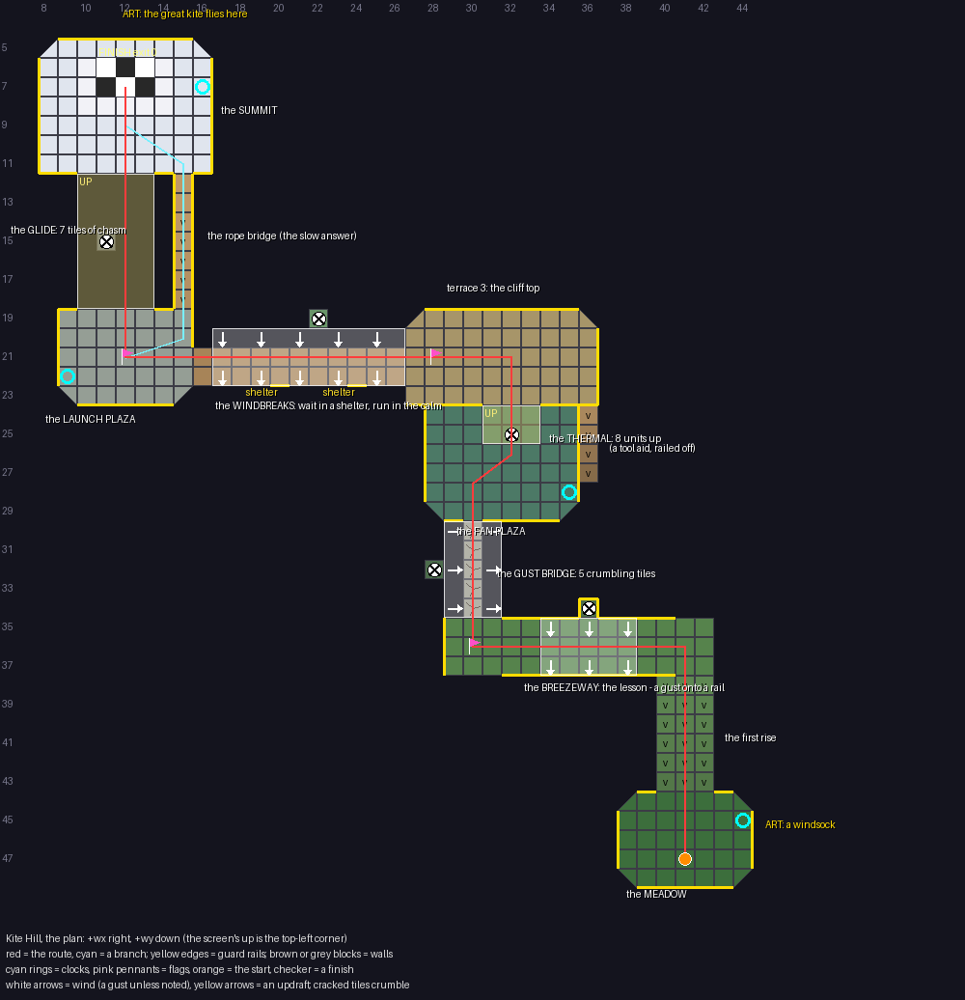
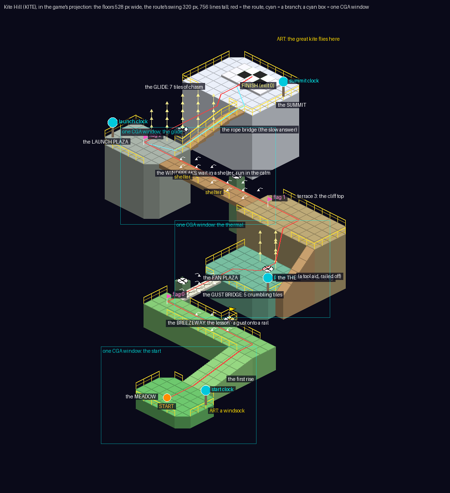

# COURSE 5, "Kite Hill" (KITE): design sheet

*Status: **PEN-IN, attempt 1** (2026-11-25), the first step of the guide's pipeline
([README.md](README.md) section 3): designed for LOOKS and FUNCTION. The engine's
constraints it meets are listed in section 10, "Risks for refinement", for the step
after this one. `kite/sketch.py` draws the pictures and writes the course
(`--bbc`), which is `apps/bonanza/courses/kite.bbc`. It COMPILES with
`tools/bbcourse.py` and its route demo finishes. It is not in the build, not on the
pathway and not a `guide` course yet. Distances are tiles and heights are units; the
cells are the engine's own. A number marked MEASURED was run on the tool's model
(`bbcourse.Physics`), never on an emulator; one marked PREDICTED is arithmetic.*

**The idea.** A CLIMB, the first course whose finish is above its start: a hill of
terraces that goes UP the screen, and the WIND on it. The ball cannot see wind, so the
course shows it (squiggles in the air, a pennant, a spinning fan) and teaches it in
four meetings: a gust that shoves the ball onto a rail, a gust across a crumbling
bridge, gusts to wait out behind windbreaks, and rising air: a THERMAL that lifts the
ball 8 units up a cliff, and the GLIDE, a chasm crossed on it to the summit.

| field | value |
|---|---|
| place | course 5, the pathway's pad 4: after WINDMILL LANE (its exit 0), "up the right-hand climb" the map already draws (section 7) |
| world | a grassy hill, terraces up the screen; the pathway's page 1 |
| ball | RUBBER from start to finish. No pad, no other ball (section 4) |
| finish | ONE: the summit's crown (a goal half a unit up, which every ball rolls up) |
| families | `wind glass` (the cracked tiles are GLASS's kind `crack`); both resident |
| new to the pathway | WIND: the gusting blower, the updraft with `lift` (a THERMAL), the updraft over a pit (the GLIDE); the CRACKED TILE |
| target time | 45 - 50 s for a first clear, 35 s for a good one (`target 60`'s class, `limit 90`). MEASURED on the model: the route demo 35.4 s; the planner's line 30.1 s by the glide, 34.0 s by the rope bridge |
| palette | `palette 0` (green, red, yellow on black: LITTLE HOP's): a grassy hill |
| clocks | 4: start, fan plaza, launch plaza, summit. A KITE whose tail grows a bow a clock (section 9) |
| song | NEW, the music agent's (section 9): light, airy, rising. `music fairway` stands in |
| the one new idea | **the air moves the ball.** Wind is read off its cues and timed; rising air is ridden |
| picture | 1,024 x 904 px (`width 128`, `origin 480`); the floors are 528 px across |





## 1. The course, section by section

```
                                   SUMMIT (crown: the goal)
                                     ^            ^
                    the GLIDE: 7 tiles of        the ROPE BRIDGE
                    chasm on rising air          (1 wide, no rail, slow)
                                     \            /
   LAUNCH PLAZA (flag 2) <-- the WINDBREAKS: a hard gust, a shelter every 4th tile <-- TERRACE 3 (flag 1)
                                                                                         ^
                                                                          the THERMAL: 8 units up the cliff
                                                                                         |
                                                              FAN PLAZA <-- the GUST BRIDGE (5 crumbling tiles)
                                                                                         ^  (flag 0)
                              the BREEZEWAY: a gust onto a rail (the lesson) <-- the first rise <-- MEADOW (start)
```

| | section | what it does | why |
|---|---|---|---|
| A | **the meadow** | 7 x 5, its corners cut, railed. The start is 3 tiles from the first rise | a safe start with roll room (1.10). The start clock is on its east side, off the way |
| R | **the first rise** | 3 wide, 3 units up in 6 tiles (half a unit a tile: rubber climbs it from rest, MEASURED) | "climb up the screen": the course's direction, said at once |
| B | **the BREEZEWAY** | a 14 x 3 walk up-left. A fan in a notch on its upwind side GUSTS across it (strength 10, on 1.2 s in every 2.3), its pennant flying while it blows. Both long edges are RAILED where it blows (9 tiles) | **the lesson**: 10 is more than rubber can lean against (8), so the gust shoves the ball onto the rail and holds it there. Nothing is lost, and the player has felt what the next bridge will do. The UPWIND rail is there because a player who leans into the gust rolls that way the moment the calm comes (MEASURED: off the back edge, before the rail was added) |
| C | **the GUST BRIDGE** | 5 CRUMBLING tiles, 1 wide, over the void; a fan on a lone pillar gusts across them (strength 8, on 1.2 s in every 4.7), its squiggles over the bridge only while it blows. Flag 0 on the tile before it | the owner's favourite of the wind lab ("across the crumbling bridge"). Two clocks at once: the tiles give 0.5 s each (so the ball may not stop), the gust says when to go |
| D | **the FAN PLAZA and the THERMAL** | 8 x 6 under an 8-unit cliff. A fan grate at the cliff's foot blows UP (`lift`, strength 40, top 9): a ball that rolls onto it is LAUNCHED, rises 8 units in front of the cliff's face, hovers at the top, and is steered onto terrace 3: 4.0 s from the launch to the landing (MEASURED) | **the signature's first half**, in its can't-fail form: nothing here kills, and the fan picks the ball up by itself. It is the course's lift (G18: up, to where no jump goes) |
| S | **terrace 3** | the cliff's top, 10 x 5. Flag 1 before the bridge | a breath, and the mid-course flag |
| E | **the WINDBREAKS** | a bridge 11 x 2, walked up-left, in a HARD gust (strength 12, on 0.44 s in every 2.3). Every fourth tile is a SHELTER: its downwind edge railed. The upwind edge is open (the wind blows away from it) | the lesson's rail, taken away (G21). One gust moves the ball 13.5 gu, under a tile (PREDICTED), so it costs the upwind lane, not the ball. See section 5 for the three ways across |
| F | **the LAUNCH PLAZA and the GLIDE** | 7 x 5; flag 2. Ahead, 7 tiles of chasm, a fan on a pillar in its middle, the whole lane rising air (strength 40, top 7 over the fan). The ball rolls off the edge, sinks a little, is caught, rises, and lands on the summit 2.5 units ABOVE where it left | **the signature set piece**: the ball flies, and gains height doing it. The fan's own pillar relaunches a ball that lands on it |
| K | **the ROPE BRIDGE** | 1 wide, RAILED both sides, out of the wind: 2.5 units up in 5 tiles beside the glide, then 2 planks onto the summit | the glide's other answer (G22): slower (5.9 s from the plaza to the crown against the glide's 2.5, MEASURED), plain and safe: the way for a player who will not roll into a chasm |
| G | **the SUMMIT** | 9 x 7, railed at the back and sides. The CROWN, 5 x 3 and half a unit up, holds the goal. The finish clock on its east edge | a main-route finish in full view (G5). The great kite flies over it (art) |

### What was MEASURED on the model

- **The thermal**: rubber rolled onto the grate with the arrow held toward the cliff is
  launched, climbs to 16.1 units and is on terrace 3 (15) 4.0 s after the launch. GLASS
  the same in 3.0 s. STEEL is not launched (a quarter of the push): it sits on the grate
  at 7. No steel reaches this course (section 4).
- **The glide**: rubber leaving the launch plaza at 120, 250 or the cap with the arrow
  held crosses the 7 tiles in 2.5 - 3.2 s, between 15.0 and 19.1 units, and lands on the
  summit (17.5). With NO key held, a ball that rolls off the edge at 200 drifts across
  and lands on the summit too, in 6.7 s.
- **The lesson**: rubber leaning into the breezeway's gust for two whole cycles stays
  on the walk (it fell off the upwind edge before that edge was railed).
- **The rope bridge**: a plain driver that aims at tile centres walks it without a fall.
- **The whole course**: the tool's route demo is COMPLETE, 1,933 steps (35.4 s),
  rubber, with 3 falls in it. The planner's own line has none: 1,645 steps (30.1 s) by
  the glide and 1,856 (34.0 s) by the rope bridge.

## 2. Flags, clocks and the camera

- **Flags (3)**: flag 0 on the breezeway's last tile, before the gust bridge. Flag 1 on
  terrace 3, before the windbreaks. Flag 2 on the launch plaza, before the glide. None
  before the thermal: nothing there kills (G20).
- **Clocks (4)**: the meadow's east side (in the start's window, G9); the fan plaza's
  front corner (seen from the gust bridge and all the way up the thermal); the launch
  plaza's west side; the summit's east edge (in the finish's window). No two share a
  window: the launch and summit clocks are 368 px apart across (G10; they were 304
  apart and refused once, section 10). MEASURED on a scratch copy that says `guide`:
  G9 and G10 pass.
- **The camera.** The course goes up the screen in legs that alternate up-left and
  up-right, so it pans across at each turn (G2): on the breezeway's corner, on terrace
  3 and on the launch plaza, all on the ground. Two flights:
  - the THERMAL rises straight up, then drifts a tile onto the terrace and the route
    turns up-left;
  - the GLIDE runs 7 tiles up-right, 112 px across, while the ball is in the air; the
    camera's no-pan band is about 110 px (the guide's 1.9).
  **G3 is REFUSED for both** on the scratch `guide` copy (MEASURED): the route pans 16
  columns in the thermal's flight and 24 in the glide's (section 10, K4).

## 3. The pace

Dense screens, not a speed course. The first rise and the breezeway are a walk with
one stop against the rail. The gust bridge is a wait and a dash. The thermal is 2.6 s
of being carried, with the plaza's clock in view the whole way. The windbreaks are two
or three short runs between shelters. The glide is 2.5 - 3.2 s of flight. PREDICTED for
a first clear: 45 - 50 s, of which about 8 s is waiting for a calm.

## 4. Balls, surfaces, lifts

- **Balls: rubber only** (G13). The wind's weighting (glass x2, rubber x1, steel x1/4)
  is the family's most striking property and this course leaves it alone on purpose:
  one new idea a course. Section 6 lists what a later course could do with it.
- **No softlock by ball** (G7): steel is the only ball a thermal does not lift, and no
  pad or flag here makes one.
- **Surfaces**: none. No ice, no sand.
- **Lifts**: the two updrafts are the course's lifts. Both go UP to where no jump
  reaches (G18): 8 units, and 2.5 units across 7 tiles of void.

## 5. Precision elements, and the answers to each (G4, G22)

| element | what the player sees | the answers |
|---|---|---|
| the gust bridge | the fan on its pillar beside the bridge, the squiggles over the tiles while it blows, the cracks on every tile, flag 0 | wait for the squiggles to go, then cross in one go (3.5 s of calm, 1.5 s to cross). Or go as the gust ENDS. A ball that stops on a tile loses it |
| the thermal | the fan grate, its squiggles rising up the cliff's face, the terrace's edge above | roll on. It cannot be missed and cannot be failed |
| the windbreaks | the fan upwind, the squiggles over the whole bridge in a gust, a rail on every fourth tile | (1) shelter to shelter in the calm; (2) ride the upwind lane and take one shove; (3) a fast ball that leaves on the gust's last step is across in the one calm (PREDICTED: 11 tiles in 1.9 s wants the cap all the way, so only just) |
| the glide | the fan on its pillar in the chasm, squiggles rising over all 7 tiles, the summit's face ahead and above | roll off the edge at any speed. Or take the rope bridge |

## 6. The place on the curve (CD2)

After WINDMILL LANE. MILL's obstacles are machines with a visible state (a gate open
or shut, a table's port). KITE's is a FORCE with a visible cue: the ball is moved by
something the player has to read off the air. Harder than MILL in one way only: two of
its hazards (the gust bridge, the windbreaks) kill when misread. It gives in return
the most forgiving set pieces yet: neither updraft can be failed.

- **The one new demand**: time a move against a rhythm that pushes back.
- **Help given**: the lesson's rail; a flag before each of the three things that kill;
  the windbreaks' shelters and second lane; the rope bridge.
- **Help a later course can remove** (G21): the shelters; the second lane; the fan on
  the glide's pillar (a glide with a dead tile in it); the rope bridge.
- **Not used here, for a later course**: the wind's weights. A steel pad before a gale
  (steel walks through it); a weak updraft (strength 16) that lifts glass alone, "a
  glass-only gate for free" (the owner's words on the lab); a glide whose top is
  reached by glass only.

## 7. The pathway

KITE takes pad 4, where the test course PEAK stands in today: `route 3 4 exit 0`, MILL's
finish, "up the right-hand climb" into page 1. The map's own picture of that route is a
climb, and the course is one. One exit. Its icon idea is in section 9.

## 8. Patterns for the props it uses first (the guide's section 4)

| prop | what it is for | how it is introduced | easy and hard forms | what to avoid |
|---|---|---|---|---|
| **the gusting blower** (`prop blower ... gust`) | a hazard with a rhythm: a crossing that is safe for part of every cycle | on a WIDE walk whose downwind edge is railed, at a strength over 8, so the first gust pins the ball and loses nothing | easy: wide, railed, a pennant or squiggles in plain view, a long calm. Hard: 1 wide, no rail, a short calm, a second timer under it (crumbling tiles) | a fan the player cannot see from the walk; a strength at or under 8 that reads as "the controls feel off" rather than as wind; a gust across the START |
| **the cracked tile** (`prop crack`) | a floor that may not be stood on | five in a row on a bridge, a flag before the first, the cracks drawn | easy: a short run with firm ground either end. Hard: with a gust; or a long run that only a ball already at speed crosses | a cracked tile where the player has to wait for something (it punishes the patience the gust asks for), unless that is the puzzle |
| **the thermal** (an updraft with `lift`, strength over 24 so rubber is launched) | a lift with no machine: up a cliff, to where no jump goes | at a cliff's foot in a railed plaza, with nothing that kills near it. The ball rises in FRONT of the cliff's face, so it is seen all the way | easy: a wide grate, the landing straight ahead. Hard: a landing to one side; two columns with dead air between | a thermal whose top is out of the window from its foot; a region over a ledge the ball should land on (it never comes down there); steel anywhere before it with no rubber pad between |
| **the glide** (an updraft over a pit) | a gap crossed by floating, and height gained on the way | after the thermal has taught "this air carries me" | easy: the whole gap is rising air and a second way round exists. Hard: a dead tile, a turn in the air, no second way | a gap wider than 4 tiles with no solid cell inside it: void more than 2 tiles from any floor kills at once (SPEC.md 130.10.4.3), which is why the glide's fan stands on a pillar in the middle |

## 9. The art and music wishlist

### The song (for the music agent)

- **Mood**: a bright spring day and a kite on a long string. Light, airy, a little
  giddy; never tense.
- **Tempo and feel**: about 120 - 132, a lilting three (a quick waltz or a 6/8): the
  kite bobs. Major, with a raised fourth here and there for "air".
- **Shape**: the tune CLIMBS as the course does. A rising arpeggio motif that starts a
  step higher each phrase; a held high note where the thermal would be; a breath (a
  bar's rest, or the bass alone) before each climb, as a calm before a gust.
- **A gust figure**: a quick upward run that stops dead, then the tune goes on - the
  only "event" in it. Keep it short: it will be heard many times.
- **On the PC speaker**: one voice, so the bounce is in the rhythm (long - short) and
  the arpeggios are broken, never chords.
- It should not sound like LITTLE HOP's song (bouncy, grounded) or WINDMILL LANE's
  (a turning figure): this one floats.

### The art (for the art agent)

- **Theme**: a spring hill and a kite festival. Green terraces, a bare stone summit.
- **Clocks**: a KITE on its string. The digits are on the kite's sail; the TAIL says
  where the player is: one bow at the meadow, two at the fan plaza, three at the launch
  plaza, a full tail streaming at the summit. The kite leans the way the course goes
  next (up-left, up, up-right). No flat panel (the guide's G23).
- **The great kite**: a large static decal in the sky over the summit, its string
  running down to a post on the crown. It is the picture the player climbs toward and
  is in sight from the launch plaza on.
- **Signs and decals** (a sign says what to do next, where it is done):
  - at the breezeway, a windsock or a row of grass tufts bent downwind;
  - before the gust bridge, "WAIT FOR THE CALM", or wordless: a pennant drawn limp
    beside a ball rolling, a pennant drawn flying beside a ball stopped;
  - at the fan plaza, an arrow UP the cliff's face beside the grate;
  - at each shelter, a small pennant on the rail;
  - before the glide, a kite-shaped arrow across the chasm; at the rope bridge, a
    plain footpath sign.
- **Small kites** as scenery in the void beside the terraces, at different heights.
- **The pathway icon** (32 x 24): a diamond kite with a two-bow tail over a green hill.
  Idle animation: the tail swings.
- **No gate.**

## 10. Risks for refinement

*Each is a place where this design meets a limit of the engine or the tool. None was
designed around on purpose, except where the pen-in had to compile: those say what was
changed.*

| | risk | what the pen-in did | what refinement has to settle |
|---|---|---|---|
| **K1** | **The tool cannot prove a climb.** `finish_reach_rule` closes the start's reach over rolls, Hops and bounces alone: no thermal, lift, spring or tube is in it. A finish above the start is refused ("the goal cell cannot be reached with the course's clocks in place") | a **TOOL AID**: a 1-wide ramp from the fan plaza to terrace 3 at 2 units a tile (no ball climbs it), RAILED OFF at both ends. The closure knows no rail, so it passes; in play the ramp is scenery. It is section K in the sketch and marked in the `.bbc` | teach the closure a `lift` updraft (a launch from its region's cells at its top) and delete the ramp; or keep a real second way up. The glide needs nothing: the rope bridge is its rollable way |
| **K2** | **Seven WIND elements, the family's limit** (`WD_NMAX`: a gusting blower without `flag` is two, its fan and its wisp). The lesson (1, flagged), the gust bridge (2), the thermal (1), the windbreaks (2), the glide (1) | nothing: it fits exactly | no eighth is possible. A second fan on the glide (a longer chasm) or squiggles on the lesson would need the limit raised |
| **K3** | **G10, two clocks in one window**: the launch and summit clocks were 304 px apart and refused | the summit clock moved to the summit's east edge (368 px); G10 passes | the art agent's clock frames are taller than the default; re-check |
| **K4** | **G3, a pan during a flight: REFUSED on both flights** (MEASURED, a scratch copy with `guide`): 16 columns in the thermal's flight (the ball lands and the route turns up-left), 24 in the glide's (112 px across in the air against a no-pan band of about 110 px) | nothing: the pen-in does not say `guide` | the thermal's flight is not steered while it rises: ask the owner for the cannon's exemption for an UPDRAFT's carry (a tool change: skip a flight that starts in a `lift` region, as a tube's is skipped). For the glide: the same, or a `stop left`/`stop right` over the chasm's span, or a shorter last leg |
| **K5** | **The budget**: LZ4 13,874 bytes against the 60 s class's 12,550 (over by 1,324; reported, not refused: SPEC.md 130.27.5). The part is 58,919 bytes of 65,024 | nothing | the rails are the cost (the lesson's second rail and the rope bridge's two added 2.6 KB): fewer of them, the tool aid's ramp gone, or the 90 s class |
| **K6** | **The gusts' numbers are PREDICTED**, not played: strength 8 across the crumbling tiles (the lab's), 12 across the windbreaks, the calms' lengths, and whether a cracked tile's 0.5 s and a gust together are fair this early | the lab's values where it has them | the owner's play. The dials are one number each (`strength`, `gust on off`) |
| **K7** | **The updrafts' numbers**: strength 40 launches rubber (over the 24 that gravity is) and glass; the thermal takes 4.0 s, which may feel long. A ball that drifts off the thermal's front falls 8 units back onto the plaza (rubber survives; not measured for a bounce off the rail) | nothing | the owner's play; `top` and the landing's rail |
| **K8** | **The glide's void**: every tile of the chasm is within 2 tiles of the fan's pillar or a rim, so none is OPEN void. Moving the pillar or widening the lane past 4 breaks that silently (the ball dies in mid-air) | the lane is 4 wide, the pillar in its middle | keep the rule in the sheet; a check in the tool would be better |
| **K9** | **`guide` is not declared.** On a scratch copy that says it: G9 and G10 pass, G3 is refused (K4), and the run stops there, so G1, G11 and G12 are unmeasured | left off | declare it once K1 and K4 are settled |
| **K10** | **The camera across** (G2): the legs swing 320 px, so the course pans at each turn; it is too wide for `lock across` | nothing | the owner's eye. The floors are 528 px across, inside the 1,024 |
| **K11** | **The visibility of air.** A steady updraft paints its squiggles into the picture over every other cell of its region; over VOID cells they are painted at the blower's own cell. Whether the glide's column reads over a chasm, on both cards, is unseen | nothing | one look on MartyPC, CGA and Hercules |
| **K12** | **Four clocks, three flags, two fans in some windows**: the pose changes a window may take on one step (`WIN_CHG` 6) passed at this layout | nothing | re-check after any clock or fan moves |

## 11. A new engine prop, PROPOSED (the course plays without it)

**A veering gust**: one word on a gusting blower (`veer`) that turns its push to the
opposite side on alternate cycles. The summit could then have a last walk where the
ball is shoved left, then right, and the pennant says which is next. It is the gust's
own rule with the face's sign taken from one more bit of the step counter: no state,
PREDICTED a few bytes of `fam/wind.asm` and one of the record. Not needed by anything
above.

## 12. How the pictures and the course are made

```
python3 docs/plans/bonanza-courses/kite/sketch.py                 # plan.png, iso.png, the clocks' spacing
python3 docs/plans/bonanza-courses/kite/sketch.py --bbc --force   # apps/bonanza/courses/kite.bbc
python3 tools/bbcourse.py -o DIR apps/bonanza/courses/kite.bbc    # alone: about 25 s
python3 tools/bbcourse.py apps/bonanza/courses/kite.bbc --png DIR # the engine's own picture
```

`../penkit.py` is the pen the three sketches of courses 5 - 7 share.
