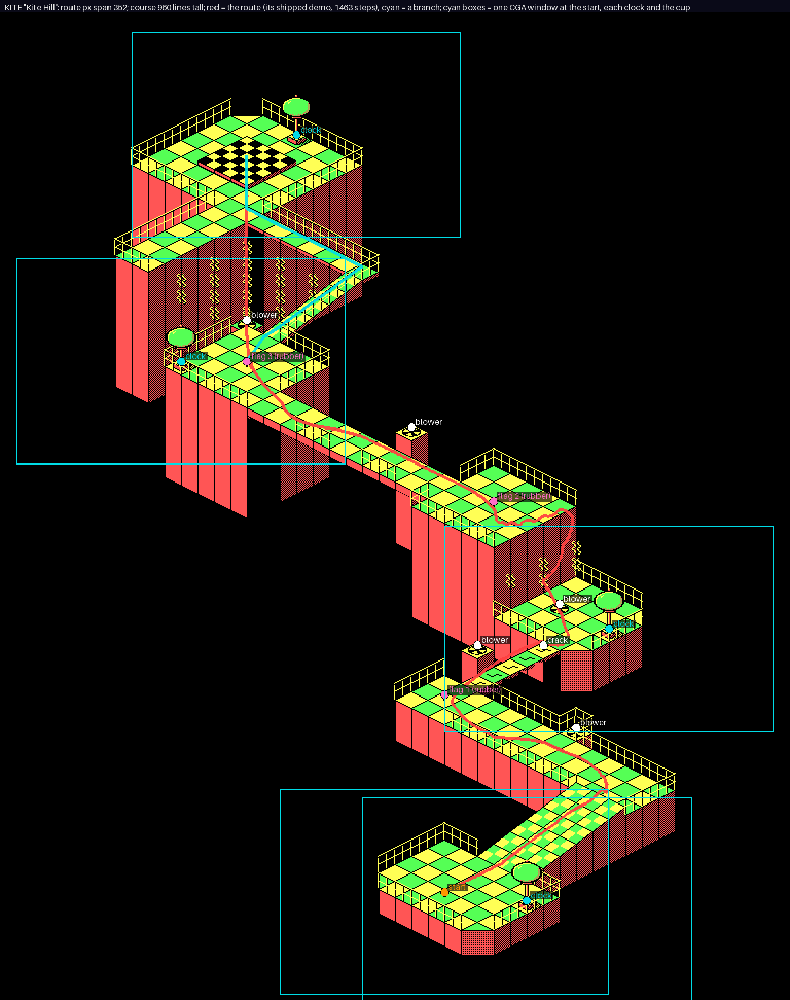

# COURSE 5, "Kite Hill" (KITE): design sheet

*Status: **REFINED** (2026-11-25), the second step of the guide's pipeline
([README.md](README.md) section 3): the pen-in of the same day, designed for looks and
function, fitted to the engine's constraints. `apps/bonanza/courses/kite.bbc` says
`guide` and passes every check a shipped course is held to (section 10); it is NOT in
the build yet (no `BZ_COURSES` entry, no pathway pad: a later step's). `kite/sketch.py`
draws the pictures and writes the course (`--bbc`). Distances are tiles and heights are
units; the cells are the engine's own. A number marked MEASURED was run on the tool's
model (`bbcourse.Physics`, `Glide`), never on an emulator and never by a player; one
marked PREDICTED is arithmetic. Section 11 is what refinement changed and why, section
12 each risk's outcome, section 13 the owner's playtest list.*

**The idea.** A CLIMB, the first course whose finish is above its start: a hill of
terraces that goes UP the screen, and the WIND on it. The ball cannot see wind, so the
course shows it (squiggles in the air, a pennant, a spinning fan) and teaches it in
four meetings: a gust that shoves the ball onto a rail, a gust across a crumbling
bridge, gusts to wait out behind windbreaks, and rising air: a THERMAL that lifts the
ball 8.5 units up a cliff, and the GLIDE, a pit crossed on it, straight up the screen,
onto the summit.

| field | value |
|---|---|
| place | course 5, the pathway's pad 4: after WINDMILL LANE (its exit 0), "up the right-hand climb" the map already draws (section 7) |
| world | a grassy hill, terraces up the screen; the pathway's page 1 |
| ball | RUBBER from start to finish. No pad, no other ball (section 4) |
| finish | ONE: the summit's crown (a goal half a unit up, which every ball rolls up) |
| families | `wind glass` (the cracked tiles are GLASS's kind `crack`); both resident |
| new to the pathway | WIND: the gusting blower, the updraft with `lift` (a THERMAL), the updraft over a pit (the GLIDE); the CRACKED TILE |
| target time | 45 - 50 s for a first clear, 35 s for a good one (`target 60`'s class, `limit 90`). MEASURED on the model: the route demo **26.8 s** (1,463 steps), no fall - the autopilot never waits for a calm; a player does (section 3) |
| palette | `palette 0` (green, red, yellow on black: LITTLE HOP's): a grassy hill |
| clocks | 4: start, fan plaza, launch plaza, summit. A KITE whose tail grows a bow a clock (section 9) |
| song | NEW, the music agent's (section 9): light, airy, rising. `music fairway` stands in |
| the one new idea | **the air moves the ball.** Wind is read off its cues and timed; rising air is ridden |
| picture | 768 x 960 px (`width 96`, `origin 528`); the floors are 544 px across. ONE part, 53,959 bytes |




## 1. The course, section by section

```
        SUMMIT (crown: the goal)
          |  \
   the WING   the ROPE WALK (1 wide round the pit: the slow answer)
          |  /
        the GLIDE: a pit crossed on rising air, STRAIGHT UP the screen
          |
   LAUNCH PLAZA (flag 2) <-- the WINDBREAKS: a hard gust, two shelters <-- TERRACE 3 (flag 1)
                                                                              ^
                                                               the THERMAL: 8.5 units up the cliff
                                                                              |
                                                                          FAN PLAZA
                                                                              ^
                                                               the GUST BRIDGE (5 crumbling tiles)
                                                                              ^  (flag 0)
                   the BREEZEWAY: a gust onto a rail (the lesson) <-- the first rise <-- MEADOW (start)
```

| | section | what it does | why |
|---|---|---|---|
| A | **the meadow** | 7 x 5, railed, its two NEAR corners cut on the diagonal. The start is 3 tiles from the first rise | a safe start with roll room (1.10): an arrow held from the start ends on a rail or up the rise. The start clock is on its east side, off the way |
| R | **the first rise** | 3 wide, 3 units up in 6 tiles (half a unit a tile: rubber climbs it from rest in 2.6 s, MEASURED) to a BROW a unit over the breezeway: the ball crests it and drops onto the walk | "climb up the screen": the course's direction, said at once. The brow is one-way: a ball on the walk cannot roll back down the rise (section 12, K13) |
| B | **the BREEZEWAY** | a 14 x 3 walk up-left. A fan in a notch on its upwind side GUSTS across it (strength 10, on 1.2 s in every 2.3), its pennant flying while it blows. Both long edges are RAILED where it blows (8 and 9 tiles), and its east end, at the top of the rise, is a railed pocket | **the lesson**: 10 is more than rubber can lean against (8), so the gust shoves the ball onto the rail and holds it there. Nothing is lost, and the player has felt what the next bridge will do. The UPWIND rail is there because a player who leans into the gust rolls that way the moment the calm comes |
| C | **the GUST BRIDGE** | 5 CRUMBLING tiles, 1 wide, over the void; a fan on a lone pillar gusts across them (strength 8, on 1.2 s in every 4.7), its squiggles over the bridge only while it blows. Flag 0 on the tile before it | the owner's favourite of the wind lab ("across the crumbling bridge"). Two clocks at once: the tiles give 0.5 s each (so the ball may not stop), the gust says when to go |
| D | **the FAN PLAZA and the THERMAL** | 5 x 5 under an 8.5-unit cliff on its WEST side. The plaza's whole west strip, 2 x 5 at the cliff's foot, is rising air (a fan grate in its middle, `lift`, strength 40, top 9): a ball that rolls into it is LAUNCHED, rises in front of the cliff's face, hovers at the top for as long as the player likes, and rolls onto terrace 3 on any arrow that points at the cliff | **the signature's first half**, in its can't-fail form: nothing here kills, the fan picks the ball up by itself, and a ball with no key held just hangs in the air. It is the course's lift (G18: up, to where no jump goes) |
| S | **terrace 3** | the cliff's top, 5 x 5. Its cliff edge is OPEN (the ball lands anywhere along it; one that rolls back off falls into the rising air). Flag 1 on the way to the bridge | a breath, and the mid-course flag |
| E | **the WINDBREAKS** | a bridge 11 x 2, walked up-left, in a HARD gust (strength 12, on 0.44 s in every 2.3). Two SHELTERS, each 2 tiles of the downwind edge railed (tiles 3 - 4 and 7 - 8). The upwind edge is open (the wind blows away from it) | the lesson's rail, taken away (G21). Section 5 has the three ways across and what the model says of each |
| F | **the LAUNCH PLAZA and the GLIDE** | 5 x 5, a diamond on the screen: the windbreaks come in at its bottom, flag 2 is its middle, its TOP corner is open. Past the corner, a pit with a fan on a pillar in it: 6 x 6 of rising air, the corner tile its near corner (strength 40, top 7 over the fan). The ball rolls off the corner, sinks, is caught, rises, and lands on the summit's corner 2.5 units ABOVE where it left, straight up the screen | **the signature set piece**: the ball flies, and gains height doing it. One arrow (Up) from the flag does all of it. The pit has ground on its three far sides, so only a ball steered BACK falls |
| K | **the ROPE WALK** | 1 wide round the pit's east and north sides: 2.5 units up in 5 tiles, then 7 tiles along the top to the summit's corner. Railed on its OUTER edge alone: a ball that slips off the inner edge falls into the rising air and is carried up | the glide's other answer (G22): slower (7.9 s from the flag to the crown against the glide's 3.6, MEASURED), plain and safe: the way for a player who will not roll into a pit |
| G | **the SUMMIT** | 7 x 7, railed all round. The CROWN, 3 x 3 and half a unit up, is the goal, straight ahead of a ball that lands on the corner. Its WING, 2 x 6 down the pit's west side, catches a ball that drifts left. The finish clock on its back row | a main-route finish in full view (G5). The great kite flies over it (art) |

### What was MEASURED on the model

*`bbcourse.Physics` on the course file as it stands; a "start" is a step of the gust's
own cycle, every 4th or 8th tried.*

- **The start and the first rise**: from rest at the rise's foot with the arrows held up
  it, over the brow in 2.6 s and at rest against the walk's back rail 3.9 s after
  starting, in each of its three lanes (from the start itself, 4.0 s). A ball on the walk
  pushed back at the rise for a second stays on the walk. Of the single arrows held from
  the start, the two forward ones end in the meadow's railed corners and the two backward
  ones roll out of its cut near corners (a fall, two tiles from the start).
- **The lesson**: rubber leaning into the breezeway's gust, with it, or holding no key,
  for two whole cycles: on the walk every time (against a rail or in the fan's notch).
- **The gust bridge**: from rest on flag 0 with the arrows held up the bridge, the ball
  is on the plaza 2.0 s later on 21 of 32 starts (66%): every start from 0.3 s into a
  gust to 2.0 s after it ends. The 11 that fall start late in the calm and meet the next
  gust on the tiles. A ball that STOPS on a tile in the calm falls through it.
- **The thermal**: from the plaza's middle with the arrows held at the cliff, launched
  0.5 s later, over the terrace 3.1 s after the launch, at rest on it 3.6 s after. Any
  of the three arrows that point at the cliff (one, or the pair) lands it, from the
  bridge's end or either end of the plaza: 4.1 - 5.0 s from the plaza. With NO key the
  ball hangs at the top (16.0 units) until it is steered. Steered AWAY it comes down on
  the plaza, alive. No fall in any run.
- **The windbreaks** (32 starts each): leaning into each gust (both arrows upwind while
  the squiggles show) and rolling on between, across on **32 of 32** in 3.1 - 3.5 s;
  shelter to shelter on the downwind lane (Grip to stop, go as a gust ends), **32 of
  32** in 6.3 - 8.6 s; leaning with ONE arrow, 25 of 32; rolling straight down the upwind
  lane with no correction, 18 of 32 from rest and 22 of 32 at the cap; straight down the
  DOWNWIND lane, 12 of 32. No start crosses in one calm: 11 tiles take 2.7 s at the cap
  and the calm is 1.9 s.
- **The glide**: Up held from flag 2 rolls the ball off the corner 1.7 s later, over the
  summit 1.4 s after that, and into the GOAL 3.6 s after the flag (from the corner
  tile, 3.0 s). Up held from anywhere else on the plaza (along either rail, in off the
  windbreaks at the cap, from the rope walk's foot) lands on the summit in 4.2 - 6.0 s.
  Off the corner straight west lands on the wing, straight north on the rope walk's
  top; steered left in the air, the wing; steered right, the rope walk. Steered BACK it
  falls (the pit's near side is open). A ball standing on the corner tile is not
  launched: it has to roll off.
- **The rope walk**: a plain driver that aims at tile centres walks it from flag 2 to
  the crown in 7.9 s without a fall. A ball pushed off its inner edge is carried up and
  lands on the wing.
- **The whole course**: the route demo is COMPLETE, 1,463 steps (26.8 s), rubber, NO
  fall and no return, 3 flags touched.

## 2. Flags, clocks and the camera

- **Flags (3)**: flag 0 on the breezeway's last tile, before the gust bridge. Flag 1 on
  terrace 3, on the line from the landing to the bridge's upwind lane. Flag 2 in the
  middle of the launch plaza, on the line to its corner. None before the thermal:
  nothing there kills (G20). NO TRAP passes from the start and each flag.
- **Clocks (4)**, positions FINAL (section 9 says what is behind each):

  | | cell | where | its digits (px, line) |
  |---|---|---|---|
  | start | (54, 55) | the meadow's east side, off the way | 504, 832 |
  | plaza | (41, 37) | the fan plaza's east edge: seen from the gust bridge and all the way up the thermal | 584, 568 |
  | launch | (16, 38) | the launch plaza's left corner (on the screen), off the line from the windbreaks to the top corner | 168, 312 |
  | summit | (7, 22) | the summit's back row, behind the crown | 280, 88 |

  G9: the start's window holds clock 0. G10: no two fit one window - the closest pair
  is launch and summit, 128 x 232 px together (a window is 320 x 200: 32 lines to
  spare), then start and plaza, 96 x 272. Each of the 9 goal cells has the summit clock
  in the window centred on it. G11: no run touches a clock. G12: the longest stretch
  with no clock in view is **3.1 s** on the CGA and 2.2 s on the Hercules (MEASURED,
  `--guide`, the route and the route demo).
- **The camera** (G2, G3), MEASURED on the route:
  - **Three pans across in the whole course, all on the ground**: 14 columns right on
    the first rise (17 on the Hercules), then nothing until the windbreaks, where it goes
    24 columns left, and 16 more as the ball comes onto the launch plaza. From the first
    rise to the top of the thermal the window does not move across at all: the breezeway
    goes left as far as the rise went right, and the bridge comes back.
  - **Four flights, none panned, on both cards.** The nearest edge of the camera's band
    to the ball at any moment of each:

    | flight | in the air | the ball's px | CGA | Hercules |
    |---|---|---|---|---|
    | over the brow onto the breezeway | 1.2 s | 572 - 583 | 33 px | 63 px |
    | off the crumbling bridge's last tile | 0.1 s | 532 - 535 | 81 | 111 |
    | the thermal | 4.5 s | 478 - 549 | 62 | 57 |
    | the glide | 2.3 s | 231 - 232 | 95 | 85 |

  - **The thermal**: the cliff is on the plaza's WEST side for this. The bridge brings
    the ball right, the flight drifts it left again, and it lands going the way the
    next leg goes.
  - **The glide** flies straight up the screen: its px does not move, and the camera
    scrolls up, which is the smooth axis.
  - **`origin 528` is part of this.** The camera frames on a lattice 64 px of the
    PICTURE wide, so where the course sits in its picture decides where each flight
    sits in its window. MEASURED over the four phases, the least margin of any flight on
    either card: **528: 33 px**; 512: 30; 544: 17; at 496 / 560 the launch plaza's
    corner is exactly on the band's edge on the CGA (the glide pans 8 columns as it
    starts) and the brow's flight is 1 px from it. An edit that moves the origin moves
    it by 64, or re-runs `--guide`.
  - **Other lines than the autopilot's** (MEASURED: drivers capped at 3/4, 5/8 and 3/8
    of its speed, which fall at the gusts and respawn into other framings): no flight
    panned on either card, the least margin 31 px. (One capped at HALF its speed never
    finishes: it meets the windbreaks' gust on the same step of every try, as no player
    would.)
  - **G3 is a property of a line, not of a course**: a player who wanders can always
    find a framing where a flight starts at the band's edge. What the design does is
    put the natural lines (over the brow and left; off the bridge to the cliff; in off
    the windbreaks, across the plaza to its corner) in the middle of their windows, and
    make the long flight one that cannot pan at all.
  - **The camera's guarantees** (SPEC.md 130.17.6.5, `--camcheck`): section 10.

## 3. The pace

Dense screens, not a speed course. The first rise and the breezeway are a walk with
a hop over the brow and one stop against the rail. The gust bridge is a wait and a
dash (2.0 s from the flag). The thermal is 3.6 s of being carried, with the plaza's clock in view the whole way.
The windbreaks are a lean and a run (3.3 s) or two waits behind shelters (6 - 9 s). The
glide is 1.4 s of flight. PREDICTED for a first clear: 45 - 50 s, of which about 8 s is
waiting for a calm; a good run about 35 s. The autopilot's 26.8 s waits for nothing:
`--guide` reads it as 26.6 s (its second is 55 steps), 1.6 s over the guide's floor
(G1, 25 s), so an edit that SHORTENS the course re-runs `--guide`.

## 4. Balls, surfaces, lifts

- **Balls: rubber only** (G13). The wind's weighting (glass x2, rubber x1, steel x1/4)
  is the family's most striking property and this course leaves it alone on purpose:
  one new idea a course. Section 6 lists what a later course could do with it.
- **No softlock by ball** (G7): steel is the only ball a thermal does not lift, and no
  pad or flag here makes one.
- **Surfaces**: none. No ice, no sand.
- **Lifts**: the two updrafts are the course's lifts. Both go UP to where no jump
  reaches (G18): 8.5 units, and 2.5 units across a 6-tile pit.

## 5. Precision elements, and the answers to each (G4, G22)

| element | what the player sees | the answers (MEASURED, section 1) |
|---|---|---|
| the gust bridge | the fan on its pillar beside the bridge, the squiggles over the tiles while it blows, the cracks on every tile, flag 0 | go as the squiggles vanish, or any time in the 2.0 s after, and do not stop: across. Go while they still show (from 0.3 s in): the ball reaches the tiles as the gust ends. Go late in the calm, or stop on a tile: a fall, and flag 0 is one tile back |
| the thermal | the fan grate, the squiggles rising up the cliff's face, the terrace's edge above | roll at the cliff. It cannot be missed, and a ball left alone hangs in the air until it is steered |
| the windbreaks | the fan upwind, the squiggles over the whole bridge in a gust, a rail on tiles 3 - 4 and 7 - 8 | (1) LEAN: roll along the upwind lane and hold both arrows into the wind while the squiggles show (32 of 32). (2) SHELTER: the downwind lane, stop behind each rail, go as a gust ends (32 of 32, twice as slow). (3) RUN and hope: about 6 in 10. There is no crossing in one calm |
| the glide | the fan on its pillar in the pit, squiggles rising over it against the summit's face, the summit's corner straight above the plaza's | hold Up from the flag. Or any line off the corner tile: the far three sides are ground. Or take the rope walk |

## 6. The place on the curve (CD2)

After WINDMILL LANE. MILL's obstacles are machines with a visible state (a gate open
or shut, a table's port). KITE's is a FORCE with a visible cue: the ball is moved by
something the player has to read off the air. Harder than MILL in one way only: two of
its hazards (the gust bridge, the windbreaks) kill when misread. It gives in return
the most forgiving set pieces yet: neither updraft can be failed without steering away.

- **The one new demand**: time a move against a rhythm that pushes back.
- **Help given**: the lesson's rail; a flag before each of the three things that kill;
  the windbreaks' shelters and second lane; the pit's far sides; the rope walk.
- **Help a later course can remove** (G21): the shelters; the second lane; the wing and
  the walk round the pit (a glide over open void); the fan on the glide's pillar (a
  glide with a dead tile in it); the rope walk.
- **Not used here, for a later course**: the wind's weights. A steel pad before a gale
  (steel walks through it); a weak updraft (strength 16) that lifts glass alone, "a
  glass-only gate for free" (the owner's words on the lab); a glide whose top is
  reached by glass only.

## 7. The pathway

KITE takes pad 4, where the test course PEAK stands in today: `route 3 4 exit 0`, MILL's
finish, "up the right-hand climb" into page 1. The map's own picture of that route is a
climb, and the course is one. One exit. Its icon idea is in section 9. Nothing of this
is wired: `path.bbc` and `BZ_COURSES` are a later step's.

## 8. Patterns for the props it uses first (the guide's section 4)

| prop | what it is for | how it is introduced | easy and hard forms | what to avoid |
|---|---|---|---|---|
| **the gusting blower** (`prop blower ... gust`) | a hazard with a rhythm: a crossing that is safe for part of every cycle | on a WIDE walk whose downwind edge is railed, at a strength over 8, so the first gust pins the ball and loses nothing | easy: wide, railed, a pennant or squiggles in plain view, a long calm. Hard: 1 wide, no rail, a short calm, a second timer under it (crumbling tiles) | a fan the player cannot see from the walk; a strength at or under 8 that reads as "the controls feel off" rather than as wind; a gust across the START; a calm sold as "long enough to dash" that is not (11 tiles want 2.7 s) |
| **the cracked tile** (`prop crack`) | a floor that may not be stood on | five in a row on a bridge, a flag before the first, the cracks drawn | easy: a short run with firm ground either end. Hard: with a gust; or a long run that only a ball already at speed crosses | a cracked tile where the player has to wait for something (it punishes the patience the gust asks for), unless that is the puzzle; a way point of the autopilot's route on or just past one (it brakes for it, and falls through) |
| **the thermal** (an updraft with `lift`, strength over 24 so rubber is launched) | a lift with no machine: up a cliff, to where no jump goes | at a cliff's foot in a railed plaza, with nothing that kills near it. The ball rises in FRONT of the cliff's face, so it is seen all the way | easy: the region the WHOLE foot of the cliff between two rails and 2 deep, the cliff's edge open: the ball cannot slide out of the column or be left hanging at a rail. Hard: a short column; a landing to one side; two columns with dead air between | a region shorter than the cliff (a ball that comes in at an angle slides along the face and out of the air part-way up: MEASURED in refinement on a 2 x 3 region, 5 units up); a rail on the cliff's edge above the region's ends (the ball hangs under it for ever); a top more than a unit over the landing (`top` is whole units: put the landing half a unit under it and the bounce is short); a region over a ledge the ball should land on (it never comes down there); steel anywhere before it with no rubber pad between |
| **the glide** (an updraft over a pit) | a gap crossed by floating, and height gained on the way | after the thermal has taught "this air carries me" | easy: straight up the screen (one arrow, and the camera cannot pan), the take-off tile inside the region, ground on the pit's far sides, a second way round. Hard: open void beside the lane, a turn in the air, a dead tile, no second way | a flight ACROSS the screen longer than about 5 tiles (it leaves the camera's 200 px band whatever the framing: G3); a take-off tile outside the region (a ball that leaves it sideways is never caught); `lift` on a region that holds the take-off tile (it becomes a launch pad); a pit wider than 4 tiles with no solid cell inside it: void more than 2 tiles from any floor kills at once (SPEC.md 130.10.4.3), which is why the fan stands on a pillar in the middle |

## 9. The art and music wishlist

### The song (for the music agent)

- **Mood**: a bright spring day and a kite on a long string. Light, airy, a little
  giddy; never tense.
- **Tempo and feel**: about 120 - 132, a lilting three (a quick waltz or a 6/8): the
  kite bobs. Major, with a raised fourth here and there for "air".
- **Shape**: the tune CLIMBS as the course does. A rising arpeggio motif that starts a
  step higher each phrase; a held high note where the thermal would be; a breath (a
  bar's rest, or the bass alone) before each climb, as a calm before a gust.
- **A gust figure**: a quick upward run that stops dead, then the tune goes on - the
  only "event" in it. Keep it short: it will be heard many times.
- **On the PC speaker**: one voice, so the bounce is in the rhythm (long - short) and
  the arpeggios are broken, never chords.
- It should not sound like LITTLE HOP's song (bouncy, grounded) or WINDMILL LANE's
  (a turning figure): this one floats.
- **Length**: a first clear is 45 - 50 s and the limit is 90 s; the two flights are
  3.6 s and 1.4 s long, if the tune wants to mark them.

### The art (for the art agent)

- **Theme**: a spring hill and a kite festival. Green terraces, a bare stone summit.
- **Clocks**: a KITE on its string. The digits are on the kite's sail; the TAIL says
  where the player is: one bow at the meadow, two at the fan plaza, three at the launch
  plaza, a full tail streaming at the summit. The kite leans the way the course goes
  next (up-right at the meadow, up the cliff at the fan plaza, straight up at the launch
  plaza, level at the top). No flat panel (the guide's G23).
- **The four clocks' places are final** (section 2's table). What is BEHIND each head
  in the picture as it stands (a clock's art bakes it in):

  | clock | cell | behind its head | beside it |
  |---|---|---|---|
  | start | (54, 55) | the first rise: its east face (the dithered shade) and its floor above that | the meadow's east rail at its foot, and the rail of its north-east corner a tile behind |
  | plaza | (41, 37) | the plaza's east rail and, past it, the void | the fan grate two tiles west; the cliff's squiggles 4 tiles west |
  | launch | (16, 38) | the tall faces of the summit's wing (both shades) | the launch plaza's west rail at its foot; the pit's squiggles start a tile to its right |
  | summit | (7, 22) | the summit's back rail and the sky (void) | the crown in front of it |

- **Three limits a clock frame has to keep** (re-run `python3 tools/bbcourse.py -o DIR
  kite.bbc` and `--guide` after any frame):
  - **G10**: the launch and summit clocks' DIGITS are 232 lines apart top to bottom,
    32 more than one window. A frame that puts the launch clock's digits more than
    about 30 lines higher over its tile than the summit's refuses the course.
  - **the wheel's list**: the windows round the FAN PLAZA hold 3 fans (the bridge's,
    the thermal's, the windbreaks') and the plaza clock's 2 digits: 5 lanes on their
    own clocks of the 6 a window may have (SPEC.md 130.19.10 item 14). A frame with a
    third digit lane, or an always-animated decal there, is one too many.
  - **the origin**: `origin 528` frames every flight (section 2). A picture that needs
    more room takes `width`, which moves nothing; the origin moves by 64 or not at all.
- **The great kite**: a large static decal in the sky over the summit, its string
  running down to a post on the crown. It is the picture the player climbs toward, and
  from the launch plaza it is straight above the ball. There is no spare picture over
  the summit today (the tool sets the top, `Y0`, by the highest a ball can be there):
  the kite brings its own room.
- **Signs and decals** (a sign says what to do next, where it is done):
  - at the breezeway, a windsock or a row of grass tufts bent downwind;
  - before the gust bridge, "WAIT FOR THE CALM", or wordless: a pennant drawn limp
    beside a ball rolling, a pennant drawn flying beside a ball stopped;
  - at the fan plaza, an arrow UP the cliff's face beside the grate;
  - at each shelter, a small pennant on the rail (a guard rail is thin lines over a
    checkered floor: the shelters are the hardest thing on the course to see, and they
    are the windbreaks' designed answer);
  - on the launch plaza, a kite-shaped arrow pointing at its top corner and UP;
  - at the rope walk's foot (17, 34), a plain footpath sign.
- **Small kites** as scenery in the void beside the terraces, at different heights
  (the floors are px 112 - 656 of the picture's 768: 112 px of void left of the
  summit's wing and 112 right of the breezeway).
- **The pathway icon** (32 x 24): a diamond kite with a two-bow tail over a green hill.
  Idle animation: the tail swings.
- **No gate.**

## 10. What the course passes (MEASURED, the file as it stands)

| check | result |
|---|---|
| the compile (`bbcourse.py -o DIR kite.bbc`, alone: about 22 s) | passes; no warning, nothing `accept`ed |
| the part | ONE part, **53,959 bytes** of 65,024 (11,065 to spare): map 23,040, 637 blocks, 1,558 occluder records, **178 masks** of 256, grid 8,321, props 2,528 |
| the course budget (reported, never refused: SPEC.md 130.27.5) | LZ4 **13,614** against the 60 s class's 12,550 (1,064 over) and its 1.5x 18,825; as the package stores it (LZB) 11,198, under. Every shipped course is over its class (ROLL 11,460 of 6,275, HOP 11,713 of 6,275, DOWN 20,750 of 12,550, MILL 23,537 of 18,825); KITE is the nearest to it |
| the occluder pass | at most 4 records in a block (the limit), 30,560 clocks (bound 50,050), 33 in a block row (128) |
| WIND's elements | 7 of 7 (`WD_NMAX`): the lesson 1 (flagged), the bridge 2, the thermal 1, the windbreaks 2, the glide 1 |
| the windows' bounds (130.19.10) | at most 3 FAST lanes of 6; 5 own-clock lanes of 6 (the fan plaza's windows: 3 fans, 2 digits); 6 pose changes on one step (reported) |
| the finish's reach (`finish_reach_rule`) | all 9 finish cells reachable past 4 clock posts - with NO compile aid: the rule follows a thermal since this step (section 12, K1) |
| the finish's clock (`finish_clock_rule`) | every goal cell sees clock 3 |
| NO TRAP | the start and each of the 3 flags |
| visibility | 0 marks below, 0 hidden stretches over 0.5 s, the ball never over half hidden on the route |
| `--guide`, the route and the route demo (`--log BZDKITE.BIN`), both cards | G1 26.6 s; G3 4 flights, 0 panned; G9; G10 4 clocks; G11 none touched; G12 3.1 s / 2.2 s |
| the route demo | 1,463 steps (26.78 s), rubber, COMPLETE, 0 falls, 0 returns, 3 of 3 flags, 670 bytes |
| `--pans` (LATTICE, the route demo) | 54 columns (2.02 a second) and 345 rows on the CGA, 57 and 172 on the Hercules; 0 reversals, 0 stalls, 0 column runs |
| the camera's guarantees (`--camcheck`, the eight shipped and nine test courses with KITE in the list) | **13 items green, none red**: guarantees 1 - 3 over 54 runs (91,575 frames), the two-row check, every tube exit, the side check, MILL's ramp bottom, and the DITHER MAP - 0 of 1,403, 1,389 and 1,336 samples reverse a pan at taps of 8, 15 and 25 steps - with all seven controls red. (Before the brow: 1 of 1,338 at 25 steps, KITE's, section 12 K13) |
| `--selfcheck` on this course alone (20 sections: `courses`, `gaps`, `routes`, `camcheck`, `clockvis`, `flags`, `hud`, `demos4`, `inc`, `compact`, `dither`, `budget`, `clockrule`, `av`, `guard`, `kit`, `width`, `blocks`, `camstop`, `reachpath`) | **160 items green**, every one that reads the course (52 name it: the picture and its Hercules translation, the grid and SAFE, OCC and OCCG, the merge exact over every query, the composites, every pose of its 23 lanes, the flags' records, the demo, the stored form's in-place expansion, the dithered masks, the ground faces, AV's completeness and WRONG-HIDE, the kit). The 9 red are the list's, not the course's: each names a shipped course a one-course list has not got (TRIAL's and MOON's clock controls, MILL's stop, an AUTHOR course, a lift, the pathway's ROLL, a demo that leaves the tightened reach) |
| `--gaps` | 23 candidates, none marked (`gap` is marked by hand, SPEC.md 130.57: the owner's or the art's) |
| in a private build with the eight shipped courses (`make BUILD=<dir> BZ_COURSES="<the eight> kite.bbc" bonanzadisk`, against the same build without it) | course 8 of that build, `BZ8.BIN` the part above. `BONANZA.O88` 177,606 -> **189,190** (+11,584). `bonanza.bin` 53,650 both (the tables are `BZ_CRS_MAX` wide already); `BZ_PROPMAX` 50, `BZ_PROPALL` 68, `BZ_FSTB` 22 and `BZ_CRS_MAXCLAIM` 8,256 paragraphs all unmoved: no bss and no claim grows. The four disks verify: 1.44MB 360 -> 383 clusters of 2,847, 1.2MB 360 -> 383 of 2,371, 720KB 182 -> 193 of 713, 360KB 182 -> **193 of 354**. Every shipped course's part and demo, the pathway, the title and the kit are byte-identical in the two builds |

**Not run here, named for the pass that wires the course in** (they are emulator or
soak rows): `bonanzacourse` (the whole selfcheck with KITE in `BZ_COURSES`),
`bonanzaphyshost` (its poisoned plays and `wind_host`), `bonanzaexit`, `bonanzaring`
and `bonanzaperf` (a step on KITE walks 7 WIND elements wherever the ball is: about
twice PLAYGROUND's 4, PREDICTED from SPEC.md 130.34.14, never measured), `bbgame`.

## 11. What refinement changed, and why

*The pen-in is commit `0d33d38b`'s `kite.bbc`; its sheet's section 10 listed twelve
risks (section 12 here). What a player would notice:*

| | the pen-in | as refined | why |
|---|---|---|---|
| **the thermal** | a 3 x 2 grate against a cliff on the plaza's NORTH side, two tiles right of the bridge's line; the ball landed and the route turned up-left | the plaza's whole WEST strip, 2 x 5, under a cliff on that side; the ball lands going up-left | G3. Off the bridge the ball has come 80 px right; the flight added 71 more and left the camera's band (16 columns panned in the air). Turned to the west side the flight goes left, back into the middle of the band. And a 3-tile region (tried first on the west side) let a ball that came in at an angle slide along the face and OUT of the air at 5 units up (MEASURED: the autopilot fell back and rode it a second time), so the region is the whole foot of the cliff |
| **the cliff** | 8 units, the terrace's edge railed but for 3 tiles | 8.5 units, the edge open | `top` is whole units, so the ball hovers at 16: with the terrace at 15.5 it lands from half a unit and stops bouncing 0.5 s sooner; a rail on the edge left a ball hanging under it |
| **the fan plaza and terrace 3** | 8 x 6 and 10 x 5 | 5 x 5 each | the thermal fills the plaza's west side now; the terrace needs a landing and a flag, and the plaza a way in and a clock |
| **the windbreaks** | a 1-tile shelter every fourth tile; "a fast ball is across in one calm" | two 2-tile shelters; no one-calm crossing claimed | a 1-tile shelter asks for a stop within half a tile every 2.3 s; the model's plain player manages 2 tiles on every start. The one-calm crossing was PREDICTED and is false (2.7 s at the cap, a 1.9 s calm) |
| **the glide** | 7 tiles of chasm crossed up-RIGHT, 112 px across the screen, a 4-wide lane with open void each side, the launch plaza 7 x 5 | a 6 x 6 pit crossed STRAIGHT UP the screen (corner to corner across 5 cells, the fan's pillar the second), the plaza a 5 x 5 diamond | G3: 112 px in the air cannot fit a 200 px band at any framing (24 columns panned). Up the screen the ball's px does not move at all, the camera scrolls on its smooth axis, and the whole finale - plaza, pit, summit, crown - is one arrow |
| **the pit's sides** | void | the summit's WING on the west, the rope walk's top on the north, its ramp on the east | corner to corner, a ball that left on a sloppy line skimmed past the summit and fell (MEASURED: along either rail with Up held). With ground on the far three sides every line but "back" lands |
| **the rope bridge** | 7 tiles straight beside the lane, railed both sides | the ROPE WALK: 12 tiles round the pit, railed on the outside only | the summit is diagonally across the pit now, so the walk goes round it. Its inner edge needs no rail: the pit is rising air. It costs 13 rail edges where the bridge cost 14 |
| **the summit** | 9 x 7, the crown 5 x 3 at its back | 7 x 7 with the wing, the crown 3 x 3 in its middle, railed all round | the ball arrives at a corner and at speed: the crown is straight ahead of it |
| **clocks** | start, plaza (front corner), launch (west side), summit (east edge) | the same four, moved with their floors: section 2 | the launch and summit clocks are over each other on the screen now: the summit's went to its back row for G10 |
| **the first rise** | a ramp onto the breezeway, flat at its top | the ramp tops out at a BROW a unit over the breezeway (the meadow a unit higher for it); the ball hops over it onto the walk | K13, the camera's "a dither does not pan back" (section 12): at a flat top, a ball braked on the walk and nudged back rolled down the whole rise with the camera after it, which `--camcheck` refuses in any shipped demo |
| **the breezeway's east end** | open on two sides at the top of the rise; its downwind rail ran one tile across the rise's west lane | a railed pocket; the rail stops a tile short | held up the rise, the arrows took the ball over the walk and off its back edge (MEASURED; the brow's hop made it likelier), and the west lane ended at a rail (G24) |
| **the meadow** | an octagon: four corners cut | its two near corners cut, the two beside the rise square and railed | one arrow held from the start slid the ball along a rail and out of a cut corner (MEASURED): a start is safe (1.10) |
| **the picture** | 1,024 x 904 px, `origin 480`, one part of 58,919 bytes, LZ4 13,874 | 768 x 960, `origin 528`, one part of 53,959, LZ4 13,614 | the course is 544 px across: `width 96` holds it (88 does too, at one origin only). The origin is the camera's (section 2) |
| **the route demo** | 35.4 s with 3 falls on the gust bridge | 26.8 s, none | two of the falls were the autopilot braking for a way point at the bridge's far end and going through a cracked tile; the way is 1.5 tiles into the plaza now. The third was the gust: the bridge's gust takes `seed 80` (the ball arrives 0.4 s after one ends), the windbreaks' `seed 48` (one shove on the upwind lane, survived). A seed moves a gust's phase and nothing else |
| **the tool aid** | a ramp no ball could climb, railed off, from the plaza to terrace 3 | gone | K1: the checker was wrong about the engine, and is fixed |

**Not changed**: the breezeway's lesson, the gust bridge, every gust's strength and
rhythm, the flags' places in the story, rubber only.

**Cut**: nothing. The rope bridge is a rope walk; the "ride the upwind lane and take
one shove" answer is the lean.

## 12. The pen-in's risks, each one's outcome

| | risk | outcome |
|---|---|---|
| **K1** | the tool cannot prove a climb: `finish_reach_rule` closed the reach over rolls, Hops and bounces alone | **RESOLVED in the tool**, and the compile aid deleted. `finish_reach_rule`'s closure takes an updraft that carries one of the course's balls (`updraft_carries`, `reach_closure(updrafts=)`; SPEC.md 130.34.5). It can only add reach: its verdict on all 37 course files is the same line before and after (MEASURED). `--selfcheck` section `wind` has its item and red arm (`nowindreach`); the section is 34 green |
| **K2** | seven WIND elements, the family's limit | **ACCEPTED**: still exactly 7. No eighth is possible without the limit raised (an engine change, the owner's) |
| **K3** | G10: the launch and summit clocks | **RESOLVED** for the default frame (232 lines together, 32 to spare); the art agent's frames re-check it (section 9) |
| **K4** | G3 refused on both flights | **RESOLVED by re-laying both legs**, no exemption asked: 0 columns panned in either flight on both cards (section 2) |
| **K5** | the budget: LZ4 13,874, the part 58,919 | **ACCEPTED**: LZ4 13,614 (1,064 over the class, reported, the least over of any shipped course; LZB, as it is stored, 11,198), the part 53,959 |
| **K6** | the gusts' numbers were PREDICTED | **MEASURED on the model** (section 1) and unchanged. One was wrong and is gone (the one-calm crossing). Whether they FEEL fair is the owner's (section 13) |
| **K7** | the updrafts' numbers; the thermal's 4.0 s; a ball that drifts off its front | **MEASURED**: 3.6 s from the launch to rest, of which the rise is 2.6 s at the engine's own rate (a unit in 0.29 s: `WD_LIFT`, not a course's number). A ball steered away comes down on the plaza alive; one left alone hangs. Whether 3.6 s is long is the owner's |
| **K8** | the glide's void: OPEN void kills in mid-air | **RESOLVED by the layout**: every cell of the region is within 2 tiles of the pillar or beside the wing, the walk or the plaza |
| **K9** | `guide` not declared | **DONE** |
| **K10** | the camera across, a pan at each turn | **RESOLVED**: three pans across in the course on either card, all on the ground; from the first rise to the top of the thermal the window does not move across |
| **K11** | the visibility of air over a chasm | **ANSWERED by the tool's previews, both cards**: a steady updraft's squiggles over void cells are drawn where those cells are, and here they fall on the summit's and the wing's faces behind the pit, where they read better than on black. Not looked at on an emulator (section 13) |
| **K12** | pose changes in one window | **MEASURED**: 5 own-clock lanes of 6 in the worst window (the fan plaza's: three fans and the clock's two digits), 6 changes on one step (reported, not refused since 130.19.10 item 14) |

**Found in refinement** (not on the pen-in's list):

| | what | outcome |
|---|---|---|
| **K13** | **The camera's dither map on a CLIMB.** `--camcheck` (the selfcheck's `camcheck` section, so the `bonanzacourse` row) asserts over every shipped demo that a ball braked and tapped back for 8, 15 or 25 steps never reverses a pan (SPEC.md 130.17.6.5 item 4). Every shipped course goes DOWN its ramps. KITE is the first to climb one, and at the first rise's flat top one sample of 1,338 did: the tap put the ball back on the ramp, it rolled down all 6 tiles, and the camera followed it down. The check was right about what the camera did, and whether it caught the sample hung on the picture's `Y0` | **RESOLVED in the course**: the BROW. A ball on the walk cannot roll back onto the rise, so no tap at its top carries it away: 0 reversing samples at 8, 15 and 25 steps on both cards. It costs a 1-unit hop at the top of the rise (1.2 s of bouncing onto the walk), and the pocket's rails (section 11). Section 14 has the alternative, which is the owner's |
| **K14** | **G1's margin.** The autopilot's run is 26.6 s by `--guide`, 1.6 s over the floor | **ACCEPTED** (MILL's pen-in measured 27.2 s). Section 3 |

## 13. For the owner's playtest

*What only play can settle. Each is one number or one statement in `kite/sketch.py`.*

1. **The windbreaks' gust** (strength 12, on 0.44 s in every 2.3): is the LEAN something
   a player finds, or do they only see the shelters? The model says both work every
   time and a blind run works 6 times in 10. `strength 10` makes the one-arrow lean
   work on 27 of 32 starts instead of 25.
2. **The gust bridge** this early: a 3.5 s calm, 2.0 s of it safe to start in, and
   tiles that give under a ball that stops. It is the course's first thing that kills.
3. **The thermal's 3.6 s**: long, or the breath the sheet means it to be? The rise is
   the engine's rate; a lower cliff is the only dial (a 6-unit cliff: about 2 s of rise).
4. **Flag 1**: it is on the line from the landing to the UPWIND lane. A player who
   leaves the terrace by the downwind lane misses it, and a fall then goes back to
   flag 0.
5. **The glide from a corner**: does "roll off the plaza's top corner" read, with the
   summit's corner straight above? The art's arrow is meant to say it.
6. **A ball on the corner tile does nothing** until it rolls off (no `lift`, on
   purpose: the sink-and-catch is the moment). `lift` on the glide's blower makes the
   tile a launch pad instead.
7. **One look on the glass** at the pit's squiggles, CGA and Hercules: the previews
   say they read; no emulator was booted for this step.
8. **The length**: 26.8 s for an autopilot that never waits.
9. **The brow**: the first rise ends in a 1-unit hop down onto the breezeway, and the ball
   bounces for 1.2 s as it turns. It is there for the camera (K13). Does it read as the
   brow of a hill, or as a bump?
10. **The meadow's two near corners** are cut and take no rail: an arrow held BACK from
    the start rolls the ball out of one. Square them too if a start should have no way
    to fall at all.

## 14. Proposed to the owner (the course plays without them)

- **A veering gust** (the pen-in's): one word on a gusting blower (`veer`) that turns
  its push to the opposite side on alternate cycles. PREDICTED a few bytes of
  `fam/wind.asm` and one of the record. Not needed by anything above.
- **`top` in half units.** An updraft's `top` is whole units, so its landing is 1 unit
  under the hover or has to be built half a unit up to meet it (this course's cliff is
  8.5 for that). A half-unit `top` is the tool's parse and the record's existing word.
- **The dither map on a climb** (K13). A ball that a SLOPE carries off after a tap is
  not dithering, as one a lift carries is not: `_cam_play` already leaves out a branch
  that steps onto a lift's slab (DOWN's steel lift, 2026-11-21). The same exception for
  a branch that ends rolling down a ramp its control never reached would let a climb end
  on a flat top, and this course lose its brow. It is a change to one of the camera's
  asserted guarantees, so it is the owner's, not a course's.
- **A check for open void in a region** (the pen-in's K8): the tool could refuse an
  updraft whose region holds an OPEN void cell, which kills a ball the picture shows
  being carried. This course does not need it.

## 15. How the pictures and the course are made

```
python3 docs/plans/bonanza-courses/kite/sketch.py                 # plan.png, iso.png, the clocks' spacing
python3 docs/plans/bonanza-courses/kite/sketch.py --bbc --force   # apps/bonanza/courses/kite.bbc
python3 tools/bbcourse.py -o DIR apps/bonanza/courses/kite.bbc    # alone: about 22 s; DIR/BZDKITE.BIN is the route demo
python3 tools/bbcourse.py --guide apps/bonanza/courses/kite.bbc --log DIR/BZDKITE.BIN    # G1, G3, G11, G12: 2 s
python3 tools/bbcourse.py apps/bonanza/courses/kite.bbc --png DIR # the engine's own picture, both cards
python3 tools/bbcourse.py --camcheck <the eight shipped> apps/bonanza/courses/kite.bbc <the nine test courses>   # the camera's guarantees: 8 minutes
python3 tools/bbmap.py apps/bonanza/courses/kite.bbc -o docs/plans/bonanza-courses/kite/map.png --log DIR/BZDKITE.BIN
```

`../penkit.py` is the pen the three sketches of courses 5 - 7 share. The route demo is
the tool's own (the autopilot on the course's `way` points, as ROLL's, HOP's, DOWN's and
MILL's are): there is no `demos/kite.bzd` to keep in step.
