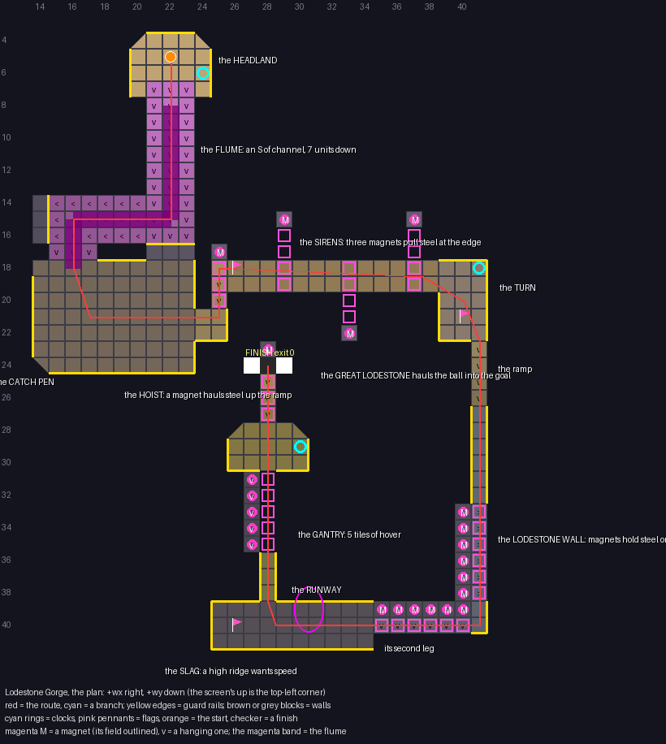

# COURSE 6, "Lodestone Gorge" (LODE): design sheet

*Status: **PEN-IN, attempt 1** (2026-11-25), the first step of the guide's pipeline
([README.md](README.md) section 3): designed for LOOKS and FUNCTION. The engine's
constraints it meets are listed in section 10, "Risks for refinement", for the step
after this one. `lode/sketch.py` draws the pictures and writes the course (`--bbc`),
which is `apps/bonanza/courses/lode.bbc`. It COMPILES with `tools/bbcourse.py` and its
route demo finishes. It is not in the build, not on the pathway and not a `guide`
course yet. Distances are tiles and heights are units; the cells are the engine's own.
A number marked MEASURED was run on the tool's model (`bbcourse.Physics`), never on an
emulator; one marked PREDICTED is arithmetic.*

**The idea.** STEEL's own course (the guide's G13: "each other ball may have one focus
course"), on DOWNHILL DECISION's steel exit: the player leaves that course as steel
and starts this one as steel. It is a SPIRAL into a quarry, the GREAT LODESTONE on an
island in its middle, in sight from the second screen on and reached last. MAGNETS are
its one new idea, and every meeting turns them over:

| meeting | the magnet... | so magnets... |
|---|---|---|
| the HOIST | stands at the top of a ramp no steel ball climbs, and hauls the ball up it | HELP |
| the SIRENS | stand across a gap from a bridge and pull the ball at its edge | HURT |
| the LODESTONE WALL | line the high side of a tilted ledge and hold the ball on it | HOLD |
| the GANTRY | hang over five tiles of void: the ball hovers under them | FLY |
| the GREAT LODESTONE | hauls the ball up the last ramp into the goal | bring it HOME |

| field | value |
|---|---|
| place | course 6, the pathway's pad 5: DOWNHILL DECISION's exit 1, the steel finish (section 7) |
| world | a quarry cut into a hillside: stone galleries, a flume, a moat of void |
| ball | **STEEL from start to finish** (`ball steel`). No pad |
| finish | ONE: the goal at the top of the last ramp, at the great lodestone's foot |
| families | `magnet` (resident). The flume and the ridge are FIELD cells: no family |
| new to the pathway | MAGNETS, in three forms (a side magnet's pull, a fence of them, a row of hanging ones); the FLUME (an S of 3-wide channel) |
| target time | 55 - 60 s for a first clear, 40 s for a good one (`target 60`'s class, `limit 99`). MEASURED on the model: the route demo 37.8 s, no falls |
| palette | the default (cyan, magenta, white): cold stone and magenta lodestones. The owner's call |
| clocks | 3: start, the turn, the vault. An ORE CART that fills along the way (section 9) |
| song | NEW, the music agent's (section 9): heavy, driving, a work song. `music fairway` stands in |
| the one new idea | **something outside the ball pulls it, and it is steel's alone.** Speed beats a pull; a pull can carry |
| picture | 1,024 x 736 px (`width 128`, `origin 480`); the floors are 656 px across |




## 1. The course, section by section

```
 HEADLAND (start) --> the FLUME (an S, 7 units down) --> CATCH PEN --> the HOIST (2 up)
                                                                           |
        TURN (flag 1) <------- the SIRENS' bridge: a tug, a pull, a hard pull (flag 0)
          |
        ramp (4 down)                      .-- the GREAT LODESTONE: the last ramp, the goal
          |                                |
        ledge                           apron (an island)
          |                                ^
   LODESTONE WALL, leg 1                the GANTRY: 5 tiles of hover
          |                                ^
        corner ----> leg 2 ----> the SLAG: a high ridge (flag 2) ----> RUNWAY
```

| | section | what it does | why |
|---|---|---|---|
| A | **the headland** | 5 x 4, railed on three sides, the flume's mouth in the fourth. The start is 3 tiles from it | a safe start. The start clock is on its east side |
| U | **the FLUME** | a `round` channel 3 wide and 8 px deep: down 5 units in a straight, a corner, 1.5 more up-left, a corner, half a unit into the pen. Each corner has a CATWALK on its outside: a strip of floor at the lip with a guard rail on its inner edge | steel's first ten seconds are a RIDE: it is at the cap by the first corner, and the banks turn it. The catwalks are what keep it in (section 3). "Fast sections are entered fast" (G19) |
| B | **the catch pen** | 10 x 7, railed, the flume's mouth in its back-left corner. The hoist's foot is off its east side | steel does not stop short (4.3 tiles from the cap with the brake): a room to arrive in |
| H | **the HOIST** | a 1-wide ramp, 2 units up in 2 tiles: steel STALLS on it (MEASURED: it needs a run-up even for half that slope). A magnet on a post at its top, facing down it (range 3, strength 64), hauls the ball to the top tile; the ball leaves it sideways onto the bridge | **magnets HELP, first**: nothing here can go wrong, and the player learns what the horseshoe and its sparks mean by being carried. It is steel's lift (G18: up, to where steel cannot go) |
| C | **the SIRENS** | a bridge 13 x 2 with no rail, three magnets on lone pillars two tiles of void off its sides, left, right, left: strengths 16, 24, 32. Flag 0 on its first tile | **magnets HURT**: the same horseshoe, now across a gap. The first is a tug, the last pulls a slow ball off (section 3). Speed beats a pull, and a player can lean against one |
| P | **the turn** | 3 x 5, railed, a backstop across the bridge's end. Flag 1. The second clock on its back corner | a fast ball arrives here: the rail is where it stops |
| R | **the ramp** | 1 wide, 4 units down in 4 tiles | the speed for the wall (G19) |
| L | **the ledge and the LODESTONE WALL** | 6 tiles of level ledge, railed both sides; then 6 tiles TILTED half a unit toward the void, a magnet on a post beside each on the high side (strength 8); a corner with a backstop; 6 more tiles, tilted, up-left, the same | **magnets HOLD**: the ledge would tip any ball off (MEASURED: without the magnets steel falls from it at every speed tried; with them it rides the whole leg with no key held across) |
| S | **the SLAG** | a gallery 10 x 3, a HIGH ridge (10 px) across all of it. Flag 2 past it | steel's momentum: the ridge wants three tiles of run (SPEC.md 130.44.5), which the wall's second leg gives. A ball that stopped backs up for one |
| Y | **the runway** | 1 wide, 3 tiles, railed both sides | the ball leaves it STRAIGHT: the hover lane is one tile wide |
| - | **the GANTRY** | five tiles of void. Five posts stand beside the lane on its far side from the camera, a magnet hanging from each over the lane. Steel that rolls off the runway HOVERS at the height it left at, bobbing, and lands on the island's apron | **the signature set piece. Magnets FLY.** MEASURED: steel crosses at 60, 150 and the cap, never under 12.9 units (it left at 13); rubber falls |
| V | **the island and the GREAT LODESTONE** | the apron (5 x 3, half a unit under the runway), a 1-wide ramp 3 units up in 3 tiles, the goal on its top tile, and behind the goal the great lodestone on its post (range 4, strength 104). The third clock on the apron | **magnets bring it HOME**: the hoist again, and this time the tile at its top is the finish. MEASURED: steel nudged onto the ramp's foot reaches the goal in 1.6 s with no key held |

### The spiral

The route winds in: down the left, across the top, down the right, back along the
bottom, and up the middle. The island is in the window from the sirens' bridge on, 3
tiles of void below it, and the player rolls all the way round it before the gantry
lets them on. Nothing drops onto it: the gap is 3 tiles, and none of 72 tries on the
model crossed it (section 3).

## 2. Flags, clocks and the camera

- **Flags (3, all steel)**: flag 0 on the bridge's first tile, before the sirens. Flag 1
  on the turn, before the ramp and the wall. Flag 2 in the slag gallery past the
  ridge, before the gantry. None before the flume or the hoist: nothing there kills.
- **Clocks (3)**: the headland's east side (in the start's window); the turn's back
  corner (in view from the last third of the bridge to the ramp); the island's apron
  (in view from the runway on, and at the finish). On a scratch copy that says `guide`,
  G9 and G10 pass (MEASURED). A fourth clock by the slag was in one window with the
  island's and was taken out.
- **The camera.** A spiral pans: left along the flume's middle leg, right along the
  bridge, left along the wall's second leg. All of it is on the ground or in a channel.
  The one flight is the gantry: 5 tiles up-right, 80 px across. **G3 is at risk**
  (section 10, L7).

## 3. What was MEASURED on the model

- **The flume.** A 2-wide channel (`round` 10 px, `bank` 8 px) threw steel over the
  first corner's lip at every slope tried. The 3-wide `round` 8 px (DOWNHILL DECISION's)
  did the same at the cap, until each corner got its catwalk and rail. With them: steered
  along the S, or with the first arrow simply held all the way, steel arrives in the pen
  in 6 s; with no key at all it stops in the second corner, level, and rolls on when
  pushed.
- **A dish does not belong here.** The first sketch threw the ball from the flume into
  a pit. With a hole it is a well: steel at 250 was in the hole in 2.9 s. With no hole
  it is a trap: steel at rest in a 16 px dish cannot steer out and took 14 s of rocking.
  Taken out.
- **The hoist.** Steel at rest on the ramp's low tile, no key: on the top tile in 0.7 s.
  Rubber the same: it rolls back down. A ramp of 2 units a tile is too steep for a hoist
  (the pull at its foot, a quarter of the strength, has to beat the slope).
- **The sirens**, a ball steered at its lane's centre line: at strengths 16, 24, 32 it
  crosses at 150, 250 and the cap on either lane, and is pulled off at 90. At 16 all
  three it always crosses; at 24, 32, 32 it is lost at 150 as well. A driver that only
  aims at the bridge's far end, at the lab's 48, was pulled off on most tries.
- **The whole course.** The tool's route demo is COMPLETE: 2,063 steps (37.8 s), steel,
  no falls. A plain driver that aims at tile centres: 34.2 s, no falls.
- **The island cannot be reached by falling**: steel sent off the bridge's near edge
  over the island, at four speeds and three slants from each of six tiles (72 tries),
  never lands on it.

## 4. Balls, surfaces, lifts

- **Steel throughout.** The start ball is steel and no pad changes it, so nothing here
  can leave the player with the wrong ball. The demands are steel's: it is slow off the
  mark, climbs nothing, and will not stop. Each section either gives it the speed it
  needs (the flume, the ramp) or a rail to stop against (the pen, the turn, the wall's
  corner).
- **Surfaces**: none.
- **Lifts**: the two hoists. Both go up where steel cannot (G18).

## 5. Precision elements, and the answers to each (G4, G22)

| element | what the player sees | the answers |
|---|---|---|
| the sirens | each magnet on its pillar, its sparks when it pulls, the two lanes | (1) cross fast; (2) take the lane away from each magnet (left, right, left: a weave); (3) lean against each pull. The first siren forgives all three |
| the wall | the fence of magnets, the ledge's tilt, the void on the open side | roll along it. The speed comes from the ramp; a slow ball is held too |
| the ridge | its bands of height, the three tiles of gallery before it | arrive with the wall's speed; or back up and take a run |
| the gantry | the five posts and their hanging magnets, the railed runway aimed down the lane, the island ahead | roll off the end. Any speed |

## 6. The place on the curve (CD2)

A peer of WINDMILL LANE: both follow DOWNHILL DECISION, one by each exit. It is no
harder than MILL to finish, and different in kind. MILL asks for timing; LODE asks the
player to plan for a ball that keeps going.

- **The one new demand**: read a pull and use speed against it.
- **Help given**: the hoist before any siren; the first siren a tug; a rail wherever a
  fast ball arrives; three flags; set pieces that carry (the flume, both hoists, the
  gantry at any speed).
- **Help a later course can remove** (G21): the catwalks at a bend that is entered
  slowly; a gantry with a dead tile (steel at the cap drops 0.7 units crossing one,
  PREDICTED, and a slow ball falls); a wall with gaps in its fence; sirens at 48.

## 7. The pathway

LODE takes pad 5, where the test course MOON stands in today: `route 2 5 exit 1`, DOWN's
steel finish. The player arrives as steel and stays steel. One exit, on to pad 6
(CLOCKWORK KEEP). Its icon idea is in section 9.

## 8. Patterns for the props it uses first (the guide's section 4)

| prop | what it is for | how it is introduced | easy and hard forms | what to avoid |
|---|---|---|---|---|
| **the HOIST** (a side magnet at a ramp's top, its field down the ramp) | steel's lift: a climb only a pull makes | first, before any magnet that hurts, on a ramp in a railed corner | easy: 2 units in 2 tiles, strength 64, range 3. Bigger: 3 units in 3 tiles, strength 104, range 4. The pull at the ramp's FOOT is the strength shifted down once a tile, and has to beat about 12 a unit-a-tile of slope | a slope of 2 a tile (the foot's pull cannot beat it); a post in FRONT of the ramp (it hides the ball): the hoist pulls up the screen; a top tile with no way off sideways |
| **the SIREN** (a side magnet across a gap) | a hazard that speed answers | after a hoist, weakest first, on a 2-wide bridge with a flag at its start | easy: 16, a tug. Middle: 24 - 32, which takes a slow ball. Hard: 48 (the lab's), or a 1-wide bridge. Two gap tiles between pillar and bridge, range 4 | a siren on a tile where the ball has to stop or turn; two in one row (their fields may not meet) |
| **the LODESTONE WALL** (a fence of range-1 magnets beside a tilted 1-wide ledge) | a path only steel can walk | entered with speed, from a ramp, a rail before it | easy: a magnet a tile, half a unit of tilt. Hard: a gap in the fence, where the player steers uphill | posts on the camera's side of the ledge (they hide the ball): the wall is up the screen, the void down it. It costs a magnet a tile |
| **the GANTRY** (a row of hanging magnets) | a gap steel floats over | last, with a railed runway aimed down the lane | easy: every tile covered, a landing half a unit lower. Hard: a dead tile, a turn in the air | posts higher than 15 units (section 10, L2); posts on the camera's side; a lane wider than the row |
| **the FLUME** (an S of 3-wide `round` channel, a railed catwalk outside each corner) | a fast descent the player rides | as the course's opening | easy: every corner railed. Hard: a bend with no catwalk, taken slow | a 2-wide channel for steel; a dish or a pit at its mouth; a corner with nothing outside it |

## 9. The art and music wishlist

### The song (for the music agent)

- **Mood**: a quarry at work. Heavy, steady, proud. A work song that swings a hammer.
- **Tempo and feel**: about 104 - 112, a firm four. Minor or dorian. A low ostinato on
  the beat (the hammer), the tune above it in short strong phrases that each fall back
  onto the same low note - it is PULLED there, as the ball is.
- **Shape**: a rolling opening for the flume (running eighths, downward); the tune
  proper from the hoist on; a lift into major for the last eight bars, as the gantry
  and the lodestone bring the ball home.
- **On the PC speaker**: one voice. Let the ostinato's low note and the tune share it
  by alternating (low on the beat, tune off it): it will sound like striking.
- It should not sound like DOWNHILL DECISION's (speed, bright): this is weight.

### The art (for the art agent)

- **Theme**: an open quarry. Cold grey stone, timber props, magenta LODESTONES (the
  magnets' own ink) growing out of the rock.
- **Clocks**: an ORE CART on a stub of track, the digits painted on its side. What is
  IN the cart says where the player is: empty at the headland, half full of lodestone
  at the turn, heaped and glowing on the island. No flat panel (G23).
- **The great lodestone**: custom art over the last magnet's post - a boulder of
  lodestone twice a horseshoe's size, the engine's sparks coming off it. It is the
  picture the spiral turns round.
- **Signs and decals**:
  - at the hoist's foot, an arrow up the ramp with a horseshoe on it (the first time the
    glyph is seen, next to what it does);
  - on the bridge before the first siren, "KEEP MOVING", or wordless: a ball with speed
    lines passing a horseshoe;
  - on the ledge before the wall, a horseshoe and a tilted line;
  - on the runway, an arrow across the void under a row of horseshoes;
  - timber props and lanterns on the catwalks; a spoil heap by the slag ridge.
- **The pathway icon** (32 x 24): a horseshoe magnet over a steel ball, two sparks. Idle
  animation: the sparks flicker, the ball lifts a pixel.
- **No gate.**

## 10. Risks for refinement

| | risk | what the pen-in did | what refinement has to settle |
|---|---|---|---|
| **L1** | **`chute 3` is ON TRIAL** (SPEC.md 130.28.3: the owner's playtest of DOWN decides whether it stays). The flume needs it: a 2-wide corner will not hold steel | uses it | if 3-wide goes, the flume becomes ramps and railed turns |
| **L2** | **A hanging magnet's ceiling is a signed byte of px**: its post may not stand over 15.3 units ("its ceiling 180 px is outside -128 - 127" at 22) | the WHOLE course is 8 units lower than first drawn: 23 at the headland, 14.5 at the gantry's posts | fine as it is, but the course cannot be raised, and a taller one would need the field widened |
| **L3** | **323 occluder masks, over the 256 of one table.** The posts (22 of them), the flume's banks and the rails are what cut them | `masks banded` (SPEC.md 130.52), which no shipped course has opted into | trim with `noocclude` behind the posts (a ball there is falling), or accept the banded table |
| **L4** | **The budget**: LZ4 19,187 bytes, over 1.5 x the 60 s class (18,825) by 362; reported, not refused. The picture part is 50,260 bytes of 65,024 | nothing | the posts again; the 90 s class |
| **L5** | **22 magnets.** Each is a prop record and a 3-pose lane. The part's cost on the step the ball's cell changes is a walk of every magnet: about 0.2k clocks a record (SPEC.md 130.33.8, PREDICTED there for 11), so about 4.5k here | nothing | MEASURE it on MartyPC (the final pass's). If it is too much: a magnet every other tile on the wall with a gentler tilt, or the wall's second leg plain |
| **L6** | **The catwalks' rails stand beside FIELD cells.** The tool accepts a rail between a floor and a FIELD cell, and the model stops the ball at it; it is the only thing that keeps steel in the flume | as designed | one look on MartyPC: the first corner's rail is on the camera's side of the channel |
| **L7** | **G3**: the gantry's hover is a flight of 5 tiles, 80 px across. `--guide` on a scratch copy finds no complete run as a guide course yet, so it is unmeasured | not `guide` | measure; a hover is not steered much (the runway aims it), so it may earn the cannon's exemption |
| **L8** | **The goal is a magnet's field cell**, and the last hoist finishes the course with no key held | compiles, and the model finishes | the owner's call on whether a finish the player is carried into is wanted; if not, the goal moves one tile to the side of the ramp's top |
| **L9** | **The sirens' strengths were tuned on a model driver**, not by hand | 16, 24, 32 | the owner's play |
| **L10** | **A course whose ball is steel.** `ball steel` compiles (the magnet lab's does). The game's first-run and resume paths have only met rubber courses | nothing | check the pathway's resume and the title's demos with a steel course |
| **L11** | **A 0.57 s hidden stretch at the start** in the tool's visibility report (the route's cells (22, 5) and (23, 5)); reported, not refused | nothing | move the start clock or a rail |
| **L12** | **Steel that stops in the flume's level corner** stays there until pushed (MEASURED) | nothing | fine, but a slope through the corner would not be accepted by the tool (corners are level) |
| **L13** | **The island is 3 tiles of void from the bridge.** Nothing reached it by falling in 72 tries on the model (section 3), but the sweep is steel only and takes no Hop | the gap is 3 | keep the gap when the layout moves; the tool's own reach should be asked the same |

## 11. A new engine prop, PROPOSED (the course plays without it)

**A pulsed magnet**: `pulse <on> <off> [seed <n>]` on a magnet, a popspike's timer: it
pulls only while it is on, its sparks showing when. A gantry whose middle magnet pulses
is a hover the player has to time; a pulsed siren can be waited out. It is the gust's
rule (SPEC.md 130.34.1 D4: a function of the step counter, no state) read where the
magnet part tests its field: PREDICTED about 20 bytes of `fam/magnet.asm` and three of
the record. Nothing above needs it.

## 12. How the pictures and the course are made

```
python3 docs/plans/bonanza-courses/lode/sketch.py                 # plan.png, iso.png, the clocks' spacing
python3 docs/plans/bonanza-courses/lode/sketch.py --bbc --force   # apps/bonanza/courses/lode.bbc
python3 tools/bbcourse.py -o DIR apps/bonanza/courses/lode.bbc    # alone: about 40 s
python3 tools/bbcourse.py apps/bonanza/courses/lode.bbc --png DIR # the engine's own picture
```

`../penkit.py` is the pen the three sketches of courses 5 - 7 share.
