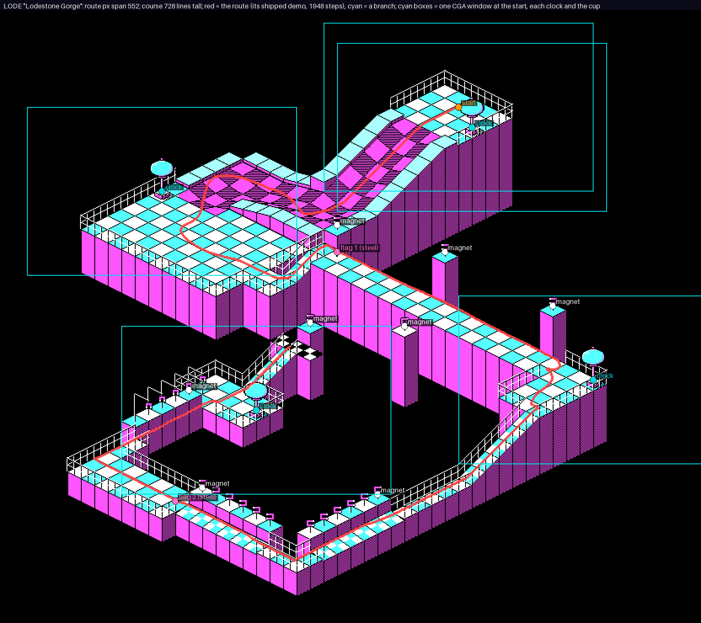
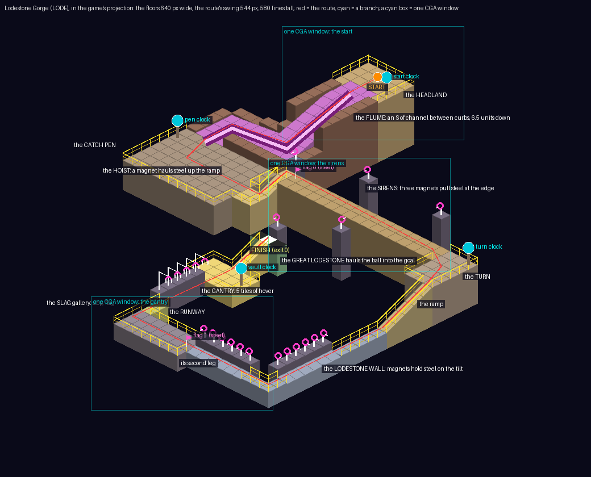

# COURSE 6, "Lodestone Gorge" (LODE): design sheet

*Status: **REFINED** (2026-11-25), the second step of the guide's pipeline
([README.md](README.md) section 3): the pen-in of the same day, designed for looks and
function, fitted to the engine's constraints. `apps/bonanza/courses/lode.bbc` says
`guide` and passes every check a shipped course is held to (section 10); it is NOT in
the build yet (no `BZ_COURSES` entry, no pathway pad: a later step's). `lode/sketch.py`
draws the pictures and writes the course (`--bbc`). Distances are tiles and heights are
units; the cells are the engine's own. A number marked MEASURED was run on the tool's
model (`bbcourse.Physics`, `Glide`), never on an emulator and never by a player; one
marked PREDICTED is arithmetic. Section 11 is what refinement changed and why, section
12 each risk's outcome, section 13 the owner's playtest list.*

**The idea.** STEEL's own course (the guide's G13: "each other ball may have one focus
course"), on DOWNHILL DECISION's steel exit: the player leaves that course as steel
and starts this one as steel. It is a SPIRAL into a quarry, the GREAT LODESTONE on an
island in its middle, in sight from the sirens' bridge on and reached last. MAGNETS are
its one new idea, and every meeting turns them over:

| meeting | the magnet... | so magnets... |
|---|---|---|
| the HOIST | stands at the top of a ramp no steel ball climbs, and hauls the ball up it | HELP |
| the SIRENS | stand across a gap from a bridge and pull the ball at its edge | HURT |
| the LODESTONE WALL | line the high side of a tilted ledge and hold the ball on it | HOLD |
| the GANTRY | hang over five tiles of void: the ball hovers under them | FLY |
| the GREAT LODESTONE | hauls the ball up the last ramp into the goal | bring it HOME |

| field | value |
|---|---|
| place | course 6, the pathway's pad 5: DOWNHILL DECISION's exit 1, the steel finish (section 7) |
| world | a quarry cut into a hillside: stone galleries, a flume between stone curbs, a moat of void |
| ball | **STEEL from start to finish** (`ball steel`). No pad |
| finish | ONE: the goal at the top of the last ramp, at the great lodestone's foot |
| families | `magnet`, 22 elements (home `resident`: section 7). The flume is FIELD cells and its curbs are walls: no family |
| new to the pathway | MAGNETS, in three forms (a side magnet's pull, a fence of them, a row of hanging ones); the FLUME (an S of 3-wide channel between curbs) |
| target time | 55 - 60 s for a first clear, 40 s for a good one (`target 60`'s class, `limit 99`). MEASURED on the model: the route demo **35.7 s** (1,948 steps), no fall (section 3) |
| palette | the default (cyan, magenta, white): cold stone and magenta lodestones. The owner's call |
| clocks | 4: start, pen, turn, vault. An ORE CART that fills along the way (section 9) |
| song | NEW, the music agent's (section 9): heavy, driving, a work song. `music fairway` stands in |
| the one new idea | **something outside the ball pulls it, and it is steel's alone.** Speed beats a pull; a pull can carry |
| picture | 832 x 728 px (`width 104`, `origin 272`); the floors are 640 px across. ONE part, 54,871 bytes |






## 1. The course, section by section

```
 HEADLAND (start) --> the FLUME (an S between curbs, 6.5 units down) --> CATCH PEN --> the HOIST (2 up)
                                                                                           |
            TURN <------------ the SIRENS' bridge: a tug, a pull, a hard pull (flag 0) <---'
              |
            ramp (5 down)                     .-- the GREAT LODESTONE: the last ramp, the goal
              |                               |
            ledge                          apron (an island)
              |                               ^
       LODESTONE WALL, leg 1               the GANTRY: 5 tiles of hover
              |                               ^
            corner --> lead-in --> leg 2 --> the SLAG gallery (flag 1): stop, turn up the RUNWAY
```

| | section | what it does | why |
|---|---|---|---|
| A | **the headland** | 5 x 4, railed all round but the flume's mouth. The start is 3 tiles from it | a safe start: a single arrow held from it ends in a railed corner or in the flume (MEASURED, all eight). The start clock is on its east side |
| U | **the FLUME** | a `round` channel 3 wide and 6 px deep between low stone CURBS (walls half a unit proud of the lip): down 5 units in a straight, a corner, 1.5 more up-left, a corner, and a LEVEL last leg into the pen | steel's first ten seconds are a RIDE: it is at the cap by the first corner, and the banks and curbs turn it. Nothing done in it loses the ball (section 3). "Fast sections are entered fast" (G19) |
| B | **the catch pen** | 10 x 7, railed, the flume's mouth in its back-left corner. The hoist's foot is off its east side. The pen clock on its west edge | steel does not stop short (4.3 tiles from the cap with the brake): a room to arrive in |
| H | **the HOIST** | a 1-wide ramp, 2 units up in 2 tiles, railed both sides: steel STALLS on it. A magnet on a post at its top, facing down it (range 3, strength 64), hauls the ball to the top tile; the ball leaves it sideways onto the bridge | **magnets HELP, first**: nothing here can go wrong, and the player learns what the horseshoe and its sparks mean by being carried. It is steel's lift (G18: up, to where steel cannot go) |
| C | **the SIRENS** | a bridge 17 x 2 with no rail, three magnets on lone pillars two tiles of void off its sides, far, near, far: strengths 16, 24, 32, four tiles apart, the first five tiles from the flag. Flag 0 on its first tile | **magnets HURT**: the same horseshoe, now across a gap. The first is a tug, the last takes a slow ball off (section 3). Speed beats a pull, and a player can lean against one |
| P | **the turn** | 3 x 5, railed, a backstop across the bridge's end. The third clock on its back corner | a fast ball arrives here: the rail is where it stops |
| R | **the ramp** | 1 wide, 5 units down in 5 tiles, railed both sides | the speed for the wall (G19) |
| L | **the ledge and the LODESTONE WALL** | 5 tiles of level ledge, railed both sides; then 6 tiles TILTED half a unit toward the void, a magnet on a post beside each on the high side (strength 8); a corner with a backstop; 2 level railed tiles; 6 more tilted tiles, up-left, the same | **magnets HOLD**: the ledge would tip any ball off (MEASURED: rubber falls from it; steel is held at every speed and against every arrow). It LOOKS like the course's most dangerous stretch and is its safest |
| S | **the SLAG gallery** | 7 x 3, railed all round. Flag 1 on its east door, where the wall's leg ends | steel arrives at the cap and stops against the west rail, then turns up the runway. The flag is before the one thing left that can kill (G20) |
| Y | **the runway** | 1 wide, 2 tiles, railed both sides, up from the gallery's west column | the ball leaves it STRAIGHT: the hover lane is one tile wide |
| - | **the GANTRY** | five tiles of void. Five posts stand beside the lane on its far side from the camera, a magnet hanging from each over the lane. Steel that rolls off the runway HOVERS at the height it left at, bobbing, and lands on the island's apron | **the signature set piece. Magnets FLY.** MEASURED: steel crosses at 150 and at the cap between 12.6 and 13.6 units (it left at 13); rubber falls |
| V | **the island and the GREAT LODESTONE** | the apron (5 x 3, half a unit under the runway, railed all round but the landing and the ramp's foot), a 1-wide ramp 3 units up in 3 tiles, railed both sides, the goal on its top tile, and behind the goal the great lodestone on its post (range 4, strength 104). The fourth clock on the apron | **magnets bring it HOME**: the hoist again, and this time the tile at its top is the finish (section 12, L8) |

### The spiral

The route winds in: down the left, across the top, down the right, back along the
bottom, and up the middle. The island is 4 tiles of void below the bridge and 3
columns of void east of the hoist's foot, with black void on every side of it in the
picture, and the player rolls all the way round it before the gantry lets them on. Nothing drops onto
it (section 3).

## 2. Flags, clocks and the camera

- **Flags (2, both steel)**: flag 0 on the bridge's first tile, before the sirens. Flag 1
  on the gallery's door, before the gantry. None before the flume or the hoist, and none
  at the turn: nothing after the sirens kills until the gantry (section 3: the wall
  cannot be fallen from), and a flag stands only before what can (G20). NO TRAP passes
  from the start and each flag.
- **Clocks (4)**, positions FINAL (section 9 says what is behind each):

  | | cell | where | its digits (px, line) |
  |---|---|---|---|
  | start | (24, 6) | the headland's east side, off the way | 552, 112 |
  | pen | (14, 19) | the pen's west edge, a tile from the flume's mouth and off the line out of it | 184, 184 |
  | turn | (45, 18) | the turn's back corner | 696, 408 |
  | vault | (32, 30) | the island's apron, east of the landing | 296, 448 |

  G9: the start's window holds clock 0. G10: no two fit one window - the closest pairs
  are start and pen, 384 x 80 px together (a window is 320 x 200: 64 px to spare
  across), and pen and vault, 128 x 272 (72 lines to spare). Each of the 3 goal cells
  has the vault clock in the window centred on it. G11: no run touches a clock. G12: the
  longest stretch with no clock in view is **7.0 s** on both cards (MEASURED, `--guide`,
  the route and the route demo): the hoist and the first two thirds of the bridge on
  one, the ramp and the wall on the other. (With the pen-in's three clocks it was
  13.7 s: the pen clock is what refinement added.)
- **The camera** (G2, G3), MEASURED on the route:
  - **Ten pans across on the CGA (160 columns, 4.5 a second), nine on the Hercules
    (156), all on the ground**: two left in the flume, three right along the bridge,
    four left down the wall and into the gallery, one right on the last ramp. No
    reversal, no stall (`--pans`).
  - **ONE flight in the whole course, the gantry's, and it does not pan on either
    card.** In the air for 1.6 s, its px runs from 159 to 251; the nearest edge of the
    camera's band is 21 px away on the CGA and 56 px on the Hercules.
  - **The picture's LEFT EDGE frames it, and `origin 272` is that edge.** The ball
    comes west along the gallery and turns back east up the runway, so the hover is 92
    px of flight straight after a U-turn. The camera LEADS: a window that had followed
    the ball freely would have it 136 - 200 px from its left edge at the turn, and the
    band ends at 280, so the hover would pan. But a window cannot go left of the
    picture, and at `origin 272` (the least the reach allows: the void band off the
    gallery's west corner starts at px 8) the gallery's pocket is 112 px from that
    edge: the window stops there, the ball turns at 112, takes off at 159 and stops
    bouncing at 251. **Every line that comes along the gallery is framed the same**,
    whatever its speed. A picture that needs more room takes `width`; the origin stays.
  - **After a respawn at flag 1** the camera cuts and centres, and its band is the
    narrower one (80 - 240, no hysteresis). The flag is 6 tiles east of the pocket for
    this: the ball rolls west 96 px before it turns, the window follows it to the edge,
    and the flight is framed as on the first try. MEASURED: 36 lines from the flag on
    each card (three rows of the pocket, four speeds, three places across the runway):
    none pans. A flag nearer than 5 tiles to the pocket would pan the hover's last tile
    on the CGA (MEASURED from 3 tiles: all 36 lines, up to 13 columns).
  - **No other air.** The pen-in's wall hung a quarter of a unit under each of its four
    joins, and each was a 7-frame flight in the middle of a pan (G3 refused it three
    times over). The legs tilt about their centre line now and the ball crosses each
    join within a pixel of its height: the engine keeps a ball on the ground across a
    drop of up to 1 px (`STICK`).
  - **The camera's guarantees** (SPEC.md 130.17.6.5, `--camcheck`): section 10.

## 3. What was MEASURED on the model

*`bbcourse.Physics` on the course file as it stands. "An arrow" is one key (the ball
moves on the screen's diagonal); "an arrow pair" is the two that move it along a tile
axis.*

- **The start.** Each of the eight arrows and pairs held from the start for 16 s ends
  at rest in a railed corner of the headland, against its back rail, or (the pair
  toward the flume) in the pen. No fall.
- **The flume, ridden.** The pair toward the flume held all the way: in the pen in
  7.7 s, the banks and curbs doing the steering. Steered round the S on 180 timings of
  the two turns (the first 1.6 - 4.7 s after the start, the second 0.5 - 3.5 s after
  it): in the pen on 178, in 5.8 - 10.0 s. **No ball leaves the flume on any of 6,480
  timings of single arrows and pairs**, and none fell in 400 random walks of 22 s from
  the start. The pen-in's flume lost 404 of those 6,480 over the first corner's east
  lip and the middle leg's far bank.
- **The flume's mouth into the pen.** A chute ends in a TAPER: the channel rises to
  its lip in one tile, and steel cannot climb a slope from rest on it. With the arrows
  held, a ball that comes into the last corner at any speed from 0 to the cap is out
  in 0.9 - 1.5 s. Coasting, it needs 260. A ball at REST in the last corner or leg (15
  places tried, and a ball rolled back in from the pen at three speeds): the pair held
  toward the pen takes 11 of the 15 out; **backing up for two seconds and coming again
  takes out 14, and one of the two always works.** No rocking is ever needed (section
  12, L12, is what the pen-in's mouth did).
- **A dish does not belong here** (the pen-in's: with a hole it is a well, without one
  a trap that took 14 s of rocking). Taken out at the pen-in.
- **The hoist.** Steel at rest on the ramp's low tile, no key: carried to the top tile
  and held there. From rest on the foot with the pair held up it: on the top tile in
  1.7 s, and on the bridge 0.7 s after the pair toward the bridge. Rubber the same:
  it rolls back down. On the top tile the magnet holds the ball against every arrow
  but the three that point at the bridge.
- **The sirens** (strengths 16, 24, 32), from REST on flag 0:
  - the pair along the bridge held and nothing else, on either lane: **across**, at
    every starting speed from 0 to the cap. The ball swerves at each magnet and is
    going too fast by the third to be taken;
  - holding a lane and capped at 200: across in 5.9 s. Capped at 120: lost, on either
    lane; down the middle, across in 9.1 s;
  - the WEAVE (the lane away from each magnet): across at every speed tried, down to
    90 (11.9 s);
  - COASTING (no key) onto the bridge at 200 - 384: lost at one siren or another on 7
    of 8 tries (the eighth stops on the bridge); at 150 it stops before the first.
  - So a siren takes a ball that creeps or coasts. It never takes one that keeps going.
- **The wall.** From the turn at rest, the pairs down the ramp and along the legs: in
  the gallery in 7.0 s. Pushing OUT on either leg, one arrow or the pair: still held,
  in the gallery in 7.0 - 9.0 s. At rest on each of the 12 tilted tiles, each of 9 keys
  held for 9 s: on the wall every time. 300 random walks of 36 s from the ledge: two
  falls, both at the gantry. Rubber on the first leg: off it at once.
- **The gallery to the goal.** From rest on flag 1: the pair west to the pocket, then
  the pair up the runway HELD: in the goal 6.4 s after the flag, no other key.
- **The gantry.** Off the runway's end at 150 with no key: 151 steps in the air between
  12.60 and 13.59 units, on the apron 2.8 s later. At the cap: 65 steps, 1.2 s. Steel
  that creeps off it at 30 floats across in 18 s. From 9 places across the runway, at
  4 speeds, with a sideways drift of 0, 20 or 40 either way, the pair held: across on
  180 of 180. **The one way to fall is to steer sideways in the air**: of 300 random
  walks of 36 s from flag 1, 47 fell, every one out of the lane.
- **A ball that STOPS under the gantry** hangs there, and it rises: the magnets' pull
  drifts a still ball up to their ceiling (4 px over the posts' tops, SPEC.md 130.33.4),
  and it is over the tops after 5.4 s. From there the pair held at the posts lands it on
  one; it can roll along the five of them and drop onto the apron, back into the lane,
  or off the far side. It is the engine's rule, not a softlock (the posts' tops keep
  their occluders for it), and section 13 asks the owner about it.
- **The island.** Landing at 5 places across the lane, at 40 - 300, with a sideways
  drift of up to 80, on each of six keys: no fall in 450 runs (201 end in the goal, the
  rest at rest on the apron). From rest on each of the apron's 14 free tiles with each
  of eight keys: no fall. From rest on the landing with the pair held at the ramp: in
  the goal in 2.2 s. A ball that coasts onto the ramp's foot at 150 is carried the rest
  with no key (1.1 s); at 40 it stops short of the foot. (The pen-in's island: 43 of
  104 single arrows held from rest ended in a fall, and a ball that landed a quarter
  tile off centre and held straight on was hauled off the ramp's side.)
- **The island cannot be reached by falling**: steel sent off the bridge's near edge
  toward it from 20 places, at four speeds and five slants, with no Hop, one, or two
  (11,600 tries): none lands on it. The nearest dies 0.58 tiles short of the
  lodestone's row.
- **NO SOFTLOCK at rest.** Steel at REST on each of the course's 260 standable tiles,
  moves of one arrow or pair held for 0.5 - 9.5 s and then let go: the GOAL is
  reachable with no fall from 257 of them, and a fall is reachable from all 260. The
  three are the bridge tiles beside each siren, where a still ball is pulled off
  whatever it does - and no ball is ever still there. From no tile does every arrow
  leave the ball where it is.
- **The whole course.** The route demo is COMPLETE: 1,948 steps (35.7 s), steel, NO
  fall and no return, 2 flags touched. It is the arrows-only autopilot: no Hop.

## 4. Balls, surfaces, lifts

- **Steel throughout.** The start ball is steel and no pad changes it, so nothing here
  can leave the player with the wrong ball. The demands are steel's: it is slow off the
  mark, climbs nothing, and will not stop. Each section either gives it the speed it
  needs (the flume, the ramp) or a rail to stop against (the pen, the turn, the wall's
  corner, the gallery).
- **Surfaces**: none.
- **Lifts**: the two hoists. Both go up where steel cannot (G18).

## 5. Precision elements, and the answers to each (G4, G22)

| element | what the player sees | the answers (MEASURED, section 3) |
|---|---|---|
| the sirens | each magnet on its pillar, its sparks when it pulls, the two lanes | (1) keep going: the pair along the bridge alone crosses; (2) take the lane away from each magnet (far, near, far: a weave), at any speed; (3) lean against each pull. What loses the ball is stopping, creeping or coasting |
| the wall | the fence of magnets, the ledge's tilt, the void on the open side | roll along it. It cannot be fallen from |
| the gantry | the five posts and their hanging magnets, the railed runway aimed down the lane, the island ahead | roll off the end and do not steer. Any speed |
| the great lodestone | the ramp between its rails, the goal's checker at its top, the lodestone over it | roll at the ramp's foot |

## 6. The place on the curve (CD2)

A peer of WINDMILL LANE: both follow DOWNHILL DECISION, one by each exit. It is no
harder than MILL to finish, and different in kind. MILL asks for timing; LODE asks the
player to keep a ball going that would rather keep going anyway, and to trust a pull.

- **The one new demand**: read a pull and use speed against it.
- **Help given**: the hoist before any siren; the first siren a tug; a rail or a curb
  wherever a fast ball arrives; a flag before each of the two things that kill; set
  pieces that carry (the flume, both hoists, the wall, the gantry at any speed).
- **Help a later course can remove** (G21): the flume's curbs at a bend that is entered
  slowly; a gantry with a dead tile (steel at the cap drops 0.7 units crossing one,
  PREDICTED, and a slow ball falls); a wall with gaps in its fence; sirens at 48, or on
  a 1-wide bridge; the rails on a hoist's ramp.

## 7. The pathway

LODE takes pad 5, where the test course MOON stands in today: `route 2 5 exit 1`, DOWN's
steel finish. The player arrives as steel and stays steel. One exit, on to pad 6
(CLOCKWORK KEEP). Its icon idea is in section 9. Nothing of this is wired: `path.bbc`
and `BZ_COURSES` are a later step's.

**What a course whose ball is steel needs there** (L10, read off the code and the
SPEC, no engine change made or wanted):

- **Nothing carries a ball between courses.** Every play starts with its course's own
  ball: `bz_gcrs` and the pause card's retry both load `[bz_mat]` from `bz_cballs`
  (`apps/bonanza/bonanza.asm`; SPEC.md 130.26.8, 130.11.5.4), and a best time is kept
  only for a play started with it. So "arrives as steel" is `ball steel` and nothing
  else, and it would be steel after WINDMILL LANE too.
- **A steel-start course on a pad is already played by the rows**, in the test build:
  TCUP (`ball steel`) is pad 3 of `pathdev.bbc`, and the rows walk onto it, finish it,
  leave by its exit and keep its best time (`tests/suite.py`: `bonanzapath`'s diagonal
  to pad 3, `bonanzaexit`'s cup, `bonanzagame`'s second best). TTALL and TWIDE start as
  steel too.
- **The pathway's own ball stays rubber** (`path.bbc`'s `ball rubber`): the ball the
  player rolls between pads does not change.
- **The title's demos are their own** (`title<N>.bzt`, each with its ball: demo 2 is
  steel already), and a course's shipped demo replays with the ball its log names
  (`BZR_MAT`): LODE's route demo says steel.
- **MAGNETS is home `resident` already** (`FAMILIES`' row: the owner's rule of
  2026-11-17, every family resident unless chosen otherwise; SPEC.md 130.33.9's "`fetch`
  until a shipped course names magnets" is older than that rule). Its part rides the
  resident bundle `bzfbun.bin`, so LODE's launch fetches no family and the arena's
  claim does not move: section 10's private build.

## 8. Patterns for the props it uses first (the guide's section 4)

| prop | what it is for | how it is introduced | easy and hard forms | what to avoid |
|---|---|---|---|---|
| **the HOIST** (a side magnet at a ramp's top, its field down the ramp) | steel's lift: a climb only a pull makes | first, before any magnet that hurts, on a ramp in a railed corner | easy: 2 units in 2 tiles, strength 64, range 3, the ramp railed. Bigger: 3 units in 3 tiles, strength 104, range 4. The pull at the ramp's FOOT is the strength shifted down once a tile, and has to beat about 12 a unit-a-tile of slope | a slope of 2 a tile (the foot's pull cannot beat it); a post in FRONT of the ramp (it hides the ball): the hoist pulls up the screen; a top tile with no way off sideways; **an unrailed ramp**: the pull is 448 a step at the top and takes a ball that came in on a slant over the side (MEASURED on both of the pen-in's) |
| **the SIREN** (a side magnet across a gap) | a hazard that speed answers | after a hoist, weakest first, on a 2-wide bridge with a flag at its start and four or five tiles of run before the first | easy: 16, a tug. Middle: 24 - 32, which takes a slow ball. Hard: 48 (the lab's), or a 1-wide bridge. Two gap tiles between pillar and bridge, range 4 | a siren on a tile where the ball has to stop or turn (a still ball on the nearer of its two bridge tiles is lost whatever it does); two in one row (their fields may not meet) |
| **the LODESTONE WALL** (a fence of range-1 magnets beside a tilted 1-wide ledge) | a path only steel can walk | entered with speed, from a railed ramp, a level railed ledge before each leg | easy: a magnet a tile, half a unit of tilt: it cannot be fallen from. Hard: a gap in the fence, where the player steers uphill | posts on the camera's side of the ledge (they hide the ball): the wall is up the screen, the void down it. **A leg that hangs under its joins**: tilt it about its CENTRE line (a quarter up, a quarter down) and keep the floors either end level at that line, or every join is a hop. It costs a magnet a tile |
| **the GANTRY** (a row of hanging magnets) | a gap steel floats over | last, with a railed runway aimed down the lane | easy: every tile covered, a landing half a unit lower, railed. Hard: a dead tile, a turn in the air | posts higher than 15.25 units (section 12, L2); posts on the camera's side; a lane wider than the row; a flight ACROSS the screen that the camera has to follow (5 tiles is 92 px in the air: frame it with the picture's edge, section 2); a place the player waits under it |
| **the FLUME** (an S of 3-wide `round` channel between curbs) | a fast descent the player rides | as the course's opening | easy: curbs all the way, 6 px deep, a level last leg. Hard: a bend with no curb, taken slow | a 2-wide channel for steel; a dish or a pit at its mouth; **a slope behind the last taper** (a ball that stops there sits in a V and only rocking frees it); a guard rail beside a curved channel where a curb will do (the rail needs a floor to stand on and is cut into many occluder masks: section 11) |

## 9. The art and music wishlist

### The song (for the music agent)

- **Mood**: a quarry at work. Heavy, steady, proud. A work song that swings a hammer.
- **Tempo and feel**: about 104 - 112, a firm four. Minor or dorian. A low ostinato on
  the beat (the hammer), the tune above it in short strong phrases that each fall back
  onto the same low note - it is PULLED there, as the ball is.
- **Shape**: a rolling opening for the flume (running eighths, downward); the tune
  proper from the hoist on; a lift into major for the last eight bars, as the gantry
  and the lodestone bring the ball home.
- **On the PC speaker**: one voice. Let the ostinato's low note and the tune share it
  by alternating (low on the beat, tune off it): it will sound like striking.
- It should not sound like DOWNHILL DECISION's (speed, bright): this is weight.
- **Length**: a first clear is 55 - 60 s and the limit is 99 s. On the autopilot's
  35.4 s the ball is in the pen at 6.3 s, on the hoist at 11.9, on the bridge at 13.2,
  at the turn at 17.3, on the ramp at 21.9 and the wall from 24.0 to 28.7, off the
  runway at 32.4 (the hover is 1.6 s) and in the goal at 35.4, if the tune wants to
  mark them.

### The art (for the art agent)

- **Theme**: an open quarry. Cold grey stone, timber props, magenta LODESTONES (the
  magnets' own ink) growing out of the rock.
- **Clocks**: an ORE CART on a stub of track, the digits painted on its side. What is
  IN the cart says where the player is: empty at the headland, a few lumps at the
  pen, half full of lodestone at the turn, heaped and glowing on the island. No flat
  panel (G23).
- **The four clocks' places are final** (section 2's table). What is BEHIND each head
  in the picture as it stands (a clock's art bakes it in):

  | clock | cell | behind its head | beside it |
  |---|---|---|---|
  | start | (24, 6) | the headland's floor (two rows of its checker) and, above that, its east rail and the void | the headland's east rail at its foot; the start two tiles west |
  | pen | (14, 19) | the void: it stands on the pen's back-left corner tile and its head is over the pen's west rail | the flume's last curb (pale stone) a tile to its right; the flume's mouth a tile further |
  | turn | (45, 18) | the turn's back and east rails where they meet, and the void | the third siren's pillar six tiles up-left along the bridge |
  | vault | (32, 30) | the apron's floor and its east rail | the last ramp's rails up-left; the goal's checker and the great lodestone above them |

- **Four limits the art has to keep** (re-run `python3 tools/bbcourse.py -o DIR
  lode.bbc` and `--guide` after any frame or decal):
  - **G10**: the start and pen clocks' digits are 384 px apart across (64 over one
    window) and the pen and vault clocks' 272 lines apart (72 over). A frame that
    moves a clock's digits by less than that keeps them apart.
  - **the masks**: the course names **247 occluder masks of one table's 256**. A clock
    frame is a solid thing a ball can be behind, so a new frame moves the count (the pen
    clock's default frame is 5 of them). If the art takes it past 256 the compile says
    so: the way out is `masks banded` (SPEC.md 130.52, the owner's opt-in: 320 bytes of
    RAM and about 750 of LZ4 on this course), not a smaller clock.
  - **the budget**: LZ4 16,779 against the 60 s class's 1.5x line of 18,825: 2,046
    bytes of room for decals before that line is crossed (it is reported, never
    refused, and DOWN ships 1,925 over its own).
  - **the origin**: `origin 272` frames the gantry (section 2). A picture that needs
    more room takes `width`, which moves nothing.
- **The great lodestone**: custom art over the last magnet's post - a boulder of
  lodestone twice a horseshoe's size, the engine's sparks coming off it. It is the
  picture the spiral turns round. Its post is 2 units over the goal, at (30, 24); the
  bridge's near face is behind it.
- **The curbs** are plain wall tops (the engine's pale stone): dressed-stone coping
  would suit them, and a timber prop or two outside the flume's corners.
- **Signs and decals** (a sign says what to do next, where it is done):
  - at the hoist's foot, an arrow up the ramp with a horseshoe on it (the first time the
    glyph is seen, next to what it does);
  - on the bridge before the first siren, "KEEP MOVING", or wordless: a ball with speed
    lines passing a horseshoe;
  - on the ledge before the wall, a horseshoe and a tilted line;
  - on the runway, an arrow across the void under a row of horseshoes, or "DON'T
    STEER";
  - lanterns on the pen's rail; a spoil heap in the slag gallery's back corner.
- **The pathway icon** (32 x 24): a horseshoe magnet over a steel ball, two sparks. Idle
  animation: the sparks flicker, the ball lifts a pixel.
- **No gate.**

## 10. What the course passes (MEASURED, the file as it stands)

| check | result |
|---|---|
| the compile (`bbcourse.py -o DIR lode.bbc`, alone: about 16 s) | passes, and under `--strict`; no warning, nothing `accept`ed |
| the part | ONE part, **54,871 bytes** of 65,024 (10,153 to spare): map 18,928, 768 blocks, 1,320 occluder records, **247 masks** of 256 (no `masks banded`), grid 11,032, FIELD tables 14 of 32 |
| the course budget (reported, never refused: SPEC.md 130.27.5) | LZ4 **16,779** against the 60 s class's 12,550 (4,229 over) and its 1.5x 18,825 (2,046 under); as the package stores it (LZB) 13,696. Every shipped course is over its class (ROLL 11,460 of 6,275, HOP 11,713 of 6,275, DOWN 20,750 of 12,550 and over its 1.5x, MILL 23,537 of 18,825) |
| the occluder pass | at most 5 records in a block, 33,070 clocks (bound 50,050), 49 in a block row (128) |
| MAGNETS' elements | 22: the hoist 1, the sirens 3, the wall 12, the gantry 5, the great lodestone 1 |
| the windows' bounds (130.19.10) | no FAST lane; 20 lanes in the worst window (unbounded); 3 pose changes on one step (bound 6) |
| the finish's reach (`finish_reach_rule`) | all 3 finish cells reachable past the 4 clock posts |
| the finish's clock (`finish_clock_rule`) | every goal cell sees clock 3 |
| NO TRAP | the start and each of the 2 flags: the model's own search, with the magnets pulling, reaches the goal |
| visibility | 0 marks below, 0 hidden stretches over 0.5 s, the ball over half hidden on 11 of the route's 1,948 steps and never wholly |
| `--guide`, the route and the route demo (`--log BZDLODE.BIN`), both cards | G1 35.4 s; G3 1 flight, 0 panned; G9; G10 4 clocks; G11 none touched; G12 7.0 s / 7.0 s |
| the route demo | 1,948 steps (35.66 s), steel, COMPLETE, 0 falls, 0 returns, 2 of 2 flags, 270 bytes |
| `--pans` (LATTICE, the route demo) | 160 columns (4.49 a second) and 359 rows on the CGA, 156 and 181 on the Hercules; 0 reversals, 0 stalls, 0 column runs |
| the camera's guarantees (`--camcheck`, the eight shipped and nine test courses with KITE and LODE in the list) | **13 items green, none red**: guarantees 1 - 3 over 58 runs (98,826 frames), the two-row check, every tube exit, the side check, MILL's ramp bottom, and the DITHER MAP - 0 of 1,528, 1,514 and 1,460 samples reverse a pan at taps of 8, 15 and 25 steps - with all seven controls red. The hoist is a climbed ramp with a flat top (KITE's K13) and does not trip it: a ball tapped back onto the ramp is hauled up again |
| `--selfcheck` on this course alone (21 sections: `courses`, `gaps`, `routes`, `camcheck`, `clockvis`, `flags`, `hud`, `demos4`, `inc`, `compact`, `dither`, `budget`, `clockrule`, `av`, `guard`, `kit`, `width`, `blocks`, `camstop`, `reachpath`, `magnet`) | **179 items green**, every one that reads the course (53 name it: the picture and its Hercules translation, the grid and SAFE, OCC and OCCG, the merge exact over every query, the composites over 1,506 positions, every pose of its 32 lanes, the flags' records, the demo, the stored form's in-place expansion, the dithered masks, the ground faces, AV's completeness and WRONG-HIDE, the kit) and the `magnet` section's own. The 9 red are the list's, not the course's, the same nine KITE met: each names a shipped course a one-course list has not got (TRIAL's and MOON's clock controls, MILL's two stops, an AUTHOR course, a lift, the pathway's ROLL, and the reach's red arm, which needs a demo that leaves it: with the full list HOP's does) |
| `--selfcheck --only reachpath` with the eight shipped, KITE, LODE and the nine test courses | 6 items green: all 10 shipped demos inside their reach, the red arm left by HOP's demo, and the arm's own round bound (section 12, L14) |
| `--gaps` | 33 candidates, none marked (`gap` is marked by hand, SPEC.md 130.57: the owner's or the art's) |
| in a private build with the eight shipped courses and KITE (`make BUILD=<dir> BZ_COURSES="<the eight> kite.bbc lode.bbc" bonanzadisk`, against the same build without LODE) | course 9 of that build, `BZ9.BIN` the part above (in a row the package already reserves: 46 part rows in both). `BONANZA.O88` 189,190 -> **203,126** (+13,936). `bonanza.bin` 53,650 both (20 bytes of its tables differ; they are `BZ_CRS_MAX` wide already); `BZ_PROPMAX` 50, `BZ_PROPALL` 68, `BZ_FSTB` 22 and `BZ_CRS_MAXCLAIM` 8,256 paragraphs all unmoved: no bss and no claim grows. MAGNETS' part is in the resident bundle in both (`bzfbun.bin` byte-identical). The four disks verify: 1.44MB 383 -> 410 clusters of 2,847, 1.2MB 383 -> 410 of 2,371, 720KB 193 -> 207 of 713, 360KB 193 -> **207 of 354**. Every other course's part and demo, the pathway, the title and the kit are byte-identical in the two builds |

**Not run here, named for the pass that wires the course in** (they are emulator or
soak rows): `bonanzacourse` (the whole selfcheck with LODE in `BZ_COURSES`),
`bonanzaphyshost` (its poisoned plays and `mg_host`), `bonanzaexit`, `bonanzapath`,
`bonanzaring` and `bonanzaperf` (the magnet part walks 22 records on every step the ball's cell changes:
about 0.2k clocks a record, so about 4.5k, PREDICTED from SPEC.md 130.33.8's 11, never
measured: section 12, L5), `bonanzagame`.

## 11. What refinement changed, and why

*The pen-in is commit `0d33d38b`'s `lode.bbc`; its sheet's section 10 listed thirteen
risks (section 12 here). What a player would notice:*

| | the pen-in | as refined | why |
|---|---|---|---|
| **the headland** | two cut back corners, its front open either side of the mouth | square, railed all round | each of the four single arrows held from the start rolled the ball off it in about 3 s (MEASURED): a start is safe (1.10) |
| **the flume's fences** | a railed catwalk outside each corner | low stone CURBS the whole length, both sides | leaks: 404 of 6,480 steering timings went over the first corner's east lip or the middle leg's far bank (MEASURED). Catwalks all round stopped them and cost 48 occluder masks (a rail beside a curved channel is cut into many); curbs are walls with a straight top, hold the same, and are the look of a stone flume |
| **the flume's last leg** | half a unit down into the pen | LEVEL (the headland half a unit lower: 22.5), the channel 6 px deep where it was 8 | L12, and worse than the pen-in feared: a chute's exit is a taper steel cannot climb from rest, and with a slope behind it a stopped ball sat in a V that no arrow and no backing up left - only rocking, 3.5 - 8 s of it (MEASURED). A ball that rolled back into the mouth from the pen was caught the same way |
| **the pen** | a cut corner; open edges beside the flume's mouth | square and railed | the cut corner was a hole in the room steel arrives in at speed (8 of 400 random walks left by it) |
| **the hoist** | an open ramp and top tile | railed both sides, and the foot's back edge | the pull is 448 a step at the top: the arrows-only autopilot came in on a slant and went off the side. "Nothing here can go wrong" is true now |
| **the bridge** | 13 tiles, sirens 3, 7 and 11 tiles along | 17 tiles, sirens 5, 9 and 13 along | length (below), and a longer run at the first siren. Strengths unchanged |
| **flag 1 at the turn** | a flag before the ramp and the wall | gone: 2 flags | the ramp is railed and the wall cannot be fallen from (MEASURED): nothing between the sirens and the gantry kills, and a flag stands only before what can (G20) |
| **the ramp** | 4 units in 4 tiles, open | 5 units in 5, railed; the ledge 5 tiles | the wall's legs are centred a unit lower (next row); an open 1-wide ramp straight after a room is a fall with nothing to learn from it |
| **the wall's legs** | level at the high edge, half a unit down at the open one: a quarter under the ledge, the corner and the gallery at their middles | tilted about the centre line (a quarter up, a quarter down), every floor either end level at that line; a 2-tile level lead-in before the second leg | G3: each of the four joins was a 7-frame flight, and three of them fell in the middle of a pan. No air now |
| **the slag RIDGE** | a HIGH ridge across the gallery | **CUT** (below) | the masks and the budget |
| **the slag gallery** | 10 x 3, flag 2 at its far west end, the runway from its middle | 7 x 3, the flag on its east door, the runway from its west column | the camera: the pocket has to be the picture's left edge (section 2), and a flag in the pocket would pan the hover after a respawn |
| **the runway** | 3 tiles | 2 tiles | 16 px less flight framing to find; the lane is held from any place across it either way (MEASURED) |
| **the island** | two cut corners, an open back, an open ramp; 3 tiles of void from the bridge and one column from the hoist's foot | square, railed all round but the landing and the ramp's foot, the ramp railed; 4 tiles from the bridge and 3 columns from the hoist's foot | 43 of 104 single arrows held from rest on the apron ended in a fall, and a landing a quarter tile off centre was hauled off the ramp's side (MEASURED). And the goal read as part of the pen's block: it is an island now, with void all round it in the picture |
| **the clocks** | start, turn, vault | start, PEN, turn, vault | G12: 13.7 s with no clock in view (the flume, the pen, the hoist and most of the bridge), 7.0 s now |
| **the picture** | 1,024 x 736 px, `origin 480`, two parts of 50,260 and 12,359 bytes, 323 masks under `masks banded`, LZ4 19,187 (362 over its 1.5x) | 832 x 728, `origin 272`, ONE part of 54,871, 247 masks in one table, LZ4 16,779 (2,046 under) | the origin is the camera's (section 2); the width is what the reach needs at it |
| **the route demo** | 37.8 s, found by the Hop search (the arrows fell at the hoist and never finished) | 35.7 s, the arrows alone, no fall | the hoist's rails, and a way on the flag |
| **the length** | 34.2 s by a plain driver | 35.4 s by `--guide` | kept: the gallery's 3 tiles and the runway's 1 that the camera took are back as 4 on the bridge and 2 on the wall's lead-in |

**Not changed**: the five meetings and their order, the spiral, every magnet's strength
and range, the hover's five tiles, steel only, the goal at the last hoist's top.

**Cut: the slag ridge.** It was a HIGH ridge (10 px) across the gallery, flag 2 past
it: "steel's momentum". It is not one of the five meetings, DOWN (the course before
this one) has three ridges of its own, and the autopilot's time is the same with it
and without. What it costs, MEASURED on the course as it stands with the ridge put
back three tiles past flag 1 (the run steel wants at it from rest: over in 3.0 s):
**46 occluder masks** (a ball beside a hump is hidden by a different sliver
of it in every block; a lower ridge and one a tile wide were tried and saved 3 - 15 of
them), 42 blocks and **1,075 bytes** of LZ4. With it the course names 293 masks, so it
needs `masks banded` (748 bytes more), and comes to LZ4 18,552: 273 under its 1.5x
line with nothing left for the art. Nothing else fitted: with the ridge the count
could be brought under 256 only by `noocclude` over the flume's own tiles, which the
tool refuses for a tile on the route and which is not true of them. `RIDGE = 10` in
`lode/sketch.py` puts it back (with `masks banded` in the head): the owner's, section
13.

**`noocclude`, 38 statements.** Most of the pen-in's masks were cut for a ball in the
void BEHIND a rail, where no ball can be: a rail is a wall at every height. The sketch
writes `noocclude` over the void no fall reaches (more than 4 cells out from every
open edge, or wide of it) and over the tiles no ball can get onto (the wall's posts,
the hoists' and the sirens' pillars): the pen-in's 1,906 records are 1,320. A ball that
does fall is still hidden where it should be: every open edge keeps its fall zone (the
bridge's whole length both sides, the gantry's lane, its east side and the void west of
its posts, the landing).

## 12. The pen-in's risks, each one's outcome

| | risk | outcome |
|---|---|---|
| **L1** | `chute 3` is ON TRIAL | **ACCEPTED, and it is not LODE's alone.** The status is one sentence of SPEC.md 130.28.3: the contract is built, checked by `--selfcheck`'s CHUT3 course, and "DOWN is the one course that uses it ... the owner's playtest decides whether it stays". DOWN SHIPS with it today (`down.bbc` line 81, in `BZ_COURSES`), so a shipped course may use it and one does. No guest byte knows a chute's width. If the owner goes back to 2-wide, DOWN's line narrows and LODE's flume has to be re-laid: a 2-wide corner threw steel over its lip at every speed the pen-in tried, but that was without curbs, and between curbs it is worth one try before the flume becomes ramps and railed turns |
| **L2** | a hanging magnet's ceiling is a signed byte of px | **ACCEPTED, the limit recorded.** The ceiling is the post's floor + 4 px and has to fit -128 - 127, so no gantry post stands over **15.25 units** and no runway over 14.5. LODE's posts are at 14.5 (its runway 13). The cost: the whole course sits 8 units lower than first drawn and cannot be raised, and a later course cannot put a gantry on high ground. Section 14 proposes the word |
| **L3** | 323 occluder masks under `masks banded` | **RESOLVED: 247 in one table**, the statement gone. What `masks banded` costs, since it was asked: nothing in the guest (one path reads both forms since 130.51, and every course's `Y` is already 4 bytes a band), and in the course its bands' tables: MEASURED on this one, 320 bytes of RAM and 748 of LZ4. It is exercised by `tests/bonanza_av.py` on a banded ROLL with a red arm, and it is the owner's own opt-in ("eat the size if we need it"): acceptable for a shipped course, and it was not needed once the ridge went and the flume's rails became curbs. It is the art's way out if a frame tips the count (section 9) |
| **L4** | the budget: LZ4 19,187, 362 over 1.5x | **RESOLVED**: 16,729, 2,096 under the 1.5x line (still 4,179 over the class's 12,550, as every shipped course is over its own). ONE part where the pen-in was two |
| **L5** | 22 magnets: the cost of a cell change | **OPEN, unchanged**: still 22, and the walk is PREDICTED at about 4.5k clocks on the step the ball's cell changes. It is MartyPC's to measure (`bonanzaperf`, the final pass's). If it is too much: the wall's lead-in can grow and its second leg lose magnets, a tile each |
| **L6** | the catwalks' rails stand beside FIELD cells | **GONE with the catwalks**, and the question moves to the curbs: they are WALL cells beside FIELD cells. That is the contract's own case (SPEC.md 130.28.5.3: beside a FIELD cell "a WALL blocks and a VOID does not, as ever"; what lies outside a chute's lip is the author's, 130.28.3), and on the model no ball crosses one in 6,480 rides. No shipped course has a wall beside a chute (DOWN's block rails stand beside a ramp), so one look on the glass is still owed (section 13) |
| **L7** | G3: the gantry's hover | **RESOLVED with no exemption**: 0 columns panned on either card, by framing the flight with the picture's left edge (section 2). The pen-in's hover panned 14 columns on the CGA |
| **L8** | the goal is a magnet's field cell: the player is carried into the finish | **KEPT, decided.** The course's argument is its five meetings, and the last one is the first one again with the finish at its top: what the hoist taught as a trick is how the course ends. The player still chooses the moment (the ball has to be rolled onto the ramp's foot; from rest on the landing the pair held does it in 2.2 s, and a ball that coasts short stops on the apron). The alternative - the goal a tile to the side of the ramp's top - makes the last move a sideways nudge against a pull of 104 that pins the ball to the post: MEASURED on the first hoist's top tile, five of the eight arrows do nothing there. That is an anticlimax, and a fiddly one |
| **L9** | the sirens' strengths were tuned on a model driver | **MEASURED again, unchanged** (16, 24, 32): section 3. The honest summary is that they take a ball that creeps or coasts and never one that keeps going. Whether that FEELS like a hazard is the owner's (section 13) |
| **L10** | a course whose ball is steel | **ANSWERED from the code** (section 7): nothing in the engine carries a ball between courses, a steel-start course on a pad is already played by the test build's rows (TCUP), and the title's demos are their own. The one decision for the wiring step is MAGNETS' home |
| **L11** | a 0.57 s hidden stretch at the start | **GONE**: 0 hidden stretches. It was never at the start in play: the arrows-only route fell at the hoist, respawned, and stood against the headland's rail behind the start clock |
| **L12** | steel that stops in the flume's level corner stays there until pushed | **RESOLVED, and it was the mouth, not the corner.** In a level corner a push works. The trap was the exit taper with a slope behind it (section 11). The last leg is level: a ball that stops near the mouth backs up along the channel and comes again, and one of "push" and "back up, then push" works from every place (MEASURED, 15 places and 3 ways in from the pen). A slope through a corner is still not something the tool lays |
| **L13** | the island is 3 tiles of void from the bridge | **RESOLVED**: 4 tiles now, and asked of the model with Hops: 11,600 tries, none lands (section 3). `finish_reach_rule`'s own closure does reach the island (it is a reach over rolls, Hops and bounces of any ball, and a ramp is a ramp to it): the proof that STEEL finishes is NO TRAP, which runs the model with the magnets pulling |

**Found in refinement** (not on the pen-in's list):

| | what | outcome |
|---|---|---|
| **L14** | **`--selfcheck`'s `reachpath` section died on LODE.** Its red arm compiles each demo's course under a reach priced wrong on purpose, and that reach's fixed point takes more rounds than a true one's: LODE's 17 where its own takes 6, one over `REACH_ROUNDS`. The course was refused as unsettled, uncaught, before any demo was asked - and demos are tried shortest first, LODE's the shortest. With LODE in `BZ_COURSES` the `bonanzacourse` row would have crashed | **RESOLVED in the tool**, the one tool change: the arm compiles under a bound of its own (`REACH_TIGHT_ROUNDS` 64; SPEC.md 130.11.4.7). It is `_sc_reachpath`'s alone, so no compile reads it: the default list's five items are the same lines before and after, the new item is green with its control `tightrounds` red, and with LODE in the list the section passes (the slowest reach the arm compiled is LODE's, 17 rounds; under a bound of 16 it is refused). It cannot move a compile, and MEASURED all the same: each of the 40 `.bbc` files of `apps/bonanza/courses/` compiled alone under HEAD's tool and under the changed one gives the same part, stored form and identity (their SHA-256), and the build's own run over the eight shipped courses, KITE, LODE and the nine test courses with the pathway, the title and the kit (`bbcourse.py --dev -o`) writes 37 files under each, every one byte-identical |
| **L15** | **Mini-flights at the wall's joins** (G3) | **RESOLVED in the course**: section 11 |
| **L16** | **Open edges nobody chose**: the hoist's ramp and top, the foot's back edge, the pen's cut corner and its edges by the mouth, the gallery's east end beside the wall's leg, the wall's corner's back cell, the island's back, corners and ramp | **RESOLVED**: railed, each found by holding every arrow from rest on every tile (section 3). The falls that are left are the three the design means: the bridge, the gantry's lane, and nothing else |
| **L17** | **G12**: 13.7 s with no clock in view | **RESOLVED**: the pen clock, 7.0 s |
| **L18** | **The goal read as part of the pen.** At the pen-in's place the great lodestone's post stood against the hoist's foot in the picture, one column of void from it, the goal half a unit lower than the foot (1.10: "keep apart what does not connect") | **RESOLVED**: the runway, the gantry and the island are two columns east |
| **L19** | **A ball that waits under the gantry rises onto its posts** (section 3) | **ACCEPTED, the engine's rule**: no softlock, and section 13 |

## 13. For the owner's playtest

*What only play can settle. Each is one number or one statement in `lode/sketch.py`.*

1. **The sirens** (16, 24, 32): the pair along the bridge held and nothing else always
   crosses. Is a hazard that only takes a ball that hesitates a hazard, or a tug? `SX`
   and the three strengths are one line; 24, 32, 48 takes a ball at 150 on the model.
2. **The wall cannot be fallen from.** It is the course's best-looking stretch and has
   no risk in it. A gap in the fence (one magnet out) makes the player steer uphill for
   a tile: a later course's, or this one's?
3. **The flume's mouth.** Riding it with the arrows held always comes out. A ball that
   STOPS in the last leg has to back up and come again (2 - 4 s). Does a first player
   find that, or sit holding the arrow at the lip?
4. **The slag ridge** is cut (section 11). The gallery is a plain room now. Put back,
   it costs `masks banded` and 1.2 KB.
5. **No flag at the turn.** Nothing kills between the sirens and the gantry, so a ball
   that goes BACK onto the bridge from the turn and is taken respawns at the hoist.
6. **The gantry**: roll off and do not steer. Is "do not steer" something a player
   does? The runway's decal is meant to say it. And a ball that stops under it is over
   the posts in about 5 s and can be steered onto them (section 3): a secret, or a rail
   along the posts?
7. **The ending** is carried (section 12, L8).
8. **The curbs on the glass**: a wall half a unit proud on the camera's side of a 6 px
   channel. The previews say the ball reads; no emulator was booted for this step.
   The same look at the gantry: the hovering ball passes in front of the posts' faces.
9. **The length**: 35.4 s for an autopilot that never hesitates; the sheet's 55 - 60 s
   for a first clear is still PREDICTED.
10. **`chute 3`** (L1): if it goes back to 2, this course's flume is the second thing
    to re-lay.

## 14. Proposed to the owner (the course plays without them)

- **A pulsed magnet** (the pen-in's): `pulse <on> <off> [seed <n>]` on a magnet, a
  popspike's timer: it pulls only while it is on, its sparks showing when. A gantry
  whose middle magnet pulses is a hover the player has to time; a pulsed siren can be
  waited out. PREDICTED about 20 bytes of `fam/magnet.asm` and three of the record.
- **A hanging magnet's ceiling as a word** (L2). The record's +22 is a signed byte of
  px, so no gantry stands over 15.25 units. A word there (the record has 9 spare bytes)
  and one `cmp` widened in `mg_apply` would lift it: a guest change, the owner's.
- **A chute's end without a taper** (L12): `chute ... open` at its last way, the channel
  running out level onto a floor at its BOTTOM's height. Steel would leave a flume as
  it leaves a ramp, and the last leg could slope again. Tool work only (no guest byte
  knows a chute's shape), the same kind as `chute 3`.
- **The hover's ceiling under the posts' tops** (L19): `MG_CEIL` is +4 px, so a ball
  that waits rises over the posts. At -4 it could not. It is in the `FAMV`.
- **The reach by the course's own balls.** `build_reach` launches every floor with the
  largest Hop and boost of ANY ball, so a steel-only course is cut occluders for
  heights no steel ball reaches (the gantry's arms and heads over the lane are most of
  its 23 masks). A reach by `course_balls` would be a compile change for every course
  with one ball: not this step's.

## 15. How the pictures and the course are made

```
python3 docs/plans/bonanza-courses/lode/sketch.py                 # plan.png, iso.png, the clocks' spacing
python3 docs/plans/bonanza-courses/lode/sketch.py --bbc --force   # apps/bonanza/courses/lode.bbc
python3 tools/bbcourse.py -o DIR apps/bonanza/courses/lode.bbc    # alone: about 16 s; DIR/BZDLODE.BIN is the route demo
python3 tools/bbcourse.py --guide apps/bonanza/courses/lode.bbc --log DIR/BZDLODE.BIN    # G1, G3, G11, G12: 20 s
python3 tools/bbcourse.py apps/bonanza/courses/lode.bbc --png DIR # the engine's own picture, both cards
python3 tools/bbcourse.py --camcheck <the eight shipped> apps/bonanza/courses/kite.bbc apps/bonanza/courses/lode.bbc <the nine test courses>   # the camera's guarantees: 25 minutes
python3 tools/bbmap.py apps/bonanza/courses/lode.bbc -o docs/plans/bonanza-courses/lode/map.png --log DIR/BZDLODE.BIN
python3 docs/plans/bonanza-courses/lode/measure.py                # section 3's numbers, on the model: about ten minutes
```

`../penkit.py` is the pen the three sketches of courses 5 - 7 share. The route demo is
the tool's own (the autopilot on the course's `way` points, as ROLL's, HOP's, DOWN's,
MILL's and KITE's are): there is no `demos/lode.bzd` to keep in step.
