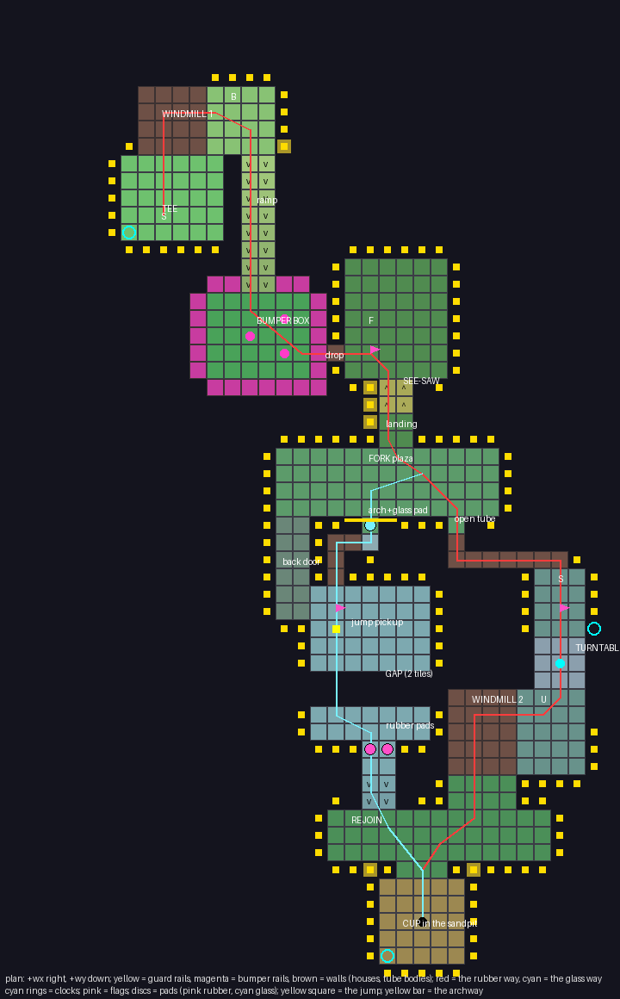
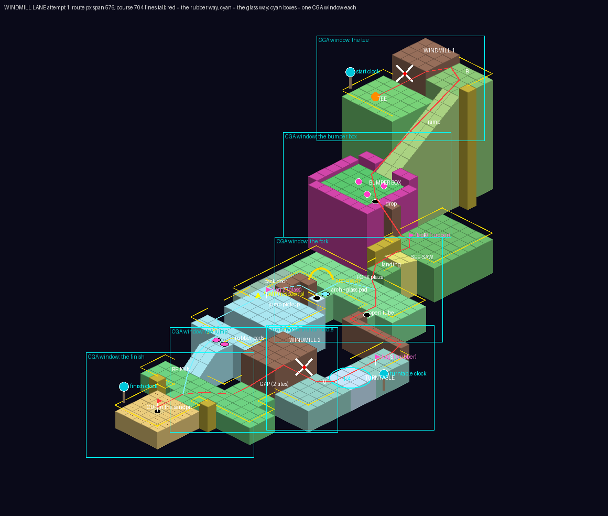

# COURSE 4, "Windmill Lane" (MILL): design sheet

*Status: **ATTEMPT 1, SHIPPED FOR THE OWNER TO PLAY** (2026-11-21). The pen-in
step of the guide's pipeline ([README.md](README.md) section 3). `mill/sketch.py`
draws the pictures and writes this design as an engine course (`--bbc`), and since
the owner's word that the prototypes are replaced as the work develops, that course
IS `apps/bonanza/courses/mill.bbc` (course K 2, pathway pad 3; SPEC.md 130.54.10).
The prototype it replaced is TMIL's top cell for cell, and the rows that needed its
features play TMIL. It compiles with `tools/bbcourse.py`, and its numbers below are
MEASURED on it (they were taken on the scratch draft `mill/mill-draft.bbc`, the same
text, which is gone). Distances are tiles and heights are units. The cells are the
engine's own, with no offset.*

The owner's brief (2026-11-21): *"a windmill minigolf course, with windmills and
tubes"*, mid length with a target of about 60 s, *"more dense screens ... spending more
time on each screen, as the theme is not 'speed down a hill'"*. The ball is rubber at the
start. It KEEPS the prototype's *"box with bumpers - the entrance and spacing on those
is good, leading to them being annoying but not impossible, and going into a tube"*
and *"the ending style - a sandpit surrounding a hole finish"*. It adds a TWO-ROUTE
section. One route takes the ball through a forced glass pad under an archway, which
makes it the riskier GLASS route. It has a respawning jump pickup and a jump the ball
must make (or break on). The other is the easier rubber route, entered by an open tube.
Both rejoin before the finish. Later the same day the owner picked BOTH suggested
elements: *"See-saw and quarter turn both sound like good elements to introduce here,
and fit the theme."*

| field | value |
|---|---|
| place | course 4, reached by DOWN's exit 0 (the glass leg's finish) |
| ball | rubber; glass on the glass route only, which ends on a rubber pad |
| finish | ONE: a CUP in a sandpit (`cup`, SPEC.md 130.14.4.3) |
| families | `rotor tube archway turntable pickups seesaw`, all of them RESIDENT, so the course has no fetched family (130.25.6.9) |
| new to the pathway | the SEE-SAW (130.42) and the QUARTER-TURN TURNTABLE (130.43); also the respawning jump pickup and the cup |
| music | `windmill` (the prototype's song) |
| picture | 1,024 x 888 px (`width 128`, `origin 672`) |
| clocks | 3 (start, turntable, finish), default frame; their art is open question 6 |





## 1. The course, section by section

```
 TEE --door--> WINDMILL 1 --tube--> B --ramp--> BUMPER BOX --drop tube--> F (flag 0)
                                                                          |
                                                              SEE-SAW --> landing
                                                                          |  (2 units down)
                                                                      FORK PLAZA
                       glass: ARCH + glass pad -> tube           |           rubber: open tube
                                  |                              |                |
            back door <-- LEDGE H (flag 2, JUMP) ; 2-tile GAP    |     S (flag 1) -> TURNTABLE
                                  |                              |                |
                        V: 2 rubber pads -> ramp                 |     U -> WINDMILL 2 -> tube
                                  \______________ REJOIN J ______/________________/
                                                     |
                                           CUP in the SANDPIT
```

| | section | what it does | why |
|---|---|---|---|
| A | **the tee** | 6 x 5, guarded; the start is 3 tiles in front of windmill 1's door | a SAFE start with roll room (the guide's 1.10). The start clock is on its front-left corner (the prototype's model start clock) |
| W1 | **windmill 1** | the prototype's right windmill: a KEEP tube through the house, entered along -y, `seed 16`. Its LEFT windmill is gone | the theme, first thing. The left one was the guide's G7 softlock case |
| B, R | **B and the ramp** | out of the house onto B, then down 12 units along +y | the prototype's. Its sides are open, as they were (see 3.2) |
| G | **the bumper box** | the prototype's green, walls and three posts, moved up 12 units: the ramp's mouth, the bumper rails (`bounce`) and the DROP tube out of its east rail | the owner's KEEP, unchanged in shape |
| F | **F** | the drop's 3 units onto plain fairway. Flag 0 is on the drop's exit line | the first thing that can kill (the see-saw's open side) is next (G20) |
| SW | **the SEE-SAW** | a 2 x 2 teeter tilting along y, pivot 14.5. At rest its near end is F's height and its far end is a unit up. The ball rolls up it, its weight tips the plate past the pivot (rubber: 0.29 s, the ball carried), and it rolls off onto a 2 x 2 landing, then steps 2 units down to the plaza | a minigolf TEETER. It sits on the course's one shared walk, so every player meets it |
| P | **the fork plaza** | 13 x 4. Its front has the open tube's mouth (rubber), and an ARCHWAY over a glass pad before the glass tube's mouth | the owner's two tubes, one behind an arch with a glass pad |
| S, T | **the rubber route: S and the turntable** | the open tube runs +y, +x and +y out onto S. Flag 1 is on its line, then comes a 3 x 3 turntable, `fill ooo/.o./.o.`, `seed 228` | the classic rotating minigolf obstacle. Its middle column is open every other quarter turn (1.07 s), and the pivot is always floor, so a player can wait on it |
| U, W2 | **U and windmill 2** | a 4 x 5 apron. The door is on the second house's +x face (entered -x), and the tube comes out of the house's FRONT (+y) onto the rejoin | the second windmill: the easy route's timing obstacle |
| Q, H | **the glass route: the arch and the ledge** | under the arch the ball rolls over the glass pad (the arch's ceiling stops a hop over it, 130.39). The tube runs -x then +y up onto LEDGE H, 2 units over the plaza. Flag 2 (glass) is on the exit line, with the JUMP pickup a tile on (`prop jump 19 36 for 10 respawn`) | the owner's forced glass choice. The jump RESPAWNS both when it wears off (`respawn`) and on a respawn (its class) |
| GAP | **the jump** | a 2-tile gap over the void to V, at the same height | the make-or-break. MEASURED (section 5): with the jump it is made, and without it glass falls every time |
| L | **the back door** | H's west edge drops 2 units onto a lane back to the plaza. Glass may step down it, and nothing climbs it | KEPT AS THE WAY BACK (no longer required): the tool once needed it (section 3.1), but since SPEC.md 130.14.4.1.2 a flag or pad also passes when it reaches a finish taking only RESPAWNING pickups. The owner keeps it as a softlock-proof way back: glass that will not jump walks back and takes the rubber route as glass |
| V | **V** | the landing, then a 2-wide neck with TWO RUBBER pads, and a ramp down to the rejoin | ends the glass stretch on rubber (G13, G14) |
| J, Z | **the rejoin and the finish** | the rejoin green, a 3-wide walk in, and a 5 x 5 SANDPIT with the cup in its middle (the cup's cell NORMAL). The finish clock is on its front-left corner | the owner's KEEP. Sand stops every ball under the cup's capture within a tile (130.14.4.3) |

### The two routes

| | rubber (easier) | glass (riskier) |
|---|---|---|
| from the plaza | the open tube, S, the turntable (wait on the pivot), U, windmill 2 (time the gate) | the arch and pad, the tube, the jump pickup, the 2-tile jump, the rubber pads, the ramp |
| what can kill | the turntable's ports (back to flag 1, a tile away) and U's east edge by the table | the gap (back to flag 2 on the ledge, the jump back with it) |
| distance from the plaza | 76.5 tiles of route in all (the sketch) | 32 tiles |
| MEASURED, start to cup | **27.4 s** (the route demo, autopilot) | **27.0 s** (the autopilot to the ledge, a scripted Hop at the lip, then on) |

The glass route is not faster for the autopilot. The autopilot never waits, and it
hops over the turntable (section 4). A human who waits on the pivot and times windmill 2 pays
that on the rubber route, and the glass route pays only the jump. The glass route
saves the most when the waits are long.

## 2. Flags, clocks and the camera

- **Flags (3 of 8)**: flag 0 on F, before the see-saw (rubber). Flag 1 on S, before the
  turntable (rubber). Flag 2 on ledge H, before the jump (glass). No flag stands where
  nothing ahead can kill: nothing before F can, because the bumper box is walled and
  a fall off B or the ramp is a short way back to the tee.
- **Clocks (3)**, all G9 - G12, MEASURED by `--guide` on the route demo: the start sees
  clock 0, no two clocks share a window, no clock is touched, and the longest stretch
  with no clock in view is **13.2 s** on the CGA (13.1 on the Hercules), under 15:
  - **start**: the tee's front-left corner (the prototype's);
  - **turntable**: on a pillar tile east of S, its top 5 units under S. It is not on the route, and it
    is low so that its head is out of the see-saw's window (section 3.1);
  - **finish**: the sandpit's front-left corner, in the cup's window.
  - There is **no fork clock**. One at the plaza met the see-saw in one window: its 2
    numerals, the plate's 4 lanes and the flag's event lane make 7 pose changes on one
    step, over the 6 a window may take (SPEC.md 130.19.10).
- **The camera** follows the course down the screen. Horizontal moves come at the
  plaza (the fork), at the turntable and at the rejoin, all on the ground. G3 is
  REFUSED for the autopilot's run (section 4).

## 3. What the tool refused, and what changed for it

### 3.1 Refusals met, each fixed in the sketch

| refusal | fix |
|---|---|
| a ramp rate of -2/3 a tile | the walk off F made of whole half units; later replaced by the see-saw |
| a guard rail touching a ramp, or a floor at a corner no rail passes through (130.35.1) | `blockrails`: a BLOCK rail there instead |
| the course wider than 512, then 896 px | `width 128`, `origin 672` |
| 5 occluder records in a block (over 4) | the SHATTER PIT under the jump (5 units down, so glass would break visibly) is OFF (`MILL_PIT=1` puts it back). There are no rails beside the turntable or on U's east edge by it |
| windmill 1's doorway "in the shade" (OCCG in IN's 3 x 3) | the tee widened under B, and its east edge before the ramp left open: a two-height guard, then a block rail there, shaded the door |
| windmill 2's doorway in the shade | U 5 deep with the door a row up, so U's south rail is two rows in front of the door's 3 x 3 |
| the arch's pad under a third seen (A10) | the glass tube runs -x first (a +y body in front of the arch hid the pad), with no rail beside its mouth |
| over 1,024 BLOCKS, three times (a limit since lifted: SPEC.md 130.56's map form 9, ROWNIBS, chosen automatically past 1,024 blocks; the bound is now the part's 65,024 bytes) | the sand BUNKER on F (about 48 blocks, `MILL_BUNKER=1`), the finish's magenta bumper rails (`MILL_FINRAILS=1`; guard rails now) and the ramp's side rails are all gone, and heights are whole units where half units bought nothing |
| a 4-long see-saw: its picture changes over 10 lanes, over the 6 a plate may have (130.42.5) | 2 x 2 |
| the see-saw's lanes in a flag's lane block | flag 0 moved a tile back, onto the drop's exit line |
| the see-saw and a clock in one window, 7 pose changes (130.19.10) | no fork clock, and the turntable clock on a low pillar |
| the jump unreachable with no pickup (130.25.7.3, Q-92: every finish reachable with no pickup, so a pickup only shortens a route) | the BACK DOOR. Without it the glass pad and flag 2 were refused (no longer: SPEC.md 130.14.4.1.2 counts the respawning jump; the door is kept as the way back) |

Also found: rubber drifted off the see-saw's open side and respawned at the START (the
autopilot did, from F). The see-saw's west side is now block-railed. Its east side is
open, because a block rail there is in front of the plate and hid the ball on it for
1.4 s. Flag 0 on F makes a fall there cheap.

### 3.2 The draft's verdict (MEASURED, `bbcourse.py -o DIR mill-draft.bbc`)

- **It compiles.** The route demo is COMPLETE: 1,495 steps, **27.37 s**, rubber, 0 falls,
  4 Hops. NO TRAP passes from every flag and pad.
- Budgets: **980 blocks**, which was the binding limit (1,024) when measured; since SPEC.md
  130.56 (map form 9, ROWNIBS) the block count is no longer a bound, only the part's
  65,024 bytes. The picture part is 55,610 bytes (9,414 under 65,024). It is **19,083
  bytes LZ4, over the 60 s target's 1.5x budget (18,825) by 258**. That is reported,
  not refused (130.27.5).
- Visibility (reported): windmill 1's drop IN 50%. The ARCH'S GLASS PAD is 50% against
  75%, because the arch's right leg covers its lower right half; that is in the shape of
  an archway along y. The second rubber pad is 74% against 75%. No hidden stretch is
  over 0.5 s.
- `--guide` with the route demo: G1 27.2 s (the floor is 25), G9, G10, G11 and G12 pass.
  **G3 is REFUSED**: the autopilot reaches the turntable while its front is closing and
  hops off the pivot over it onto U. That flight pans 15 columns on the CGA and 6 on the
  Hercules as it turns toward windmill 2's door. A human who waits on the pivot makes no
  such flight. An authored "wait on the pivot" demo was tried and not finished: a ball
  gripped to rest near the pivot fell before the front opened, which is worth a look at
  where the autopilot stops (section 6, question 3).

## 4. Time: the course is SHORT of 60 s

The autopilot does the rubber route in 27.4 s and the glass route in 27.0 s. It never
waits. A player adds windmill 1's gate (up to 1.2 s), ricochets in the bumper box, the
see-saw's tip, a wait on the pivot (up to 2 quarters, 2.1 s) and windmill 2's gate.
PREDICTED for a human: about 40 - 45 s, not 60. The course was at 980 of 1,024
blocks when this was written; since SPEC.md 130.56 blocks no longer bound it (the part's
65,024 bytes do: the picture part has 9,414 bytes spare), so reaching 60 s no longer means
making block room first. See questions 1 and 2.

## 5. The jump (MEASURED on the model)

- With the pickup, a Hop at the lip of H (the jump's Hop 400 for any ball, 130.25.9)
  lands on V, 4.5 tiles on, and the run finishes (27.0 s).
- Without it (the pickup moved off the line), glass falls into the gap every time and
  respawns at flag 2: 32 falls in 4,000 steps. The jump is needed, as the brief wants,
  and the back door is the only other way (3.1).
- The SHATTER PIT the brief's "break" suggests (a floor 5 units under the gap, so glass
  breaks visibly rather than falling away) is in the sketch behind `MILL_PIT=1`, and is
  refused today for its occluder records (3.1).

## 6. Open questions for the owner

1. **Length.** The course is about 27 s for the autopilot and about 40 - 45 s PREDICTED
   for a human, against the 60 s target, and it has 980 blocks (no longer a bound, SPEC.md 130.56). Should the
   target be 45 s? Or should room be made for a third dense screen: a second bumper box
   without rails (G21) on the rubber route, or MOON's tube fan?
2. **What the block budget took** (the 1,024-block limit, lifted by SPEC.md 130.56). The sand bunker on F, the finish's magenta bumper
   rails and the ramp's side rails are all gone (each is a knob in the sketch). Which do
   you want back, and at what cost elsewhere?
3. **The turntable's G3.** The autopilot hops it. Options: accept a playtest demo as the
   G3 run; make the crossing slower to need (`quarter 64` is the slow default already);
   or move the turntable to where a pan cannot happen (a straight +y run with no turn
   after it).
4. **The back door.** Kept as the way back (no longer required by the tool, SPEC.md 130.14.4.1.2; the owner keeps it as a softlock-proof way back).
   It reads as a blind alley from the plaza. Keep it, or make it a visible "chicken run"
   (a sign, a step)?
5. **The see-saw's open east side** (a block rail there hides the ball), and its fall
   back to flag 0. Is that fine, or should it be a guard-railed flat plate instead?
6. **Clocks.** There are three, in the default frame. A theme idea for art that says where
   the player is: windmill SAILS, whole at the start, split at the fork's turntable (one
   sail for each route) and a flag pin at the cup.
7. **Both new elements.** Both fit, at the costs above: the see-saw cost the fork clock,
   and the turntable cost rails and G3. If one goes, I would keep the TURNTABLE: it is the
   rubber route's reason to exist, and the see-saw sits on a walk that worked without it.
   The other candidates were the drawbridge with a switch and key (130.41), which needs
   backtracking, and a water pond (130.36). A pond that rubber floats over reads oddly
   as a minigolf hazard, and it would be a fetched family.

## 7. How the pictures and the course are made

```
python3 docs/plans/bonanza-courses/mill/sketch.py                    # plan.png, iso.png, the clocks' spacing
python3 docs/plans/bonanza-courses/mill/sketch.py --bbc apps/bonanza/courses/mill.bbc --force   # the SHIPPED course
python3 docs/plans/bonanza-courses/mill/sketch.py --bbc OUT.bbc --force --glass   # the glass route's ways
python3 tools/bbcourse.py -o DIR apps/bonanza/courses/mill.bbc   # alone: about 2.5 minutes
MILL_PIT=1 / MILL_BUNKER=1 / MILL_FINRAILS=1                         # the parts the budgets took out
```
