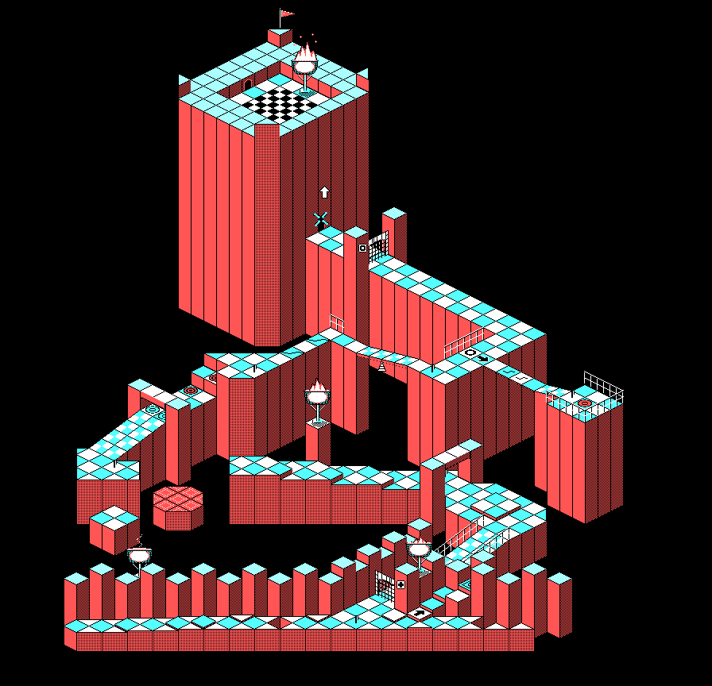
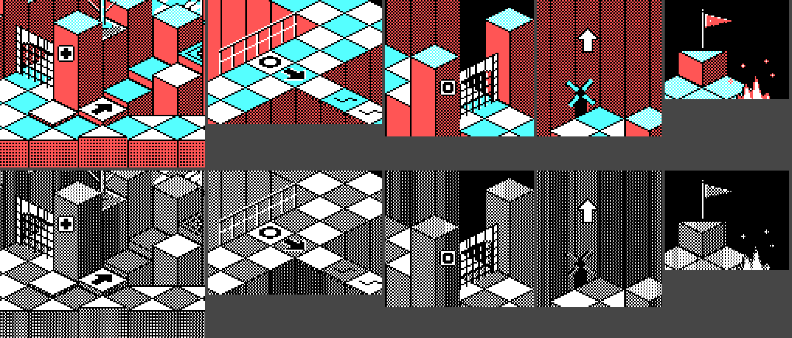

# CASTLE CLIMB: minimal art (2026-11-25, in the course; the owner may strike any piece)

> **2026-11-25, the owner:** finding the plate's side stair is part of the course, and this is not a
> training course, so the two pieces that pointed to it (`castle_plus.bba`, `castle_toplate.bba`) are
> removed from the course and the tree, and the plate is marked `hidden`. Four pieces remain. `art.py`
> still knows how to draw the two.

*The course is the owner's own layout, drawn in the Builder. Nothing of it moved: no floor, wall, prop, route,
clock cell, guard or `noocclude` line. This step added the four clocks' `frame` words ([CLOCKS.md](CLOCKS.md))
and SIX `art` lines at the END of `apps/bonanza/courses/castle.bbc`, under a comment, a line a piece: deleting a
line strikes its piece. [art.py](art.py) is the artwork's SOURCE, with [../artkit.py](../artkit.py) the kit; the
`castle_*.bba` files it writes are committed. Looked at in the tool's own picture on both cards, never on an
emulator.*

    python3 docs/plans/bonanza-courses/castle/art.py              # write the .bba files, print the `art` lines
    python3 docs/plans/bonanza-courses/castle/art.py --png DIR    # ...compile, and write DIR/art-pieces.png and picture-*.png

[picture-herc.png](picture-herc.png) is the Hercules; [map.png](map.png) is the plan.

## The pieces

Every piece is BLACK ON WHITE with a black edge. The castle's walls are red, and on the Hercules red and cyan
are one grey, so colour carries nothing here.

| piece | file | where | why it earned its place |
|---|---|---|---|
| the PLUS on the first gate | `castle_plus.bba`, 11 x 11 | a plaque on the gate's right pier, the wall at (39, 31), on the face the ball rolls up to | the first gate is shut and its plate is out of sight up a side stair (the tool warns that the plate at (41, 28) is more than half hidden). The plaque is the same plus the engine draws on the plate, at twice the size: the gate says which thing opens it |
| the way to the plate | `castle_toplate.bba`, 16 x 8 | a floor arrow on the stair's first step, (40, 31), pointing up it | the stair is five small steps squeezed between two walls and reads as scenery. With the plaque it is the whole lesson: plus, and this way |
| the way to the key | `castle_tokey.bba`, 32 x 16 | the floor of (27, 14) and (28, 14): a ring, and an arrow along the bridge | the junction where the keep's gate is straight on and the ring key is off to the side, across the cracking bridge. A first run goes straight on and meets a shut gate |
| the RING on the keep's gate | `castle_ring.bba`, 11 x 11 | a plaque on the gate's left pier, the wall at (16, 12), on the face toward the approach | the same glyph as the key and as the floor mark at the junction, so the three read as one thing |
| UP, over the tube | `castle_up.bba`, 13 x 16 | the keep's wall above the tube's mouth at (12, 10), over the windmill | the tube's mouth is a black arch behind a windmill at the foot of a wall 18 units high, and the goal is on top of that wall. The arrow says the hole is the way up |
| the keep's PENNANT | `castle_flag.bba`, 22 x 26 | on the keep's west corner turret, (4, 6), the highest thing in the picture; the void is behind it | the goal is a chequered floor inside four walls and is not seen until the ball is in it. A flag on the keep says where the climb ends |

Art has no depth of its own (SPEC.md 130.23.2): the plaques and the arrow on the wall are part of the faces
they are painted on, the floor marks part of their tiles, and the ball is drawn over the pennant.

## What it costs (MEASURED: compiles of the course in this step)

Without a song, so that the three rows compare (the song changed during this step: see below):

| | part in RAM | blocks | masks (of 256) | LZ4 | LZB |
|---|---|---|---|---|---|
| as it came (default clocks, no art) | 58,191 | 943 | 178 | 16,779 | 13,950 |
| + the beacon clocks | 58,529 (+338) | 959 | 179 | 17,439 (+660) | 14,521 |
| + the six pieces | **58,977 (+448)** | **987** | **179** | **17,810 (+371)** | **14,850** |

The step is **+786 bytes of RAM, +1 mask, +1,031 bytes of LZ4**. By piece, in blocks touched (35, of which 28
are new to the part; a new block is 16 bytes of RAM and about 13 of LZ4): the pennant 11, the ring and arrow to the key 7, up 6, each plaque 4, the plate's arrow
3. The pennant is the dearest and the first to strike if bytes are wanted.

The whole course as `bbcourse.py -o` builds it, song included:

| | part in RAM | LZ4 (budget 18,825 for a 90 s course) | route demo |
|---|---|---|---|
| before (`music fairway`) | 59,031 | 17,309 | 1,062 bytes, 56.87 s, COMPLETE |
| after (`music castleclimb`, set by the song's own step meanwhile) | 60,333 | 18,901: **76 over the budget**, reported and not refused (SPEC.md 130.27.5) | 1,062 bytes, 56.87 s, COMPLETE: the same 523 runs; only its two bytes of course identity (offset 14) differ, the part having changed |

Of the 1,592 LZ4 bytes between the two rows, 1,031 are this step's and 561 the new song's. The part is 4,691
bytes under its 65,024 and has 77 masks to spare.

## The warnings (four before, the same four after)

No new warning. The course compiles with these, all the layout's and all the owner's to settle:

1. the PLATE at (41, 28) is hidden: 64 of its pressed pose's 120 pixels are drawn over by geometry in front;
2. the windmill's doorway at (12, 9) is in the shade (a ball there is drawn over what stands in front of it);
3. a ball behind the gate's clock at (39, 30) is wholly hidden for 25 ground units (26 with the default frame;
   [CLOCKS.md](CLOCKS.md));
4. the floors at (34, 21), height 2.5, and (35, 21), height 3, BLEND: their checker runs on across 76 px of
   seam with no edge between them (lines 78 and 86).

## Not done, and why

- **A flag before the cracking tiles and the see-saw** (G20): the cracks draw themselves on their tiles, and a
  flag is a prop, which is layout.
- **The gates' own art**: both say `art portcullis`, the lab's. A gate arch with the glyph on its keystone, as
  CLOCKWORK KEEP's, took 31 masks for that course's three gates; the two plaques say the same for 8 blocks and no mask.
- **Arrow slits, banners along the walls, a drawbridge look for the float**: dressing, not reading. The owner
  asked for minimal.
- **Words** ("KEY", "UP"): the glyphs are the engine's own and need no reading.

**2026-11-26:** the owner removed the ring-key arrow (`castle_tokey.bba`) and the tube's up arrow
(`castle_up.bba`) too: Castle Climb is not a training course. The RING plaque and the pennant remain;
`art.py` can still draw the removed pieces.
