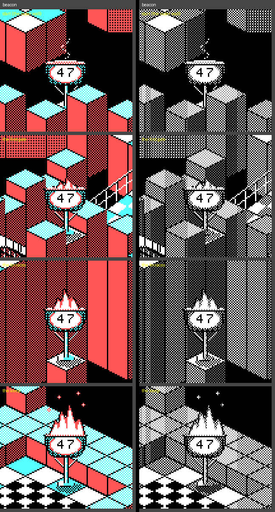

# CASTLE CLIMB: clock options (2026-11-25, for the owner to pick)

**INSTALLED for the pick: A, `beacon`** - the tool's `bcn0`, `bcn1`, `bcn2` and `bcn3` (`_clock_beacon` in
`tools/bbcourse.py`, SPEC.md 137.18.5.2), named on the four `clock` lines of `apps/bonanza/courses/castle.bbc`.
Those four words are the only change to the owner's lines; no clock moved. B, `banner`, and C, `turret`, are
kept here as scratch frames.

*The brief is the course guide's G23 ([README.md](../README.md) 1.5). WINDMILL LANE's
[study](../mill/CLOCKS.md) is the method and [../clockkit.py](../clockkit.py) the kit. CASTLE's four clocks are
the OUTER WALL (start, cell (28, 41)), the FIRST GATE (39, 30), the TERRACES (23, 22) and the KEEP (8, 8).
Palette 2's inks: cyan, RED, white on black. On the Hercules cyan and red are one grey checker, and so is
nearly every wall of this course.*

## How to look at them

| file | what |
|---|---|
| [clocks/beacon.png](clocks/beacon.png) | the installed beacons, each cropped from the course's REAL compiled picture with "47" in the digits' blocks: CGA left, Hercules right, a row a clock |
| [clocks/overview-cga.png](clocks/overview-cga.png), [clocks/overview-herc.png](clocks/overview-herc.png) | a row a position, a column a concept (`crystal`, `beacon`, `banner`, `turret`); the `beacon` column is the installed frame, the other two as first drawn |
| [clocks/frames.png](clocks/frames.png) | every frame on a plain block, zoomed, no compile: CGA rows over Hercules rows |
| `clocks/<concept>.txt`, `clocks/<concept>.warn.txt` | the compile's sizes and its warnings for that concept |
| [clocks/frames.py](clocks/frames.py), [clocks/sheet.py](clocks/sheet.py) | the concepts and the sheet |

## What is behind each clock (LOOKED AT in the tool's picture)

| clock | stands on | behind its head |
|---|---|---|
| the outer wall (28, 41) | a 4.5-high block in the first zig-zag | the void, and the corner of a wall top |
| the first gate (39, 30) | a 5.5-high floor beside the gate | a 7-high wall's cyan top and its dark right face; the plate's rail to the right |
| the terraces (23, 22) | a 5-high pillar | the terraces' wall: one large red and black dither |
| the keep (8, 8) | the keep's floor beside the goal | the keep's wall tops (a cyan dither) and the void over them |

Two of the four stand in front of red walls, and the keep's stands in front of cyan. So an object that is
mostly red or mostly cyan disappears somewhere on this course. What reads at all four is WHITE with a black
edge, with a little of each colour.

## The options

### A. `beacon`: a BEACON, its fire growing up the castle (INSTALLED)

An iron fire-basket on a stem with two stays, standing on its block. The digits are on the fire's white-hot
heart: no window. The heart cools to a red ring and then to the basket's dark iron (cyan and black). A beacon
belongs on a castle wall, a gate pier, a pillar and in a keep, which is where the four clocks stand.

**The fire says how far up the castle the player is.** The alarm runs up the walls ahead of the ball:

- `bcn0` (the outer wall): only EMBERS. The coals glow and a curl of smoke rises.
- `bcn1` (the first gate): a SMALL flame.
- `bcn2` (the terraces): a TALL one.
- `bcn3` (the keep): the GREAT fire, four tongues, with sparks over it.

**Reads:** the white heart and the white flames carry it on both cards and against all four backgrounds. The
flames' red edges are lost on the red walls at the gate and the terraces; their black outline and white body
remain. On the Hercules the four are told apart by the flame's height alone, which is enough: nothing, 6 px, 16
px, 25 px. The smoke at the start is 11 white pixels and is the detail one finds second.

### B. `banner`: a war BANNER on a spear, a chevron a stage

A cloth hung from a crossbar on a spear, the digits on its white chief, a red field below with dagged tails.
The field carries one white CHEVRON at the outer wall, two at the gate, three at the terraces and a CROWN at
the keep.

**Reads:** the cheapest of the three. Its red field vanishes into the red walls at the gate and the terraces,
which leaves a white rectangle with digits on it: the flat square G23 warns about. On the Hercules the chevrons
are white on grey and hard to count. It is also close to CLOCKWORK KEEP's `shield`, the frame that course did
not take.

### C. `turret`: a brick TURRET, a storey taller at each clock

A round red-brick turret with a door, the digits on a white string course round it. It has battlements at the
outer wall, one more storey with an arrow slit at each clock after, and a cyan cone roof with a pennant at the
keep.

**Reads:** height is a good way to say "how far up", and at the keep it is the best looking of the three. But
it is a red tower among red towers: at the gate and the terraces only its white band shows, and on the Hercules
the brick is the same grey as everything behind it. It is also the dearest, and the tallest thing to hide a
ball behind.

## The bytes (MEASURED: each concept compiled on the course with no art and no song)

| concept | picture blocks | occluder masks (of 256) | part in RAM | on disk LZ4 / LZB | against `crystal` | longest wholly-hidden run behind each clock (bound 16) |
|---|---|---|---|---|---|---|
| `crystal` (the default) | 943 | 178 | 58,191 | 16,779 / 13,950 | - | 0, 26, 0, 0 |
| `beacon` (installed) | **959 (+16)** | **179 (+1)** | 58,529 (+338) | 17,439 / 14,521 | **+660 B LZ4, +571 LZB** | 0, 25, 0, 0 |
| `banner` | 955 (+12) | 177 (-1) | 58,449 (+258) | 17,371 / 14,445 | +592 B LZ4, +495 LZB | 0, 27, 0, 0 |
| `turret` | 977 (+34) | 181 (+3) | 58,845 (+654) | 17,545 / 14,535 | +766 B LZ4, +585 LZB | 0, 27, 0, 0 |

The `banner` and `turret` rows are their first drawings. The beacon's stays, smoke and sparks are PAINT (the
part `"shadow"`: no occluder mask, and the ball is drawn over them), which is why four tall frames cost one
mask.

## What the tool says about the clocks

- **The gate's clock hides a ball behind it** (a WARNING the course already had, SPEC.md 137.18.5.4): a ball
  rolled behind the clock at (39, 30) is wholly hidden for 25 ground units in a row, against a bound of 16.
  With the default frame it is 26, so the beacon is not the cause: the clock stands on a 5.5-high floor right
  beside the low corridor behind the gate. It is the owner's to settle. A `noocclude` on the corridor's cells
  behind it, or the clock one cell further from the corridor, would clear it.
- **G9** (`guide_static_rule`, run on a scratch copy with a `guide` line; the course itself does not declare
  it): the start sees clock 0. Kept.
- **G10**: REFUSED on that copy. Clocks 1 and 2 (the gate's and the terraces') fit one CGA window together:
  their digits span 144 x 200 px and a window is 320 x 200. It is exactly on the line, by height. This is the
  layout's, the same under every frame. The other five pairs are apart (the nearest: clocks 0 and 2 at 240 x
  208).
- **G11** (`guide_run_checks` over the course's own route demo, on the same copy): no clock touched. Kept.
- **G12**: the longest stretch with no clock in view is 11.1 s on the CGA and 12.8 s on the Hercules, under the
  15 s bound. Kept.
- **G3** is not about clocks, but the same run reports it and would refuse a `guide` course: the route demo
  pans while the ball is in the air in 7 of its 21 flights on the CGA (up to 16 columns) and 6 on the Hercules.
  The layout's, for the owner to know.

## Tool support

`beacon` costs no guest byte: it is picture. To take `banner` or `turret` instead, copy its `_clock_*` from
`clocks/frames.py` into `tools/bbcourse.py` beside `_clock_beacon`, add its four names to `CLOCK_STYLES` and
`_CLOCK_DRAW`, a paragraph to SPEC.md 137.18.5.2, and name them on the four `clock` lines.
