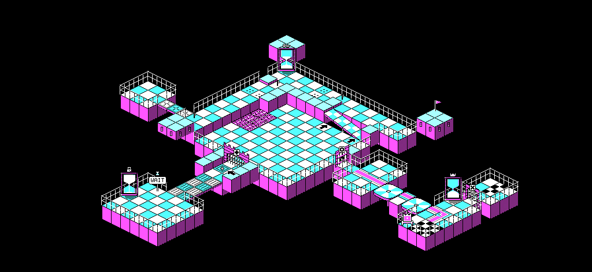
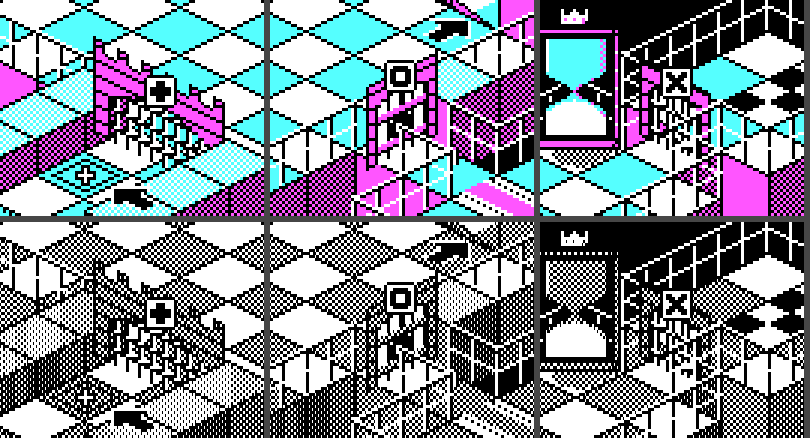
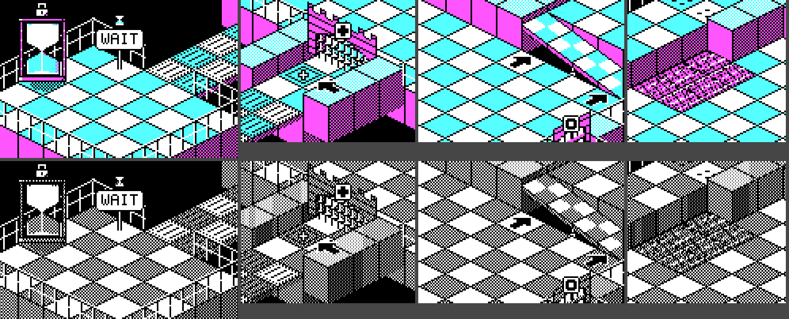
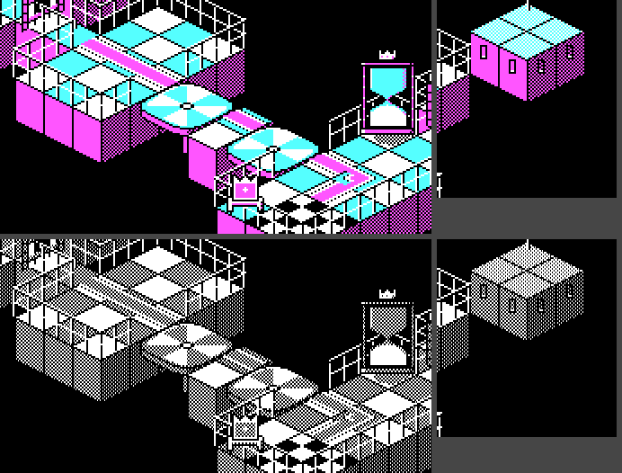

# CLOCKWORK KEEP: gates, signs and decals (2026-11-25, in the course; the owner may strike any piece)

*What [KEEP.md](../KEEP.md) section 9 asked the art step for, as built. Everything here is IN
`apps/bonanza/courses/keep.bbc` (`keep/sketch.py` writes it). The clocks are [CLOCKS.md](CLOCKS.md).
[art.py](art.py) is the artwork's SOURCE, with [../artkit.py](../artkit.py) the kit courses 5 - 7 share; the
`.bba` files it writes are committed, and `sketch.py` imports its `lines()` and `GATES`, so a re-emitted course
keeps its art. Looked at in the tool's own picture on both cards, never on an emulator.*

    python3 docs/plans/bonanza-courses/keep/art.py              # write the .bba files, print the `art` lines
    python3 docs/plans/bonanza-courses/keep/art.py --png DIR    # ...compile, and write DIR/art-*.png and picture-*.png

## The gates (SPEC.md 137.41.12.7)

Each is a file of its own under `apps/bonanza/courses/gates/`: GATE's lab art (`portcullis`, `door`,
`crumble`) is untouched and nothing else names the new three.

| gate | file | cells | shut (frame 0) | opening (frames 1 - 3) |
|---|---|---|---|---|
| the PORTCULLIS, (24, 30) `along y`, channel plus | `keep_port.bba`, 44 x 54 a frame | 2 | a stone gate arch with battlements between the gatehouse's cheeks, an iron grille in it, the **PLUS** on a plaque on its keystone | the grille RISES into the arch; in frame 3 only its spikes show under the head |
| the DOOR, (30, 24) `along x`, channel ring | `keep_door.bba`, 24 x 40 | 1 | two iron-bound plank leaves under a round stone head, a ring for their knocker, the **RING** on a plaque on the keystone | the leaves SLIDE apart into the jambs (clockwork: the lab's swung leaf read as a leaf still in the way); frame 3 is an empty doorway |
| the TREASURY's grille, (41, 21) `along y`, channel cross | `keep_vault.bba`, 24 x 38 | 1 | heavy bars under a round stone head, the **CROSS** on a plaque on the keystone | the bars slide ASIDE into one jamb |

- **The three glyphs are LARGE and UPRIGHT**: 7 x 7, black on a white 11 x 11 plaque with a black edge, the
  look the engine gives a plate and a key (SPEC.md 137.41.5) at about twice the size. A plaque is drawn in
  screen pixels, not sheared with the wall (a sheared 7 x 7 plus was a blot): the kit's `gate_bba` takes it as
  a "flat" piece. They are the course's whole language, and on the Hercules they are what a gate IS.
- **The stone is the scene's own magenta**, with black joints. White stone, the first try, vanished on the
  white and cyan floor behind it; what MOVES (grille, leaves, bars) is black and white, so every frame differs
  on the Hercules (the tool refuses two equal ones).
- **The gaps stay open.** A gate's occluder is its shut frame's (SPEC.md 137.41.12.6, question 1), so a ball
  behind an OPEN gate is still cut by frame 0's pixels. The grille and the bars are 2 px of iron in 4 or 5 with
  nothing between; the door's leaves are solid, and a ball rolling up to the open door is clipped for the last
  third of a tile before the sill, as it was with the lab's door.
- **The drawbridges take a `style`, not art** (a timed bridge refuses art). The main one keeps `picket` (a
  planked deck). The TRAITOR'S BRIDGE had no style, a bare seam that reads as floor; it now says
  `style portcullis`: iron plates with a boss on each tile, a different machine from the planked one. A
  one-plank rickety deck would be a new style (a tool change, proposed, not built).

## The signs (a sign says what to do next, where it is done)

| piece | file | where | what |
|---|---|---|---|
| **WAIT** | `keep_wait.bba` | a signboard on the barbican's edge, tile (23, 37), left of the drawbridge's mouth; only the void is behind it | the word on a white board on a post, a small hourglass on top: the clocks' own object, and what the bridge is. The one thing the first screen has to say |
| the arrow to the plate | `keep_plate.bba` | the floor of (25, 31), the gatehouse's right lane, before the bars | a black arrow, a white line round it, pointing at the plate beside it (KEEP.md's C10: the lesson for a ball that came up the wrong lane) |
| UP, twice | `keep_up0.bba`, `keep_up1.bba` | the courtyard floor at (28, 21) and (25, 21), south of the rocking stair's two ends | the same arrow, pointing onto the stair |
| the HAY | `keep_hay.bba` | the six sand tiles (20 - 21, 23 - 25) under the key's wall | straw: short white and black strokes over the sand's own pattern. It reads on the CGA and faintly on the Hercules |

## The decals

| piece | file | where | what |
|---|---|---|---|
| the CARPET | `keep_carpet.bba` | along row 24 from the keep's passage: the hall's floor (32 - 34), the island between the cogs (37), the dais (40), turning right at (41, 24) down (41, 25) to the goal | a magenta runner with white edges, painted on the tiles. It is the way to the throne drawn on the floor. Not on the door's sill, the flag's tile or a cog: a prop draws those tiles itself |
| the THRONE | `keep_throne.bba` | tile (40, 27), the dais's west side beside the goal; the void is behind it | a high-backed chair with a crown's three points, white with a magenta cushion. It is a picture: a ball that rolls onto its tile is drawn over it |
| arrow slits, a pennant | `keep_tower0.bba`, `keep_tower1.bba` | the visible faces of the north-east and south-west towers; the pennant on the north-east one | a slit a face of each tower cell, a magenta pennant on a pole |

## What it costs (MEASURED: compiles of the course in this step, with its song)

| | part in RAM | blocks | masks (of 256) | LZ4 (class 18,825) |
|---|---|---|---|---|
| before the art step | 48,287 | 719 | 191 | 15,979 |
| + the hourglass clocks | about 48,970 | 740 | 209 | about 16,830 |
| + the three gates (in the lab art's place) | 49,631 | 743 | 240 | 17,291 |
| + the signs and decals | 50,703 | 810 | 240 | 18,188 |
| + the traitor's bridge's style | **50,703** | **810** | **240** | **18,233** |

The signs and decals are 67 blocks (1,072 bytes of RAM, 897 of LZ4) and no mask: paint has no depth of its own.
The gates are the masks: 31 of them. **The course is 592 LZ4 bytes under its class and has 16 masks to spare.**
The next thing it carries wants `masks banded` (SPEC.md 137.52) or a piece struck.

## Not done, and why

- **Gear teeth** on the stair's fulcrum and round the cogs: the stair and the cogs draw their own tops in
  every pose, so paint on them would be drawn over and would not tilt or turn with them. (Paint BESIDE them is
  safe: the carpet shares blocks with both cogs' lanes and the up arrows with the stair's, and every pose of
  those lanes holds the decal's pixels - MEASURED, the compile's lanes against the `.bba` files.)
- **A heap of crystals in the treasury**, banners on every tower: budget. The treasury is the secret's reward
  and has a bare floor.
- **The keys' glyphs large beside the keys**: a key is the engine's own icon on its tile (a lane).
- **A rickety one-plank style** for the traitor's bridge: a new preset is a tool change.
