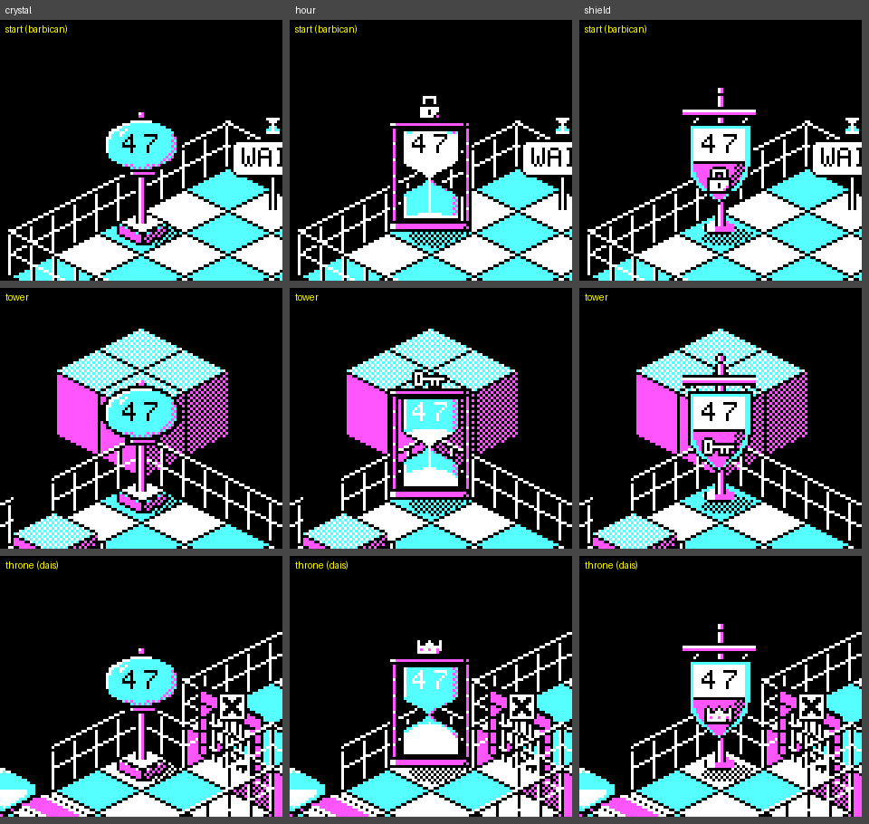

# CLOCKWORK KEEP: clock options (2026-11-25, for the owner to pick)

**INSTALLED for the pick: A, `hour`** - the tool's `hourp`, `hourk` and `hourc` (`_clock_hour` in
`tools/bbcourse.py`, SPEC.md 130.18.5.2), named on the three `clock` lines that
[keep/sketch.py](sketch.py) writes into `apps/bonanza/courses/keep.bbc`. The course is complete with them. B,
`shield` (the designer's own idea), is kept here as scratch frames.

*The brief is the course guide's G23 ([README.md](../README.md) 1.5). WINDMILL LANE's [study](../mill/CLOCKS.md)
is the method. KEEP's three clocks are the BARBICAN (start, cell (22, 39)), the north-west TOWER (18, 18) and
the throne's DAIS (40, 22); their cells are final ([KEEP.md](../KEEP.md) section 2) and no clock moved. Palette
1's inks (cyan, magenta, white on black); on the Hercules cyan and magenta are one grey checker.*

## How to look at them

| file | what |
|---|---|
| [clocks/overview-cga.png](clocks/overview-cga.png), [clocks/overview-herc.png](clocks/overview-herc.png) | a row a position, a column a concept (`crystal`, `hour`, `shield`), each cropped from the course's REAL compiled picture with "47" in the digits' blocks, in each clock's own ink |
| [clocks/frames.png](clocks/frames.png) | every frame on a plain block, zoomed, no compile: CGA rows over Hercules rows |
| `clocks/<concept>.txt` | the compile's sizes for that concept (the table below) |
| [clocks/frames.py](clocks/frames.py), [clocks/sheet.py](clocks/sheet.py) | the concepts and the sheet; [../clockkit.py](../clockkit.py) is the kit (see [KITE's study](../kite/CLOCKS.md)) |

## The options

### A. `hour`: an HOURGLASS, the digits in its upper bulb (INSTALLED)

The castle's timers are all the course is, so its clock is the oldest timer there is: an hourglass in a
turned stand (two plates, two banded rods), cyan glass with a white shine, white sand. The digits are IN THE
UPPER BULB: no window. Two things change down the course.

**The SAND runs out**, which is where the player is in the keep:

- `hourp` (barbican): the upper bulb FULL, a first trickle and a pinch of sand below.
- `hourk` (tower): HALF run through: the sand is under the digits, a mound has grown below.
- `hourc` (dais): RUN OUT: the upper bulb is clear glass, the lower one is full.

**The stand's FINIAL is the course's own lock** (the designer's three crests, kept): a PADLOCK at the barbican
(the keep is shut), a KEY at the tower (the ring key is two tiles on), a CROWN at the dais (the throne).

**The digits' ink follows the sand** (SPEC.md 130.18.5.6): BLACK on the white sand at the barbican, WHITE on
the cyan glass at the tower and the dais (`ink white` on those two clock lines). The sand's level never
crosses the digits. On the Hercules that is black digits on white, then white digits on the grey checker.

**Reads:** an hourglass is an hourglass at any size and on both cards, and the three sand levels are told
apart at a glance. The finials are 9 - 13 px and are the detail one finds second. At the tower the cyan glass
stands in front of the tower block's cyan top; the black line round it and the magenta rods hold it.

### B. `shield`: a heater SHIELD on a banner pole, its crest the place

The designer's ([KEEP.md](../KEEP.md) section 9): a shield hung by two chains from a T-shaped pole, a cyan
bordure, a white chief that carries the digits, a magenta field below with the crest in white: PADLOCK, KEY,
CROWN, the same three.

**Reads:** a shield is plain on both cards, and it is much the cheaper. The crest sits in the shield's point,
where there are 10 px for it, and the three are harder to tell apart than three sand levels. The chief is a
white rectangle with the digits on it: nearer to a panel than G23 likes, saved by the shield's outline.

## The bytes (MEASURED: each concept compiled on the course as committed, art included, no song)

| concept | picture blocks | occluder masks (of 256) | part in RAM | on disk LZ4 / LZB | against `crystal` | longest wholly-hidden run behind each clock (bound 16) |
|---|---|---|---|---|---|---|
| `crystal` (the default) | 789 | 223 | 49,053 | 16,669 / 13,942 | - | 0, 0, 0 |
| `hour` (installed) | **810 (+21)** | **240 (+17)** | 49,715 (+662) | 17,514 / 14,597 | **+845 B LZ4, +655 LZB** | 0, 0, 0 |
| `shield` | **793 (+4)** | **224 (+1)** | 49,207 (+154) | 17,199 / 14,396 | **+530 B LZ4, +454 LZB** | 0, 0, 0 |

All three compile under `--strict`. The masks are the number to watch: the course's three gates took 32 of its
65 spare ([ART.md](ART.md)), and the hourglasses take 17 more, leaving 16. `shield` would leave 32.

## Rules each one keeps

- **G9, G10, G12** (MEASURED, `--guide` with both logs, the installed `hour`): the start's window holds clock
  0; no two clocks in one window; the longest stretch with no clock in view is 8.3 s (CGA) and 3.0 s
  (Hercules) on the throne's run and 8.3 s and 12.6 s on the treasury's, as before.
- **G11**: no run touches a clock.
- **No flat squares**: the hourglass has none.
- **The treasury's gate** stands one tile right of the dais clock: the hourglass is 30 px wide and its tile's
  centre is 32 px from the gate's, so the two do not meet (LOOKED AT in [art-gates.png](art-gates.png)).

## Tool support

`hour` costs no guest byte. To take `shield` instead: copy `_clock_shield` from `clocks/frames.py` into
`tools/bbcourse.py` beside `_clock_hour` (about 50 lines; it reads `_HOUR_CREST`, which stays), add its three
names to `CLOCK_STYLES` and `_CLOCK_DRAW`, a paragraph to SPEC.md 130.18.5.2, and name them in
`keep/sketch.py`'s three `p.clock(...)` lines without `ink white` (its digits are on white).
