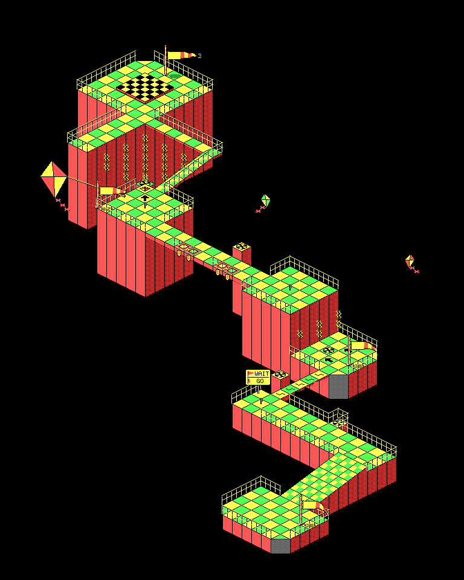
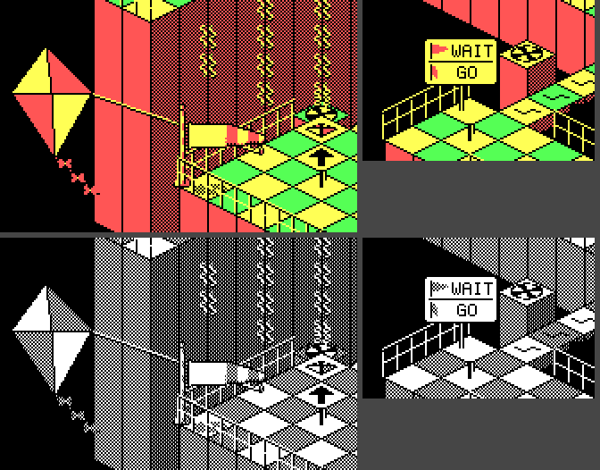
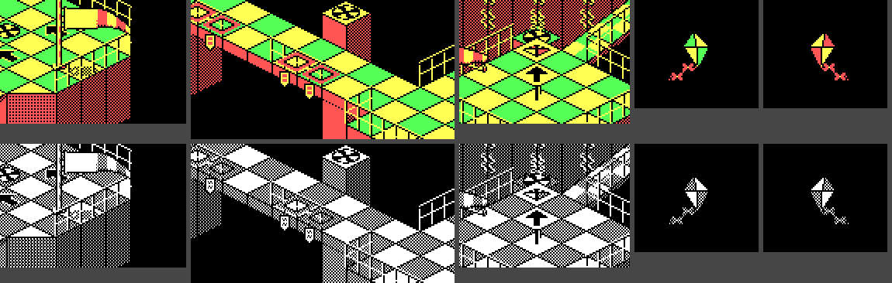
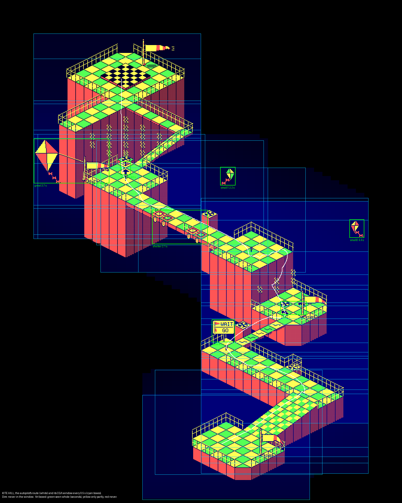

# KITE HILL: signs and decals (2026-11-25, in the course; the owner may strike any piece)

*What [KITE.md](../KITE.md) section 9 asked the art step for, as built. Everything here is IN
`apps/bonanza/courses/kite.bbc` (`kite/sketch.py` writes it). The clocks are [CLOCKS.md](CLOCKS.md).
[art.py](art.py) is the artwork's SOURCE, with [../artkit.py](../artkit.py) the kit courses 5 - 7 share; the
`.bba` files it writes are committed, and `sketch.py` imports its `lines()`, so a re-emitted course keeps its
art. KITE is `palette 0`: ink 1 GREEN, ink 2 RED, ink 3 YELLOW; on the Hercules green and red are one grey
checker and yellow is white. Looked at in the tool's own picture on both cards, never on an emulator. (The
tool's `--png` draws every course in palette 1; `art.py --png` writes `picture-cga.png` in the course's own.)*

    python3 docs/plans/bonanza-courses/kite/art.py              # write the .bba files, print the `art` lines
    python3 docs/plans/bonanza-courses/kite/art.py --png DIR    # ...compile, and write DIR/art-*.png and picture-*.png

## The signs

| piece | file | where | what |
|---|---|---|---|
| the GREAT KITE | `kite_great.bba` | in the sky left of the launch plaza, its string down to a peg on the plaza's west edge (16, 36). **Placed by the camera** (below): its first place, over the summit with its string to the crown, was never whole in the window | a harlequin kite 45 x 63 px, yellow and red panels on black spars, a three-bow tail. It is what the launch plaza is for, and it is on screen from the plaza through the whole glide. The string crosses the plaza's rail and floor as paint: the ball rolls over it |
| FLYING: WAIT, LIMP: GO | `kite_calm.bba` | a signboard on the breezeway's last tile (39, 45), beside the gust bridge's mouth; only the void is behind it | two lines, each a pennant and a word: a pennant flying beside WAIT, a pennant hanging beside GO. The fan's own pennant is the one the player watches; the sign says what it means, before the first thing on the course that kills |

## The decals

| piece | file | where | what |
|---|---|---|---|
| into the THERMAL | `kite_lift.bba` | the fan plaza's floor at (39, 36) and (39, 38) | two black arrows (a yellow line round each) pointing west into the strip of rising air at the cliff's foot. The sheet asked for an arrow up the cliff's FACE; the face is where the thermal's own squiggles are drawn, so the arrows are on the floor in front of it |
| the SHELTERS | `kite_shelter.bba` | the windbreaks' four sheltered tiles, (24 - 25, 38) and (28 - 29, 38) | each tile framed in red, and a small yellow and red banner hung from its rail's foot, over the bridge's face and the void. The shelters were the hardest thing on the course to see (a guard rail is thin lines) and are its designed answer |
| ROLL OFF HERE | `kite_launch.bba` | the launch plaza: (17, 35), between the flag and the open corner, and the corner tile (16, 34) itself | an arrow pointing straight up the screen, and a kite painted on the corner tile. From the flag the line is: arrow, kite, the great kite above |
| two small kites | `kite_small0.bba`, `kite_small1.bba` | in the void right of the fan plaza and right of the launch plaza, each where the route's window holds it whole | scenery, a 17 x 24 px sail each with a two-bow tail: a backdrop, the ball is always drawn over them. There were three: the third's place is the great kite's now |

## What the camera shows (MEASURED: `kite/camera.py`)

The owner: *"Is anyone going to see the further out kites, with our camera moving as it does?"* As first placed,
no. `camera.py` runs the autopilot's route through the tool's own camera model (`bbcourse.guide_runs`, the run
`--guide` reads: the camera once a frame at each card's rate) and counts, for each piece, the frames on which
every opaque pixel is in the window (WHOLE) and on which a quarter or more is (PARTLY). The run is 26.8 s.

| piece | as first placed: whole / partly, CGA | Hercules | now: whole / partly, CGA | Hercules | seen while the ball is on |
|---|---|---|---|---|---|
| the great kite | **0.0 s** / 0.5 s | 0.0 / 0.4 | **3.7 s** / 0.4 | 3.6 / 1.2 | the launch plaza (2.0 s), the glide (1.6 s), the summit's first moment |
| small kite 0 (right of the fan plaza) | 0.0 / 4.5 (cut by the window's right edge) | 4.6 / 0.1 | **4.4** / 0.2 | 4.6 / 0.1 | the fan plaza and the thermal (3.0 s), terrace 3 (1.4 s) |
| small kite 1 | **never** | **never** | **2.2** / 0.2 | 1.3 / 0.2 | the end of the windbreaks, the launch plaza |
| small kite 2 (left of the launch plaza) | 0.0 / 4.0 (cut by the left edge) | 0.0 / 4.6 | removed | removed | - |
| the WAIT / GO sign | 8.7 / 0.3 | 7.1 / 0.2 | the same | | the rise, the breezeway, the bridge, the plaza |
| the thermal's arrows | 6.1 / 4.4 | 6.1 / 4.5 | the same | | the bridge, the fan plaza |
| the shelters | 2.1 / 2.6 | 2.9 / 2.6 | the same | | the windbreaks, the launch plaza |
| the launch arrow and kite | 4.6 / 1.6 | 5.8 / 0.1 | the same | | the launch plaza, the glide |

What it found: **the window does not reach the top of the picture until the ball is on the summit**, half a
second before the goal, and its left edge is the picture's column 64 for the whole top of the course. So the
sky over the summit is never on screen, and the great kite went where the window IS for the course's set
piece: beside the launch plaza, flown from it. The run ends at the goal; what the finish holds on screen after
it is not in the model. A player who waits or wanders sees more than the autopilot, never less of these.

## What it costs (MEASURED: compiles of the course in this step, with its song)

| | part in RAM | blocks | masks (of 256) | LZ4 (1.5x line 18,825) |
|---|---|---|---|---|
| before the art step (the song as it was then) | 54,030 | 634 | 178 | 13,624 |
| with the kite clocks and the first placing (the song as it is now) | 56,973 | 796 | 180 | - |
| with the WINDSOCK clocks and the kites placed by the camera | **56,669** | **752** | **200** | **15,615** |

The signs and decals are paint: blocks and no mask. Moving the great kite shortened its string by a third and
the third small kite went, which with the cheaper clocks is 44 blocks fewer than the first placing. The course
is 8,355 bytes under one part, has 56 masks to spare and is 3,210 LZ4 bytes under its budget's 1.5x line (3,065
over its 60 s class: reported, never refused).

## Not done, and why

- **A windsock or bent grass at the breezeway**: the lesson's fan already flies a pennant while it blows
  (`flag`), and the windsocks are the clocks now ([CLOCKS.md](CLOCKS.md)).
- **The great kite over the summit, its string to the crown** (the sheet's): the camera never shows that sky.
- **A footpath sign at the rope walk's foot**: the rope walk is the plain way and reads as one.
- **An arrow on the cliff's face**: see `kite_lift`.
