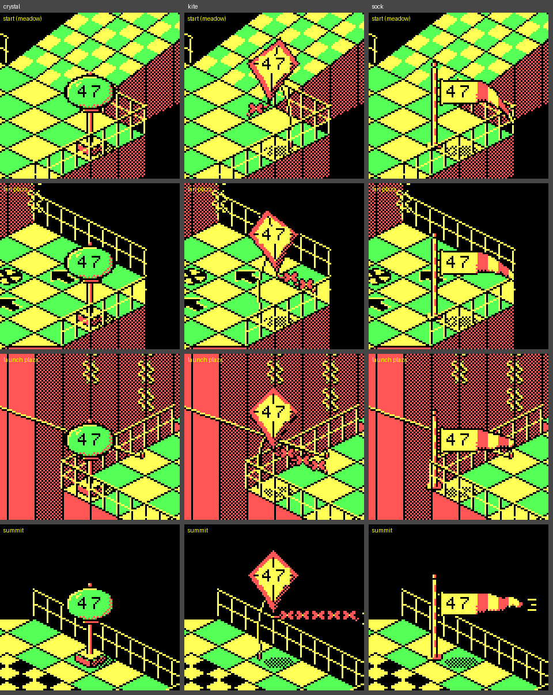

# KITE HILL: clock options (2026-11-25, for the owner to pick)

**PICKED (2026-11-25): B, `sock`, the WINDSOCK.** The owner: *"I do like the kite clocks a lot, but the windsock
is probably better; just because kites themselves don't have a reason to be in that spot, and we'll have kite
art."* It is the tool's `sock1`, `sock2`, `sock3` and `sock4` (`_clock_sock` in `tools/bbcourse.py`, SPEC.md
137.18.5.2), named on the four `clock` lines that [kite/sketch.py](sketch.py) writes into
`apps/bonanza/courses/kite.bbc`. The `kite1` - `kite4` frames stay in the tool for another course: a frame no
course names costs no byte of any part. What follows is the study, its numbers re-measured with the pick in.

*The brief is the course guide's G23 ([README.md](../README.md) 1.5): the digits fit into the art, no window is
needed, no flat squares, cyan is allowed, and something on the clock says where in the course it stands.
WINDMILL LANE's [study](../mill/CLOCKS.md) is the method. KITE's four clocks are the MEADOW (start, cell
(54, 55)), the FAN PLAZA (41, 37), the LAUNCH PLAZA (16, 38) and the SUMMIT (7, 22); their cells are final
([KITE.md](../KITE.md) section 2) and no clock moved. KITE is `palette 0`: ink 1 is GREEN, ink 2 RED and ink 3
YELLOW. On the Hercules green and red are one grey checker and yellow is white.*

## How to look at them

| file | what |
|---|---|
| [clocks/overview-cga.png](clocks/overview-cga.png), [clocks/overview-herc.png](clocks/overview-herc.png) | a row a position, a column a concept (`crystal` the default frame, then `sock`, then `kite`), each cropped from the course's REAL compiled picture with "47" put into the digits' blocks as the lanes would |
| [clocks/frames.png](clocks/frames.png) | every frame on a plain block, zoomed, no compile: CGA rows over Hercules rows |
| `clocks/<concept>.txt` | the compile's sizes for that concept (the table below) |
| [clocks/frames.py](clocks/frames.py), [clocks/sheet.py](clocks/sheet.py) | the concepts and the sheet. [../clockkit.py](../clockkit.py) is the kit the three courses share: `sheet.py` compiles the course once a concept (about 25 s each), `--overview` redraws the pictures from its cache, `--preview` draws `frames.png`, `--outline` is the fast proxy for masks |

## The options

### A. `kite`: a KITE on its string, the digits on its sail (not picked; kept in the tool)

A diamond kite, taller than it is wide, flying on a string from a peg in the clock's tile. The sail is YELLOW
in a broad RED hem with black spars, and the digits sit on the yellow where the spars cross: no window. The
course's clock lines say `digits 0 -16` (SPEC.md 137.18.5.5), which lifts the kite two block rows clear of its
tile so that it FLIES; at a clock's natural spot the same frame stands with its foot on the tile.

What changes is the TAIL, a bow a clock, and the lean:

- `kite1` (meadow): ONE bow. The kite leans right, the way the first rise goes; its tail is to the left.
- `kite2` (fan plaza): TWO. It leans left, toward the cliff the thermal climbs.
- `kite3` (launch plaza): THREE, upright: the glide goes straight up the screen.
- `kite4` (summit): a FULL tail of five bows streaming level, and wind marks past its end.

**Reads:** on the black sky (summit) and on the red face (launch plaza) it is plainly a kite on both cards. On
the meadow the yellow sail stands on yellow and green floor: the red hem and the black line round it carry it
on the CGA, and on the Hercules it is a white diamond on a white and grey checker, the weakest of the four.
A red sail with a yellow band was tried and dropped: it was lost on the launch plaza's red face.

**Paint, not geometry.** The sail and the peg are the clock's keyed face (SPEC.md 137.18.5.4). The string, the
tail, its bows and the wind marks are PAINT, as a clock's shadow is: thin lines each cut an occluder mask of
their own in every block they cross. MEASURED on this course: 232 masks with them keyed, 180 as paint (the
course has 178 with the default frame). A ball behind a string is drawn over it.

### B. `sock`: a WINDSOCK on a pole, the digits on its first band (PICKED)

A pole banded red and yellow with a hoop on two arms, and a windsock flying from it: the first band is yellow and
carries the digits, the cone beyond it is banded red and yellow. The WIND fills it up the hill, which is the
course's subject:

- `sock1` (meadow): LIMP, the cone hanging.
- `sock2` (fan plaza): half out.
- `sock3` (launch plaza): straight out.
- `sock4` (summit): taut, longer, with flutter marks past its tip.

**Reads:** the cleanest of the two on every background and on both cards: the digits' band is yellow (white on
the Hercules) with a black line round it, and the pole and the cone are an unmistakable outline. Its digits'
band is a rectangle, which is the one thing G23 warns about; it is a cloth on a hoop, as FIRST ROLL's `pin` is a
sign on a pole. **It is the cheaper one on disk** and the dearer one in masks.

**As installed**: the pole is banded every 4 px, the band's hems are lit above and shaded below, and the hoop's
two arms and the summit's wind marks are PAINT (thin lines, as the kite's string is). The pole, the band and
the cone are the clock's keyed face.

## The bytes (MEASURED: each concept compiled on the course as committed, art included, no song)

| concept | picture blocks | occluder masks (of 256) | part in RAM | on disk LZ4 / LZB | against `crystal` | longest wholly-hidden run behind each clock (bound 16) |
|---|---|---|---|---|---|---|
| `crystal` (the default) | 747 | 178 | 54,874 | 14,348 / 11,859 | - | 6, 8, 0, 0 |
| `sock` (picked) | **752 (+5)** | **200 (+22)** | 55,400 (+526) | 14,870 / 12,258 | **+522 B LZ4, +399 LZB** | 0, 0, 0, 0 |
| `kite` | **777 (+30)** | **180 (+2)** | 55,402 (+528) | 15,167 / 12,616 | **+819 B LZ4, +757 LZB** | 5, 1, 0, 0 |

Both compile under `--strict` and pass 137.18.5.4's one ball length. Neither adds a lane: the fan plaza's
windows stay at 5 own-clock lanes of 6 (KITE.md section 9).

## Rules each one keeps

- **G9, G10, G12** (MEASURED, `--guide`, the picked `sock`; its digits are at a clock's natural spot): the
  start's window holds clock 0; no two clocks in one window; the longest stretch with no clock in view is 3.1 s
  on the CGA and 2.2 s on the Hercules, as with the default frame. (The kites, 16 px higher, measured the same.)
- **G11**: no run touches a clock. The post's circle is the tile's, whatever the frame (SPEC.md 137.18.5.3).
- **No flat squares**: the kite is a kite. The sock's band is discussed above.

## Tool support

Both concepts are frames of the tool now and neither costs a guest byte. To go back to the kites, name
`kite1` - `kite4` with `digits 0 -16` in `kite/sketch.py`'s four `p.clock(...)` lines.
