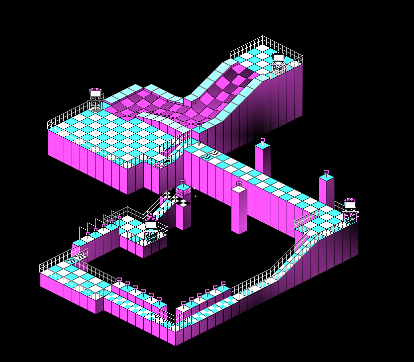
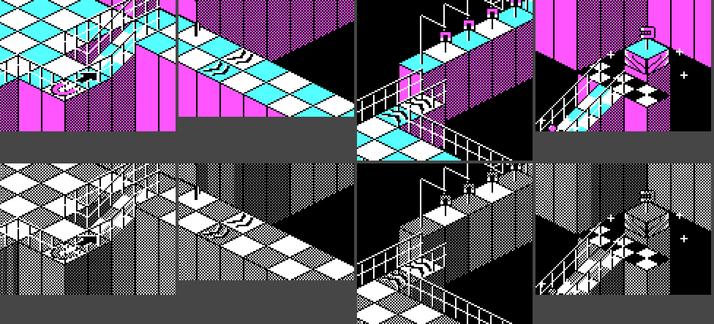

# LODESTONE GORGE: signs and decals (2026-11-25, in the course; the owner may strike any piece)

*What [LODE.md](../LODE.md) section 9 asked the art step for, as built - the short list: the course came to
this step about 1,800 LZ4 bytes under its budget's 1.5x line and its clocks take 670 of that. Everything here
is IN `apps/bonanza/courses/lode.bbc` (`lode/sketch.py` writes it). The clocks are [CLOCKS.md](CLOCKS.md).
[art.py](art.py) is the artwork's SOURCE, with [../artkit.py](../artkit.py) the kit courses 5 - 7 share; the
`.bba` files it writes are committed, and `sketch.py` imports its `lines()`, so a re-emitted course keeps its
art. Looked at in the tool's own picture on both cards, never on an emulator.*

    python3 docs/plans/bonanza-courses/lode/art.py              # write the .bba files, print the `art` lines
    python3 docs/plans/bonanza-courses/lode/art.py --png DIR    # ...compile, and write DIR/art-signs.png and picture-*.png

## The pieces

| piece | file | where | what |
|---|---|---|---|
| the HOIST | `lode_hoist.bba` | the floor at the hoist's foot: (25, 22) and (25, 21) | a HORSESHOE painted on the floor (magenta, white pole tips, a black line round it) and an arrow up the ramp. It is the first time the magnets' glyph is seen, next to what it does: a ramp no steel ball climbs, and the thing that hauls it up |
| KEEP MOVING | `lode_sirens.bba` | the sirens' bridge, both lanes, at x 28: two tiles past flag 0 and three before the first siren | two chevrons a lane, pointing along the bridge. Wordless: speed is what beats a pull |
| STRAIGHT ON | `lode_runway.bba` | the runway's two tiles, (30, 37) and (30, 38) | the same chevrons, pointing up the runway at the gantry. The sheet's "DON'T STEER" in two marks |
| the GREAT LODESTONE | `lode_great.bba` | the last magnet's post, (30, 24): its two faces, and the void either side | the post dressed as rough crystal (white facets, black cracks in the magenta) with four glints round it. Nothing is painted on the post's TOP: that is the magnet's lane, where the engine draws the horseshoe and its sparks |

## What it costs (MEASURED: compiles of the course in this step, with its song)

| | part in RAM | blocks | masks (of 256) | LZ4 (1.5x line 18,825) |
|---|---|---|---|---|
| before the art step | 55,132 | 768 | 247 | 17,046 |
| + the cart clocks | about 55,390 | 788 | 244 | about 17,730 |
| + the four pieces | **55,948** | **823** | **244** | **18,188** |

The four pieces are 35 blocks (560 bytes of RAM, about 455 of LZ4) and no mask. **The course is 637 LZ4 bytes
under its 1.5x line and has 12 masks to spare** (it had 9: the carts' trestles are paint, CLOCKS.md).

## Not done, and why

- **The great lodestone as a boulder twice a horseshoe's size**: the magnet's top is its lane, and a boulder
  round it would be drawn under the engine's horseshoe. The post's faces are what is free.
- **The words** ("KEEP MOVING", "DON'T STEER"), **a horseshoe and a tilted line before the wall**, **lanterns on
  the pen's rail, a spoil heap, dressed coping on the curbs, timber props**: budget, in that order of what
  would be added first. Each is a block or two a tile; the 637 bytes hold about two more small pieces.
