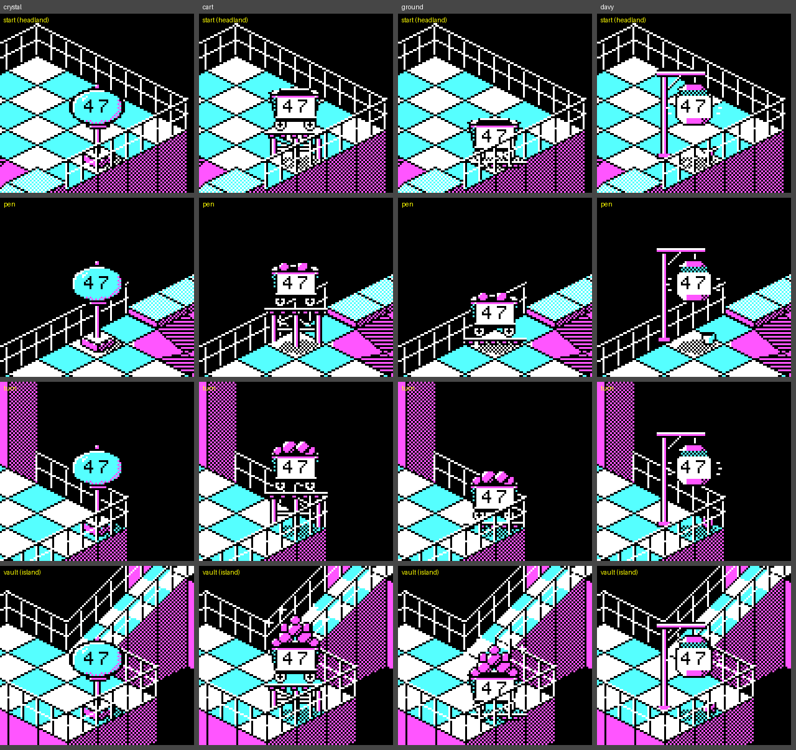

# LODESTONE GORGE: clock options (2026-11-25, for the owner to pick)

**INSTALLED for the pick: A, `cart`** - the tool's `cart0`, `cart1`, `cart2` and `cart3` (`_clock_cart` in
`tools/bbcourse.py`, SPEC.md 130.18.5.2), named on the four `clock` lines that
[lode/sketch.py](sketch.py) writes into `apps/bonanza/courses/lode.bbc`. The course is complete with them. A2
(`ground`, the same frames set on the tile) is one clause a clock away; B, `davy`, is kept here as scratch
frames.

*The brief is the course guide's G23 ([README.md](../README.md) 1.5). WINDMILL LANE's [study](../mill/CLOCKS.md)
is the method. LODE's four clocks are the HEADLAND (start, cell (24, 6)), the PEN (14, 19), the TURN (45, 18)
and the island's apron by the VAULT (32, 30); their cells are final ([LODE.md](../LODE.md) section 2) and no
clock moved. Palette 1's inks (cyan, magenta, white on black); on the Hercules cyan and magenta are one grey
checker.*

## How to look at them

| file | what |
|---|---|
| [clocks/overview-cga.png](clocks/overview-cga.png), [clocks/overview-herc.png](clocks/overview-herc.png) | a row a position, a column a concept (`crystal`, `cart`, `ground`, `davy`), each cropped from the course's REAL compiled picture with "47" in the digits' blocks |
| [clocks/frames.png](clocks/frames.png) | every frame on a plain block, zoomed, no compile: CGA rows over Hercules rows |
| `clocks/<concept>.txt` | the compile's sizes for that concept (the table below) |
| [clocks/frames.py](clocks/frames.py), [clocks/sheet.py](clocks/sheet.py) | the concepts and the sheet; [../clockkit.py](../clockkit.py) is the kit (see [KITE's study](../kite/CLOCKS.md)) |

## The options

### A. `cart`: an ORE CART on a timber trestle, the digits painted on its side (INSTALLED)

A mine tub on two wheels, on a stub of track carried by a little timber trestle that stands on the clock's
tile. The tub is dark iron (a cyan and black dither) with a magenta rim; between its two iron straps it is
whitewashed, and the digits are painted there: no window. The ORE is magenta, the magnets' own ink, faceted
white so that it is a grey heap with white glints on the Hercules.

What is IN the tub says how far down the quarry the clock stands:

- `cart0` (headland): EMPTY: the tub's dark mouth.
- `cart1` (pen): a few LUMPS showing over the rim.
- `cart2` (turn): HALF full: a low mound.
- `cart3` (island): HEAPED, with four glints round the heap: the great lodestone's own.

**Reads:** the cart is clear of the guard rails that stand in front of three of the four clocks, and its
outline (tub, wheels, trestle) is the same on both cards. The empty one says least: a box on legs until the
second clock shows what it is filling with.

**Paint, not geometry.** The tub, its wheels and its ore are the clock's keyed face (SPEC.md 130.18.5.4). The
track, the trestle's three bents, its tie and its braces are PAINT, as a clock's shadow is. MEASURED: with the
bents keyed the course needs **267 occluder masks of one table's 256** and does not compile; as paint, **244**,
three FEWER than with the default frame (247). So a ball that goes behind a clock is drawn over the trestle's
legs and under the cart. That is the price of staying inside one mask table; `masks banded` (SPEC.md 130.52,
about 750 LZ4 bytes here) is the other way to pay it.

### A2. `ground`: the same cart on the tile (`digits 0 16`)

The four frames with `digits 0 16` on each clock line (SPEC.md 130.18.5.5): the digits two block rows down,
the track laid on the tile, no trestle. It is the cheapest (no new block at all) and everything it draws but
the track is keyed. **Not picked** because the guard rails cross the cart's lower half at the headland, the
turn and the island, and the tub is white on a white and cyan floor.

### B. `davy`: a MINER'S SAFETY LAMP on a timber gallows, the digits on its glass

A timber post, a beam and a brace; from the beam hangs a safety lamp: a magenta cap, a gauze of cyan and
black, a lit white glass that carries the digits between two guard bars, a magenta base. A small thing at the
post's foot is the place: a PICK at the headland, a BUCKET at the pen, a HORSESHOE at the turn, a lodestone
CRYSTAL on the island.

**Reads:** a strong outline (a gallows and a lantern) on both cards. The foot marks are 8 px and do not read
at game size, so it does not say where the player is; and it takes the course to 255 masks of 256.

## The bytes (MEASURED: each concept compiled on the course as committed, art included, no song)

| concept | picture blocks | occluder masks (of 256) | part in RAM | on disk LZ4 / LZB | against `crystal` | longest wholly-hidden run behind each clock (bound 16) |
|---|---|---|---|---|---|---|
| `crystal` (the default) | 803 | 247 | 54,592 | 16,717 / 13,671 | - | 8, 0, 0, 8 |
| `cart` (installed) | **823 (+20)** | **244 (-3)** | 54,846 (+254) | 17,391 / 14,195 | **+674 B LZ4, +524 LZB** | 0, 0, 0, 2 |
| `ground` | **803 (+0)** | **249 (+2)** | 54,560 (-32) | 17,157 / 13,997 | **+440 B LZ4, +326 LZB** | 0, 0, 0, 2 |
| `davy` | **816 (+13)** | **255 (+8)** | 55,044 (+452) | 17,370 / 14,171 | **+653 B LZ4, +500 LZB** | 2, 0, 0, 2 |

All four compile under `--strict`. The course's 1.5x budget line is 18,825 LZ4; with the installed carts, the
signs and its song it is 18,188 ([LODE.md](../LODE.md) section 10).

## Rules each one keeps

- **G9, G10, G12** (MEASURED, `--guide`, the installed `cart`): the start's window holds clock 0; no two clocks
  in one window; the longest stretch with no clock in view is 7.0 s on both cards, as before.
- **G11**: no run touches a clock.
- **No flat squares**: a tub is not a panel; the lamp's glass is a lantern's.

## Tool support

`cart` costs no guest byte. `ground` is `digits 0 16` on each of `lode/sketch.py`'s four `p.clock(...)` frames
and nothing else. To take `davy`: copy `_clock_davy` and `_FOOT` from `clocks/frames.py` into
`tools/bbcourse.py` beside `_clock_cart` (about 70 lines), add its four names to `CLOCK_STYLES` and
`_CLOCK_DRAW`, a paragraph to SPEC.md 130.18.5.2, and name them in the sketch.
