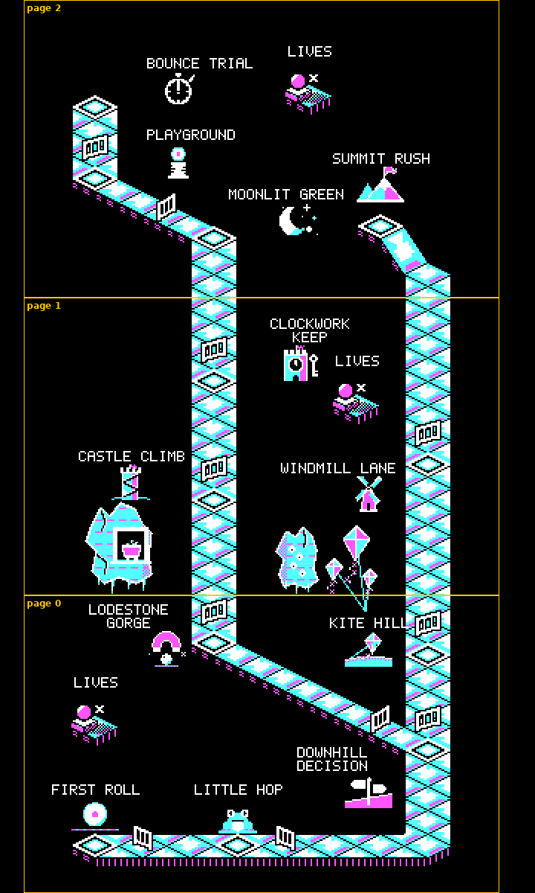

# Bounce Bonanza: the pathway, initial-look options

*Options for the owner, 2026-11-19: "Lets work on the pathway, before the
next course. Here is my original concept. We don't have to be quite this
dense, but I would like a few options. 1-2 are the tutorials and then 3 is
'Downhill Decision', which is the first course with two exits into a split
pathway." Nothing here ships. The shipped prototype is still
`apps/bonanza/courses/path.bbc` (SPEC.md 130.22), and it is unchanged.*

## How the sketch was read

- Numbered shapes are courses and the ovals beside them are each course's
  title and artwork. The red circle by 1 is where the marble starts: pad 0
  and a new game.
- **1 -> 2 -> 3 along the bottom** on a broad road. 3 sits at the right.
- **3 is the split.** Its two exits open two routes:
  - one climbs the right-hand side, past 4 to 5;
  - one runs up-left into the middle, past 6 to 7, then on to 8 at the far
    left.
- The routes that run off the sketch's top edge are read as "the map goes
  on". No sheet adds pads for them.
- **The graph the sheets use**:
  - ROLL 1 -> HOP 2 -> TRIAL 3.
  - TRIAL's exit 0 -> MILL 4 -> PEAK 5.
  - TRIAL's exit 1 -> MOON 6 -> PLAY 7 -> FIRST 8.
  - 5 and 8 are the two ends.
- **Every course but TRIAL has one exit**, so a split can only happen at 3.
  TRIAL is the stand-in for Downhill Decision because it is the only
  course with two exits.

**Stand-ins**:

- Courses 4 - 8 are the old test courses.
- Course 3 is TRIAL with the title "Downhill Decision".
- Course 8 is FIRST titled "Bounce Trial", because FIRST and ROLL are both
  "First Roll" today.
- The icons are placeholders:
  - `tools/bbicons.py`'s drawings, redrawn at each size (the shapes are
    scaled, not the pixels);
  - two new ones in `gen.py`: a frog for Little Hop, whose clocks are
    frogs, and a signpost on a slope for Downhill Decision.

## The options

| | A - Faithful | B - Roomy | C - Causeway |
|---|---|---|---|
| the idea | the sketch's arrangement, as dense as the rules allow | fewer pads a screen, today's sizes | a different route style: no crystal, the routes stand on walls and ramp |
| pages | 2 | 4 (page 3 left for what follows 8) | 3 |
| routes | crystal, floating (today's look) | crystal, floating | the floor's own look (`rail normal`), not floating, ramps up 5 units |
| the split at 3 | in from below; Up to 4; a long up-left diagonal to 6 | a T: Left to 6, Right to 4, two columns | in from below; Up to 4; Left then a steep ramp to 6 |
| titles | 5 x 7 small caps | today's 8 x 8 | 5 x 7 small caps |
| icons | 32 x 24 (2/3 of today's) | 48 x 32, Downhill Decision 64 x 40 | 32 x 24 and 40 x 28 |
| part, RAM | 22,710 | 35,012 | 31,188 |
| part, LZB | 6,570 | 8,314 | 8,715 |

Today's BZROLL=1 map, the baseline, is 21,788 RAM and 6,470 LZB. It has 6
pads on 2 pages, with 48 x 32 icons and 8 x 8 titles. All figures are the
tool's own (`path_costs`, `packed_len`), MEASURED on 2026-11-19.

### The title face, priced

The same layout was built with each face, at one commit:

| | 8 x 8 | 5 x 7 | 5 x 7 costs |
|---|---|---|---|
| A | 22,070 / 6,308 LZB, 236 picture blocks | 22,710 / 6,570, 274 | +640 RAM, +262 LZB |
| B | 35,012 / 8,314, 311 | 35,748 / 8,616, 357 | +736, +302 |
| C | 30,420 / 8,417, 349 | 31,188 / 8,715, 395 | +768, +298 |

**A smaller face costs bytes rather than saving them.** An 8 x 8 letter is
exactly one picture block, and the pool shares identical blocks: every "E"
on the map that lands on a block boundary is one block. A 6-pixel pitch puts
nearly every letter across two blocks, and each such pair is unique. What
the 5 x 7 face buys is width: DOWNHILL DECISION is 102 px rather than 136,
so titles fit between two route columns. A and C would not fit without it.

## What shaped every option (the tool's rules, met)

- **The key map decides the junction (130.22.4.5).** A three-way pad needs
  a STRAIGHT direction among its routes. Three diagonal routes always leave
  some arrow claimed by two of them, and the tool refuses that. At 3 the
  shapes that work are:
  - in from below, with Up and an up-left diagonal (A, C);
  - in from below, with Left and Right (B's T);
  - in from the left, with Up and an up-right diagonal.
- **A straight route is a FAT band**, three cells wide (64 px across a
  vertical climb). A diagonal is one cell. Titles therefore have to fit
  between bands, and that is the main pressure on density.
- **A pad's cell is at least 24 lines inside its page** (130.22.2), and
  **every page has a LIVES counter**. A layout cannot crowd the page edges.
- **Every non-secret route has a gate**, and the gate needs room on the
  route clear of the pads' lanes. A 1-2-cell route between two pads is
  refused, which is why the sketch's 4-5 pair cannot sit as close as drawn.
- **Titles are centred over their icon**, 10 lines above it. With a long
  title the icon is placed by where its TITLE fits, not where the icon
  would look best (`gen.py` nudges each one).

## Guest changes

**None, for any option.** Titles and the static parts of icons are picture
pixels. An icon of any size is cut into lanes the guest already plays. The
5 x 7 face is a tool-side swap (`gen.py` replaces `bbcourse.text_pixels` for
the sheet). Taking it into the build means a face argument on
`text_pixels` in `tools/bbcourse.py` and its 5 x 7 glyphs in the tool,
which is also a tool-side change. The LIVES label stays in the 8 x 8 face
in every option.

Bigger parts do cost the guest RAM. A held pathway (130.22.1, "memory") is
B's 35 KB or C's 31 KB rather than today's 22 KB, and `BZ_PATH_CLAIM`
grows with it, which decides on more machines whether the pathway is
dropped before a course. Every option is well inside the 65,024-byte part
limit.

## Files

- `gen.py`: the options (`OPTIONS`: pads, routes, icon sizes and sides,
  lives, face, material), the icon redraws and the sheets. It writes:
  - `optA.bbc`, `optB.bbc` and `optC.bbc`, generated. Each compiles with
    `tools/bbcourse.py`'s own checks and its `path_proofs` against the
    BZROLL=1 course list. Each also compiles in the plain 8 x 8 face,
    unpatched.
  - `icons/*.bba`, generated.
  - the sheets.
- Run it with:

  ```
  python3 docs/plans/bonanza-courses/pathway/gen.py --out DIR
  ```

  It writes `opt<X>-sheet.png` (every page, CGA palette 1 and the
  Hercules, the windows marked, pads tagged 1 - 8), `overview.png` and
  `titles.png` (both faces, both cards). The default DIR is
  `build/bonanza-pathway/`.
- The first run compiles the BZROLL=1 courses, which takes about 3 minutes.
  What the pathway reads of them is remembered in
  `build/bonanza-pathway/courses.json`.

## Option A, revision 2 (2026-11-19): the owner's mark-up of page 0

The owner chose A's direction (*"I like A and C; but probably this will push
us towards A"*: 14 - 20 courses, and A's density is what fits the engine's
five pages) and marked page 0 up: *"Keeps the icons closer to their owners,
text more associated, gates and text fully on screen, lives a little more in
the middle. Note this is screen 1 only; screen 2 is fully undecided yet ...
prototype only for now."* So, in `gen.py`'s option A:
- the icons of 3, 4 and 6 sit beside their pads, and their TITLES are set
  off to the icon's left, clear of the routes (`@DX@` before a title in
  `TITLES`); DOWNHILL DECISION is on TWO lines (a `|` in a title, the 5 x 7
  face only - the tool's own 8 x 8 face is one line);
- page 0's window 8 lines higher (`view 0 332`), so the gate on 6's route and
  both titles there are wholly on page 0 (16 lines would put pad 1 within
  the 24 lines the tool keeps from a page's edge);
- the page-0 lives counter one cell up and in (16, 23).

Both `|` and `@DX@` live in this generator's 5 x 7 face; if A ships, the
tool's title drawing takes them (and the 5 x 7 face) as a grammar change.

### Revision 3 (2026-11-19): Downhill Decision two steps down

The owner: *"For downhill decision, could we move the pad down 2, and then the
icon/course name down as well, so it doesn't overdraw the path? The gates can
stay where they are."* Pad 3 is at (26, 19), two screen steps down. Two
consequences of the rules:
- the route to 6 may not leave pad 3 upward too (the climb to 4 does), and a
  line through its old gate cell would meet the climb's fat band, so it runs
  the old diagonal two cells lower (y 19) and steps up into 6 at its end; its
  gate is now the first cell from 3. The gate on the climb to 4 is kept at
  (23, 16);
- under that route there is room for Downhill Decision's icon and two-line
  title only further left, so the icon is 32 px left of its first place and
  LITTLE HOP's title is set 24 px left of its icon to keep the two titles
  apart.

### Revision 4 (2026-11-19): back to revision 2's routes, the art lower

The owner: *"This one crowds the bottom far too much ... We can't have the
path stay where it was, and have 'up arrow' go up, and 'left arrow' go up a
little, then to the left path? ... we could also do what I had in my earlier
edit (previous path configuration) and just have the icon (and title) a bit
lower."* Revision 2's routes did exactly that (the climb to 4 leaves pad 3 UP,
the route to 6 UP-LEFT, so Up takes one and Left the other), so revision 3
is undone: pad 3 back at (24, 17), and Downhill Decision's icon and two-line
title 16 px lower, clear of the route to 6's underside; LITTLE HOP's title
centred over its frog again.

## The journey: the owner's order on the map (2026-11-25, the pathway step)

*The last step of the pipeline that made KITE HILL, LODESTONE GORGE and CLOCKWORK KEEP
(design, refinement, music, course art, pathway), with CASTLE CLIMB, the owner's own
course, added the same day. SPEC.md 130.22.11 is the contract's record. Nothing was run
on an emulator.*

**The order is the owner's** (2026-11-25): *"order on the pathway is only decided up
until downhill; my current thought is kite where mill is currently, with mill moving
after it on the path, and loadstone where moon currently is, with caste after it, and
keep after that splitting into two; with the treasury allowing a course skip. (Pathway
page 2 is not yet designed, at all, what is there was just prototype)."* So the ORDER
below is the owner's current thought, and the LAYOUT past page 0 is this step's working
arrangement, not a design: every choice is one line of
`apps/bonanza/courses/path.bbc`.



`map-before-*.png` and `map-after-*.png` are the whole map before and after, on both
cards; `map-after-revealed-*.png` is the map once the secret route is taken;
`icons-new.png` is the four new icons, every frame, on both cards.

### What ships

| pad | course | cell (height) | page | reached by | |
|---|---|---|---|---|---|
| 0 | ROLL, First Roll | (34, 41) | 0 | a new game rests here | |
| 1 | HOP, Little Hop | (37, 38) | 0 | ROLL's exit 0 | |
| 2 | DOWN, Downhill Decision | (37, 30) | 0 | HOP's exit 0 | the split |
| 8 | KITE, Kite Hill | (33, 26) | 0 | DOWN's exit 0 | on MILL's old pad cell |
| 3 | MILL, Windmill Lane | (25, 18) | 1 | KITE's exit 0 | |
| 4 | PEAK, Summit Rush | (15, 10), 2 up | 2 | MILL's exit 0 | stand-in; the right-hand branch's end |
| 9 | LODE, Lodestone Gorge | (28, 30) | 0 | DOWN's exit 1 | on MOON's old pad cell |
| 11 | CASTL, Castle Climb | (22, 24) | 1 | LODE's exit 0 | |
| 10 | KEEP, Clockwork Keep | (17, 19) | 1 | CASTL's exit 0 | the second split |
| 5 | MOON, Moonlit Green | (11, 13) | 2 | KEEP's exit 0 (the throne) | stand-in; the course the treasury skips |
| 6 | PLAY, Playground | (6, 13) | 2 | MOON's exit 0, **and KEEP's exit 1, SECRET** | stand-in; where the shortcut lands |
| 7 | FIRST, "Bounce Trial" | (3, 10) | 2 | PLAY's exit 0 | stand-in; the left-hand branch's end |

Twelve pads, twelve routes, three pages.

- **`BZ_COURSES`** gained `kite.bbc lode.bbc keep.bbc castle.bbc` at its END: courses K
  8, 9, 10 and 11, so no other course's K moved. K is not play order (the pathway is):
  the three were appended in the order their sheets and records already number them,
  and CASTL after them because it came last. Nothing keys by K but a course's part row.
- **Pad numbers** follow the courses: pads 0 - 7 play the courses they played, the new
  courses are pads 8 (KITE), 9 (LODE), 10 (KEEP) and 11 (CASTL). "Where mill is" and
  "where moon is" are the CELLS: KITE and LODE stand on them, and page 0's picture is
  the owner's mark-up with two icons and two titles changed.
- **Every cell is 13 further along both axes.** That is 208 lines down the picture, the
  room page 2 needs above page 1 (a world cell is never negative). Nothing on page 0
  moved against anything else there: `view 0 332` is `view 0 540`, and each kept icon's
  SY is 208 more.
- **The stand-ins**, re-hung in the order they had: PEAK still follows MILL and ends
  the right-hand branch (now up a ramp, 2 units: a summit). MOON, PLAY and FIRST, which
  were DOWN's exit-1 branch, follow KEEP's throne exit.

### The treasury: a secret SHORTCUT

`route 10 6 exit 1 secret  path 17,19 12,19 6,13`: CLOCKWORK KEEP's hidden exit 1 opens
a route straight to PLAYGROUND, **skipping MOONLIT GREEN**. The tool's verdict is
`SHORTCUT (2 pads to the end where the open way takes 3)`.

- **The format allows it**: a secret route may end on a pad that is also reached
  normally. Each pad may be the visible end of one secret route (its pad sign carries
  four more poses for it); KEEP and PLAY each are, of this one.
- **Why MOON is skipped and PLAY is the landing.** A shortcut has to land on a pad
  further along KEEP's own road, so the choice was among the stand-ins after the
  throne. Keeping them in the order they had (MOON, PLAY, FIRST) and skipping the first
  is the smallest change, lands on a course with something after it (a skip to the very
  last pad would make the shortcut the end of the map), and MOONLIT GREEN is the
  gentlest of the three to miss.
- **Not given away.** Nothing of the route is in the picture; it is drawn by 8 reveal
  lanes as the marble first takes it. At KEEP's pad it is the Left arrow alone (Up is
  the throne's road), which does nothing until the route is open.

### The layout, and why

- **Page 0** is the owner's mark-up, with KITE HILL's icon and title in WINDMILL LANE's
  place and LODESTONE GORGE's in MOONLIT GREEN's (its title on two lines).
- **The right-hand branch** is the climb that was there: KITE, up into page 1 to MILL,
  up into page 2 and a ramp to SUMMIT RUSH.
- **The left-hand branch** is one road straight up from LODE: CASTLE CLIMB, then
  CLOCKWORK KEEP, then into page 2 to MOONLIT GREEN, up-left to PLAYGROUND and up to
  "Bounce Trial". The secret leaves KEEP up-left and climbs the left edge to PLAYGROUND.
- **KEEP's pad is plain on purpose** (the owner expects to rework KEEP): no scenery is
  its, and moving it is its `pad` line, three `route` lines and its `icon` line.
- **The scenery** is small and all near page 0's top: three kites over KITE HILL, the
  gorge's two rock walls either side of the road up from LODESTONE GORGE (the mine's
  adit and an ore cart in the west one, a vein of lodestone in the east). CASTLE
  CLIMB's icon stands on the west wall's top.

Rules that shaped it (the tool's, each met):

- **The key map (130.22.4.5).** A three-way pad needs a straight among its roads. KEEP
  is reached straight up, the throne's road goes straight on (Up), and the secret is the
  one diagonal (Left). The first try (KEEP reached by a diagonal) left the Right arrow
  claimed by two diagonals, refused.
- A pad's cell is at least 24 lines inside its page, so no pad sits near a page
  boundary; roads cross them.
- Scenery is `art`: painted over the finished picture with no depth, so each piece
  stands in open sky.

### The art

All generated by `gen.py` (`--ship` writes the files, `--check` says the committed ones
are what it writes; no hand-edited pixel):

| file | | |
|---|---|---|
| `icons/kite32x24.bba` | 6 frames | a diamond kite with a two-bow tail over a hill, swaying on its string (KITE.md's idea; the course's clocks are kites) |
| `icons/lode32x24.bba` | 6 frames | a horseshoe magnet lifting a steel ball and letting it go, two sparks (LODE.md's idea) |
| `icons/keep32x24.bba` | 6 frames | a square clock tower whose hand turns a sixth a frame, a pennant, a key (KEEP.md's idea) |
| `icons/castl32x24.bba` | 6 frames | a tall narrow tower, a stair zig-zagging up it and a marble climbing the stair, a banner: told from KEEP's beside it by its shape (narrow against square) and by what moves (a climber against a clock hand) |
| `path_kites.bba` | 40 x 64 | three kites on their strings |
| `path_cragw.bba` | 48 x 64 | the gorge's west wall: the mine's adit, an ore cart |
| `path_crage.bba` | 32 x 48 | the gorge's east wall: a vein of lodestone |

White carries every shape and the two colours shade it, so each reads on the Hercules,
where both colours are one grey (`bbicons.py`'s rule).

No pad or gate art was added: pads 0 - 3 use the tool's own pad overlay and gate, and
so do the new ones. `pads/` and `gates/` are SPEC.md 130.22.8's provisional previews and
the courses' own gate art, which no map names.

### One tool change it needed

`art` was only ever on the title. On a map with a secret route the tool renders the
picture a second time with the route drawn and cuts the DIFFERENCE into the reveal
lanes; the art was painted on the first picture only, so every art pixel counted as a
difference and a reveal would have painted the scenery out. `tools/bbcourse.py` now
paints a map's art on each secret route's picture too. No map before this one had both
an `art` and a `secret`, so no other output changed; no guest code changed.

Two of `--selfcheck`'s `path` items were about the shipped map as it was and now say
what it is: the shipped map HAS a secret route (each must be opened by a hidden exit
and carry a verdict, and KEEP's exit 1 must be a SHORTCUT), and the test map's first
two pads are compared with the shipped map's by the ROAD between them, since the
shipped map's cells moved and the test map's did not.

### The limits found (none was raised)

| limit | where | now | of |
|---|---|---|---|
| pads | `BZ_PAD_MAX`, the save's word-a-pad tables (the grammar allows 0 - 31) | 12 | 23 |
| routes | the save's opened and taken dwords | 12 | 32 |
| courses | `BZ_CRS_MAX`, every per-course table's width | 12 (21 with BZDEV's nine test courses) | 23 |
| pages | the grid header's top-line byte (the grammar allows 8) | 3 (page 0's top line 432) | about 5 (1,020) |
| the pathway's part | one part, 65,024 bytes | 35,711 | 65,024 |
| signs | a byte | 43 | 255 |
| an icon's frames | a lane's poses | 6 | 16 |
| lanes on a page | SPEC.md 130.19.10's bounds, proved by the tool on every window row | icons' FAST lanes: 1 in a window, 3 changes a step | 6 and 6 |

What one more of each costs, MEASURED on this map (bytes of the part in RAM): a pad
about 200 (its lane and poses), an animated 32 x 24 icon about 410, a gate about 230, a
page 3,200 for its rows of the map plus its picture blocks, a block of new picture 16.
The resident package pays nothing for any of them (SPEC.md 130.22.11's table).

### What the map cost (MEASURED on the host, 2026-11-25)

| | before | after | |
|---|---|---|---|
| the pathway's part, RAM (the tool's figure) | 22,784 | 34,862 | +12,078: the third page's rows 3,200, 210 more picture blocks 3,360 (the scenery 1,440 of the part), 4 pads 608, 4 more icons' lanes 1,672, 4 gates 704, the reveals 568, the rest tables |
| the same, LZB | 6,561 | 10,194 | +3,633 (the scenery 971 of it) |

The package and the disks are in SPEC.md 130.22.11, measured at the end of the step.

### Open choices for the owner

1. **Pages 1 and 2 are a working layout.** The order is yours; where each pad stands
   past page 0 is not designed.
2. **Which course the treasury skips, and where it lands** (MOON skipped, PLAY the
   landing): one `route` line.
3. **Where the stand-ins hang.** PEAK after MILL; MOON, PLAY, FIRST after the throne.
   When real courses take those places the stand-ins need pads somewhere, or to leave
   the default build.
4. **A secret or a plain second way.** The treasury is `secret` because KEEP's second
   goal says `hidden`. A plain fork (as DOWNHILL DECISION's) is the word off the goal
   in `keep/sketch.py`, and `secret` off the route with a `gate` on it.
5. **The scenery.** Each piece is one `art` line; without all three the part is 1,440
   bytes smaller in RAM and 971 packed. A castle behind CASTLE CLIMB's pad was drawn and
   left out: the pad is in the middle of a straight road, and it had no clear sky.
6. **`width 64`.** The Hercules window uses 45 of the map's 64 columns. `width 48` would
   save about 2,700 bytes of the part in RAM. Not done: it moves the picture's column
   origin, and nothing here could be run on an emulator.
7. **The three sheets' section 7** (KITE.md, LODE.md, KEEP.md) describe the places the
   sheets pencilled in before your order. Their status lines now point here.
